# ERD v2 and Migration Matrix

**Status:** Architecture design candidate  
**Depends on:** `CANONICAL_DOMAIN_MODEL_V2.md`  
**Baseline:** `main@22ab5675da1d5525aff04ee8986943961648d4ab`  
**Tracking:** #96 / PR #97  
**Scope:** P0/P1 enterprise-product domain schema and migration design. No runtime migration is authorized by this document.

---

# 1. Objectives

This document translates Canonical Domain Model v2 into an implementation-oriented relational model.

It answers:

1. which current tables remain authoritative;
2. which new tables are required;
3. which current columns become compatibility/cache fields;
4. what cardinalities and uniqueness constraints are expected;
5. how migrations happen without breaking historical Pilot data;
6. what must be verified before switching API/frontend write paths.

The design remains intentionally relational and PostgreSQL-oriented. It does not introduce a graph database or universal entity table.

---

# 2. Design principles

1. Prefer explicit foreign keys for semantic business relationships.
2. Use typed generic references only for bounded cross-cutting infrastructure.
3. Add new structures before removing old dependencies.
4. Historical completed records retain their original semantic meaning.
5. Tenant isolation is represented directly in tenant-owned records and validated across relationships.
6. Authorization scope continues to resolve primarily through `OrganizationUnit`.
7. Published/versioned records become immutable by workflow/domain rule rather than casual CRUD.
8. Commercial entitlements are separate from content licensing.
9. A current Pilot field may remain as a compatibility cache during transition, but there must be one eventual authority.
10. No customer-specific schema fork.

---

# 3. High-level ERD

```mermaid
erDiagram
    TENANT ||--o{ ORGANIZATION_UNIT : contains
    TENANT ||--o{ OBJECTIVE : owns
    TENANT ||--o{ BUSINESS_PROCESS : owns
    TENANT ||--o{ BUSINESS_SERVICE : owns
    TENANT ||--o{ RISK : owns
    TENANT ||--o{ CONTROL_IMPLEMENTATION : owns
    TENANT ||--o{ ASSESSMENT : owns
    TENANT ||--o{ EVIDENCE : owns
    TENANT ||--o{ FINDING : owns
    TENANT ||--o{ ACTION : owns

    ORGANIZATION_UNIT ||--o{ ORGANIZATION_UNIT : parent_of
    BUSINESS_PROCESS ||--o{ BUSINESS_PROCESS : parent_of

    OBJECTIVE ||--o{ RISK_OBJECTIVE : has
    RISK ||--o{ RISK_OBJECTIVE : relates_to

    BUSINESS_PROCESS ||--o{ RISK_PROCESS : contextualizes
    RISK ||--o{ RISK_PROCESS : relates_to

    BUSINESS_SERVICE ||--o{ RISK_SERVICE : contextualizes
    RISK ||--o{ RISK_SERVICE : relates_to

    ASSET ||--o{ RISK : current_direct_link
    RISK ||--o{ RISK_CONTROL : mitigated_by
    CONTROL_IMPLEMENTATION ||--o{ RISK_CONTROL : mitigates

    RISK ||--o{ RISK_EVALUATION : evaluated_by
    RISK_METHODOLOGY ||--o{ RISK_EVALUATION : calculates

    RISK ||--o{ RISK_TREATMENT : treated_by
    RISK ||--o{ RISK_ACCEPTANCE : accepted_by
    RISK_EVALUATION ||--o{ RISK_ACCEPTANCE : accepts_snapshot

    FRAMEWORK ||--o{ FRAMEWORK_VERSION : versions
    FRAMEWORK_VERSION ||--o{ REQUIREMENT : contains
    REQUIREMENT ||--o{ CONTROL_REQUIREMENT : mapped_to
    CONTROL ||--o{ CONTROL_REQUIREMENT : mapped_to

    CONTROL ||--o{ CONTROL_IMPLEMENTATION : implemented_as
    CONTROL_IMPLEMENTATION ||--o{ CONTROL_TEST : tested_by
    CONTROL_TEST ||--o{ CONTROL_TEST_RUN : executed_as
    CONTROL_IMPLEMENTATION ||--o{ EFFECTIVENESS_CONCLUSION : concluded_by
    CONTROL_TEST_RUN ||--o{ EFFECTIVENESS_SOURCE_RUN : supports
    EFFECTIVENESS_CONCLUSION ||--o{ EFFECTIVENESS_SOURCE_RUN : based_on

    ASSESSMENT_TEMPLATE ||--o{ ASSESSMENT_TEMPLATE_VERSION : versions
    ASSESSMENT_TEMPLATE_VERSION ||--o{ ASSESSMENT_CRITERION : contains
    ASSESSMENT_TEMPLATE_VERSION ||--o{ ASSESSMENT : instantiated_as
    ASSESSMENT ||--o{ ASSESSMENT_ITEM : contains
    ASSESSMENT_CRITERION ||--o{ ASSESSMENT_ITEM : instantiated_as

    ASSESSMENT ||--o| COMPLIANCE_ASSESSMENT_PROFILE : specializes
    FRAMEWORK_VERSION ||--o{ COMPLIANCE_ASSESSMENT_PROFILE : evaluates
    ASSESSMENT_CRITERION ||--o{ CRITERION_REQUIREMENT : represents
    REQUIREMENT ||--o{ CRITERION_REQUIREMENT : represented_by

    ASSESSMENT_ITEM ||--o{ APPLICABILITY_DECISION : applicability_history

    METRIC_DEFINITION ||--o{ METRIC_OBSERVATION : observations
    METRIC_DEFINITION ||--o{ METRIC_THRESHOLD : thresholds
    METRIC_THRESHOLD ||--o{ METRIC_BREACH : breaches

    OBJECTIVE ||--o{ METRIC_TARGET : measured_by
    RISK ||--o{ METRIC_TARGET : measured_by
    CONTROL_IMPLEMENTATION ||--o{ METRIC_TARGET : measured_by

    EVIDENCE ||--o{ EVIDENCE_LINK : links
    DOCUMENT ||--o{ DOCUMENT_LINK : links
    WORKFLOW_DEFINITION ||--o{ WORKFLOW_INSTANCE : executes

    PRODUCT_EDITION ||--o{ PRODUCT_EDITION_FEATURE : grants
    PRODUCT_FEATURE ||--o{ PRODUCT_EDITION_FEATURE : included_in
    PRODUCT_LICENSE ||--o{ LICENSE_ENTITLEMENT : grants
    PRODUCT_FEATURE ||--o{ LICENSE_ENTITLEMENT : entitled
    TENANT ||--o{ PRODUCT_LICENSE : licensed
```



---

# 4. Existing tables retained as canonical

These current models remain first-class and should not be recreated under new names solely for naming purity.

| Current model | Canonical status | Notes |
|---|---|---|
| Tenant | Preserve | commercial links added separately |
| TenantMembership | Preserve | user membership boundary |
| OrganizationUnit | Preserve | primary authorization scope |
| Asset | Preserve | later linked to process/service |
| AssetDependency | Preserve | keep dependency semantics |
| RiskCategory | Preserve | hierarchical taxonomy |
| RiskMethodology | Preserve + engine refactor | execution strategy expands |
| Risk | Preserve | add explicit contextual links |
| RiskEvaluation | Preserve + harden | historical, immutable-ish |
| RiskControl | Preserve | explicit Risk↔Implementation relationship |
| RiskTreatment | Preserve + narrow | acceptance removed as authority |
| Framework | Preserve | licensing/content ownership strong |
| FrameworkVersion | Preserve | locked version/checksum |
| Requirement | Preserve | hierarchical reference content |
| RequirementTranslation | Preserve | multilingual content |
| RequirementMapping | Preserve | cross-framework mapping |
| ControlCategory | Preserve | domain-specific taxonomy |
| Control | Preserve | acts as reusable/common control |
| ControlRequirement | Preserve + enrich later | mapping governance |
| ControlImplementation | Preserve + evolve | context/effectiveness authority |
| ControlTest | Preserve | test definition |
| ControlTestRun | Preserve | test execution result |
| Evidence | Preserve | first-class evidence |
| EvidenceLink | Preserve + registry validation | cross-cutting generic link |
| Finding | Preserve | shared finding |
| Action | Preserve + registry validation | shared action |
| AuditPlan | Preserve | future AuditUniverse attaches |
| AuditEngagement | Preserve | context expands |
| AuditTeamMember | Preserve | |
| Workpaper | Preserve | |
| Document | Preserve | controlled document |
| DocumentVersion | Preserve | versioned content |
| DocumentApproval | Preserve | explicit approval |
| DocumentLink | Preserve + registry validation | |
| WorkflowDefinition | Preserve | versioning hardened |
| WorkflowState | Preserve | |
| WorkflowTransition | Preserve | |
| WorkflowInstance | Preserve + registry | no hard-coded map |
| WorkflowEvent | Preserve | history |
| Permission | Preserve | |
| Role | Preserve | |
| UserRoleScope | Preserve | primary org scope |
| AuditEvent | Preserve | append-only integrity chain |
| ConnectorConfig | Preserve + evolve | future definition registry |
| ConnectorRun | Preserve | |
| AIProviderConfig | Preserve | |
| AIInteraction | Preserve | |
| AISuggestion | Preserve + registry | |
| KnowledgeChunk | Preserve | permission-safe RAG context |

---

# 5. Context foundation

## 5.1 Objective

**New table:** `objectives_objective`

Suggested columns:

| Column | Type | Rule |
|---|---|---|
| id | UUID PK | generated |
| tenant_id | FK Tenant | required |
| organization_unit_id | FK OrganizationUnit | nullable primary scope |
| parent_id | FK self | nullable, same tenant |
| code | varchar(100) | unique per tenant |
| title | varchar(255) | required |
| description | text | optional |
| objective_type | enum/varchar | strategic/operational/financial/compliance/security/resilience |
| owner_id | FK User | required |
| status | varchar | draft/active/achieved/retired |
| target_date | date | nullable |
| metadata | jsonb | optional extension |
| created_at/updated_at/deleted_at | timestamps | standard |

Constraints:

- unique `(tenant_id, code)` among non-deleted business records;
- parent must belong to same tenant;
- parent cannot form cycles;
- organization unit must belong to same tenant.

Recommended indexes:

- `(tenant_id, status)`
- `(tenant_id, organization_unit_id, status)`
- `(tenant_id, owner_id)`

## 5.2 RiskObjective

**New table:** `objectives_riskobjective`

Purpose: explicit many-to-many Risk↔Objective semantic relationship.

Columns:

- id;
- tenant_id;
- risk_id FK;
- objective_id FK;
- relationship_type: threatens/supports/dependency;
- rationale;
- created_at.

Constraint:

- unique `(risk_id, objective_id, relationship_type)`;
- tenant on link must match both endpoints.

Do not use generic object links for this relationship.

---

# 6. Business process

## 6.1 BusinessProcess

**New table:** `context_businessprocess`

Columns:

- id;
- tenant_id;
- organization_unit_id nullable primary owner/scope;
- parent_id self nullable;
- code;
- name;
- description;
- owner_id;
- criticality decimal or bounded scale;
- status;
- metadata;
- timestamps.

Constraints:

- unique `(tenant_id, code)`;
- same-tenant parent;
- acyclic hierarchy.

Indexes:

- tenant/parent;
- tenant/org unit/status;
- tenant/owner.

## 6.2 RiskProcess

**New link table:** `context_riskprocess`

- risk_id;
- business_process_id;
- relationship_type;
- rationale.

Many-to-many.

## 6.3 ControlImplementationProcess

**New link table:** `context_controlimplementationprocess`

Many-to-many because:

- one control implementation may operate across several processes;
- one process has several controls.

Do not force one process FK onto ControlImplementation.

## 6.4 AuditProcess

Use an explicit join between AuditEngagement and BusinessProcess.

---

# 7. Business service

## 7.1 BusinessService

**New canonical table, implementation may be delayed until P1/P2:**
`context_businessservice`

Columns:

- tenant;
- organization scope;
- code;
- name;
- description;
- owner;
- service_type;
- criticality;
- recovery classification/metadata where later appropriate;
- status.

Relationships:

- Service↔Process;
- Service↔Asset;
- Service↔Risk;
- Service↔Objective.

No BCM-specific RTO/RPO fields should be hard-coded into the core Service table until BCM/Resilience module design confirms ownership. Those can live in module-specific profiles later.

---

# 8. Legal entity

## 8.1 Decision gate

Do **not** create a LegalEntity migration in the first implementation wave automatically.

First validate whether current `OrganizationUnit(unit_type=company|holding)` plus metadata is insufficient.

Create a separate `LegalEntity` only if at least one required capability needs independent legal semantics:

- legal registration identity;
- jurisdiction;
- regulatory applicability;
- contract ownership;
- statutory reporting;
- independent license boundary.

If introduced:

```text
LegalEntity 1 -- 1/optional OrganizationUnit
```

The org hierarchy remains the authorization tree.

---

# 9. Risk governance

## 9.1 RiskMethodology

Current table retained.

The `formula` string should evolve into a stable `calculation_strategy` code.

Recommended additive fields:

- `calculation_strategy` varchar;
- `configuration_schema_version` integer;
- `published_at`;
- `is_locked` if methodology versioning is implemented.

Avoid arbitrary executable expressions.

If full versioning is required, prefer:

```text
RiskMethodology
  1:N RiskMethodologyVersion
```

rather than mutating published methodology JSON. This can be a later P1 decision.

## 9.2 RiskAppetiteStatement

**New table:** `risks_riskappetitestatement`

Columns:

- id;
- tenant_id;
- organization_unit_id nullable;
- category_id nullable;
- objective_id nullable;
- name;
- statement;
- measurement_type;
- lower_bound nullable;
- upper_bound nullable;
- unit nullable;
- effective_from;
- effective_until;
- owner_id;
- approved_by_id nullable;
- approved_at nullable;
- status draft/approved/retired;
- metadata.

A statement may be qualitative or quantitative; therefore bounds are optional.

Constraint policy:

- one statement can apply to a category/objective/org combination, but do not force global uniqueness that prevents time-versioned appetite;
- overlapping effective periods should be validated in services where appropriate.

## 9.3 RiskTolerance

**New table:** `risks_risktolerance`

Purpose: measurable tolerance around/under appetite.

Columns:

- appetite_statement_id;
- metric_definition_id nullable;
- risk_level nullable;
- warning_threshold;
- breach_threshold;
- direction;
- metadata.

This allows future metric-driven appetite breach without hard-coding score scales.

## 9.4 RiskAcceptance

**New table:** `risks_riskacceptance`

Columns:

| Column | Rule |
|---|---|
| tenant_id | required |
| risk_id | FK required |
| risk_evaluation_id | FK required; must belong to risk |
| decision_status | pending/approved/rejected/expired/superseded |
| requested_by_id | required |
| decided_by_id | nullable until decision |
| requested_at | required |
| decided_at | nullable |
| valid_from | nullable |
| valid_until | required for approved acceptance unless policy permits indefinite |
| review_date | nullable |
| rationale | required for approval |
| conditions | text/json |
| supersedes_id | self nullable |
| workflow_instance_id | optional |
| metadata | json |

Rules:

- accepted evaluation cannot be silently changed;
- approved acceptance is immutable except for supersession/expiry fields controlled by service;
- only one current effective approved acceptance per policy scope unless explicit exception;
- approval actor and timestamp required for approved status.

## 9.5 Migration from RiskTreatment acceptance fields

Current fields:

- `RiskTreatment.accepted_by`
- `RiskTreatment.accepted_at`
- `approval_status`

Migration:

1. create RiskAcceptance table;
2. for legacy treatment with strategy=accept and accepted_at present:
   - locate latest residual/current evaluation at or before accepted_at;
   - if found, create migrated RiskAcceptance;
   - if not found, create migration exception report; do not invent evaluation;
3. preserve original fields during compatibility phase;
4. APIs read new acceptance first, legacy fallback second;
5. after all existing tenants verify data, stop writing acceptance fields on RiskTreatment;
6. fields can be deprecated much later, not immediately dropped.

---

# 10. Control effectiveness authority

## 10.1 EffectivenessConclusion

**New table:** `controls_effectivenessconclusion`

Columns:

- id;
- tenant_id;
- control_implementation_id;
- design_effectiveness: not_assessed/effective/partial/ineffective;
- operating_effectiveness: same;
- overall_effectiveness;
- conclusion;
- period_start nullable;
- period_end nullable;
- concluded_by_id;
- reviewed_by_id nullable;
- approved_at nullable;
- status draft/approved/superseded;
- supersedes_id nullable;
- metadata;
- timestamps.

Approved conclusion should be immutable/superseded rather than overwritten.

## 10.2 EffectivenessSourceRun

**New join:** `controls_effectivenesssourcerun`

- effectiveness_conclusion_id;
- control_test_run_id;
- weight/role optional;
- notes.

## 10.3 EffectivenessEvidence

Either use existing EvidenceLink to link Evidence directly to the conclusion, or a dedicated link if stronger referential semantics become necessary.

Initial recommendation: register `effectiveness_conclusion` in Domain Object Registry and use EvidenceLink.

## 10.4 Current ControlImplementation.effectiveness

Transition:

1. retain column;
2. make service write it only as a derived cached summary from current approved conclusion;
3. prohibit direct user mutation through serializers;
4. mark provenance in API;
5. once all reporting paths use approved conclusion, decide whether cache remains for performance or is removed.

---

# 11. Generic assessment engine

## 11.1 AssessmentTemplate

**New table:** `assessments_assessmenttemplate`

Columns:

- id;
- tenant_id nullable: null means global/reference template;
- code;
- name;
- assessment_family;
- description;
- status draft/active/archived;
- created_by;
- metadata.

Uniqueness:

- tenant-scoped code unique;
- global code unique where tenant is null.

## 11.2 AssessmentTemplateVersion

**New table:** `assessments_assessmenttemplateversion`

Columns:

- template_id;
- version_code;
- title;
- status draft/active/retired;
- publication_date;
- effective_date;
- is_locked;
- checksum;
- scoring_strategy;
- scoring_configuration jsonb;
- workflow_configuration jsonb;
- created_by;
- metadata.

Constraint:

- unique `(template_id, version_code)`.

Locking semantics should mirror FrameworkVersion.

## 11.3 AssessmentCriterion

**New table:** `assessments_assessmentcriterion`

Columns:

- template_version_id;
- parent_id nullable;
- code;
- title;
- description;
- guidance;
- response_type;
- response_configuration;
- weight;
- mandatory;
- sort_order;
- metadata.

Constraint:

- unique `(template_version_id, code)`;
- parent must be same template version;
- cycle validation.

## 11.4 CriterionRequirement

**New table:** `assessments_criterionrequirement`

Purpose: explicit relationship between generic criterion and compliance Requirement.

Columns:

- criterion_id;
- requirement_id;
- relationship_type primary/supporting;
- metadata.

Unique criterion-requirement pair.

## 11.5 Assessment

Current table retained.

Additive changes:

- add `template_version_id` nullable initially;
- make `framework_version_id` nullable only after migration/backfill;
- preserve current `assessment_type` during compatibility;
- later consider replacing type with profile/family derived from template.

Do not remove overall_score/progress fields; they remain runtime summaries.

## 11.6 ComplianceAssessmentProfile

**New table:** `assessments_complianceassessmentprofile`

One-to-one with Assessment.

Columns:

- assessment_id PK/FK unique;
- framework_version_id required;
- compliance_model_version;
- metadata.

This becomes authoritative Framework relation for new compliance assessments.

## 11.7 AssessmentItem

Current table retained.

Additive changes:

- add `criterion_id` nullable initially;
- add `criterion_code_snapshot`;
- add `criterion_title_snapshot`;
- add `criterion_body_snapshot`;
- add `criterion_config_snapshot` jsonb;
- keep current requirement snapshot fields during compatibility;
- make requirement nullable only after migrated generic engine is active.

The snapshot is authoritative for historical runtime display.

## 11.8 ApplicabilityDecision

**New table:** `assessments_applicabilitydecision`

Columns:

- assessment_item_id;
- decision: applicable/not_applicable/conditional;
- justification;
- requested_by;
- decided_by;
- decided_at;
- status;
- supersedes_id;
- metadata.

During transition, `AssessmentItem.applicability` remains a derived/cache summary of latest approved decision for new engine records.

## 11.9 Backfill algorithm for existing compliance assessments

For each distinct current `FrameworkVersion` referenced by Assessment:

1. generate a deterministic tenant/global AssessmentTemplate;
2. generate one TemplateVersion bound to the FrameworkVersion checksum/version;
3. create Criterion per assessable Requirement;
4. create CriterionRequirement explicit links;
5. update current Assessment.template_version;
6. create ComplianceAssessmentProfile;
7. map every current AssessmentItem to its criterion by exact Requirement ID/code;
8. copy current requirement snapshots to criterion snapshot columns without changing content;
9. recompute **nothing**;
10. compare row counts and existing scores/statuses before commit.

Idempotency key:

- generated template metadata contains source FrameworkVersion UUID and source checksum;
- migration must reuse existing generated template if already created.

## 11.10 Compatibility rules

During phase 1:

```text
old clients:
Assessment.framework_version
AssessmentItem.requirement

new core:
Assessment.template_version
ComplianceAssessmentProfile.framework_version
AssessmentItem.criterion
```

All represent the same compliance assessment.

Writes remain dual-consistent until old API is deprecated.

---

# 12. Metric foundation

## 12.1 MetricDefinition

**New table:** `metrics_metricdefinition`

Columns:

- tenant_id;
- organization_unit_id nullable;
- code;
- name;
- metric_type: KPI/KRI/KCI;
- description;
- owner_id;
- unit;
- value_type;
- aggregation_method;
- frequency;
- source_type manual/connector/calculated/imported;
- status;
- metadata.

Unique `(tenant_id, code)`.

## 12.2 MetricThreshold

**New table:** `metrics_metricthreshold`

Columns:

- metric_definition_id;
- name;
- severity/level;
- operator;
- threshold_value/json;
- effective_from/to;
- metadata.

## 12.3 MetricObservation

**New table:** `metrics_metricobservation`

Columns:

- metric_definition_id;
- observed_at;
- numeric_value nullable;
- text_value nullable;
- json_value nullable;
- source_type;
- source_reference_type/id optional via Domain Object Registry;
- provenance json;
- collected_by nullable;
- created_at.

Append-only by default.

Indexes:

- `(metric_definition_id, observed_at desc)`;
- tenant derived through definition; consider denormalized tenant only if performance/RLS requires it.

## 12.4 MetricBreach

**New table:** `metrics_metricbreach`

- metric_definition;
- threshold;
- observation;
- detected_at;
- status open/acknowledged/resolved;
- acknowledged_by/at;
- resolved_by/at;
- related risk/finding/action through explicit or registered links depending semantics.

## 12.5 MetricTarget

A metric may measure different semantic objects.

Because this relationship is meaningful but polymorphic, two approaches are possible.

**Recommended v2:** dedicated join tables for first-class targets:

- ObjectiveMetric;
- RiskMetric;
- ControlImplementationMetric.

Do not create one generic MetricTarget until actual module diversity proves it necessary.

---

# 13. Cross-domain object registry

## 13.1 This is a code contract, not necessarily a database table

Initial implementation should be a registry/service API.

Example conceptual registration:

```python
register_domain_object(
    type_code="risk",
    model=Risk,
    tenant_resolver=...,
    scope_resolver=...,
    display_resolver=...,
    permissions={...},
    deletion_policy="soft_reference"
)
```

Stable type codes must be treated like API identifiers and cannot casually change.

## 13.2 Initial registered types

At minimum:

- risk;
- assessment;
- assessment_item;
- finding;
- action;
- document;
- audit_engagement;
- audit_workpaper;
- control_implementation;
- control_test_run;
- requirement;
- evidence;
- objective;
- business_process;
- effectiveness_conclusion;
- metric_definition;
- metric_observation.

## 13.3 Consumers migrated to registry

- EvidenceLink validation;
- DocumentLink validation;
- Workflow target resolution;
- Action source validation;
- AISuggestion target validation;
- Notification target display.

## 13.4 Integrity job

Add periodic/check command:

`check_domain_references`

Reports:

- unknown type code;
- missing target;
- cross-tenant target;
- invalid organization scope;
- deleted target under unsupported deletion policy.

It must not silently repair/delete records.

---

# 14. Product licensing ERD

## 14.1 ProductFeature

**New global table:** `licensing_productfeature`

Examples:

- risk.core;
- compliance.core;
- audit.core;
- third_party;
- bcm;
- ai_governance;
- connector.fortigate;
- connector.veeam.

Columns:

- code PK/unique;
- name;
- feature_type;
- description;
- active.

## 14.2 ProductEdition

**New global table:** `licensing_productedition`

- code;
- name;
- description;
- active;
- metadata.

Do not encode pricing in application core unless a future commercial subsystem explicitly requires it.

## 14.3 ProductEditionFeature

Join table:

- edition;
- feature;
- default_limit nullable;
- configuration.

## 14.4 ProductLicense

Tenant-owned license record.

Columns:

- tenant_id;
- license_id/serial fingerprint;
- edition_id;
- valid_from;
- valid_until;
- maintenance_until nullable;
- status;
- max_active_users nullable;
- signature/key_id metadata;
- issued_at;
- issued_to;
- deployment_id optional;
- metadata.

On-prem verification should be offline-capable.

No private signing key is stored in the application.

## 14.5 LicenseEntitlement

Overrides/add-ons.

Columns:

- license_id;
- feature_id;
- enabled;
- limit_value nullable;
- valid_from/to;
- source;
- metadata.

Resolution:

```text
Edition defaults
    +
explicit entitlements
    =
effective entitlement set
```

## 14.6 Product vs content license

No FK from ProductLicense to Framework license rights should imply distribution rights.

Framework/content licensing remains on Framework/Content Pack metadata.

---

# 15. Exception / waiver

## 15.1 Exception

**New shared GRC table:** `exceptions_exception`

Columns:

- tenant;
- organization scope;
- exception_type;
- title;
- description;
- owner;
- requested_by;
- approved_by;
- status;
- valid_from;
- valid_until;
- review_date;
- justification;
- compensating_measures;
- metadata.

Target relationships should be explicit for first supported targets if possible:

- ControlImplementationException;
- Policy/DocumentException;
- RequirementApplicabilityException if semantically justified.

Avoid a completely generic exception-to-anything model until use cases are clear.

---

# 16. Current-to-target migration matrix

| Current model/field | Target | Change | Migration class | Data rewrite? |
|---|---|---|---|---|
| Tenant | Tenant | preserve | none | no |
| OrganizationUnit | OrganizationUnit | preserve | none | no |
| Risk.organization_unit | same | auth scope retained | none | no |
| Risk.asset | same initially | preserve + additional context links | additive | no |
| RiskMethodology.formula | calculation_strategy | compatibility mapping | additive | no score recalculation |
| RiskEvaluation | same | harden immutability | behavior | no |
| RiskTreatment.accepted_* | RiskAcceptance | backfill accepted decisions | additive/backfill | copy only |
| Framework* | same | preserve | none | no |
| Requirement* | same | preserve | none | no |
| Control | same | preserve | none | no |
| ControlRequirement | same | later governance metadata | additive | no |
| ControlImplementation.effectiveness | EffectivenessConclusion + cache | dual-write/derive | additive/backfill | no invented conclusion |
| ControlTest/Run | same | preserve | none | no |
| Evidence | same | preserve | none | no |
| EvidenceLink | registry validation | service refactor | behavior | no |
| Assessment.framework_version | ComplianceAssessmentProfile | dual representation | additive/backfill | no |
| Assessment | add template_version | generic engine | additive/backfill | no |
| AssessmentItem.requirement | criterion + compatibility requirement | generic engine | additive/backfill | no |
| AssessmentItem snapshots | criterion snapshots + preserve originals | additive | copy exact |
| AssessmentItem.applicability | ApplicabilityDecision + cache | additive | only when historical evidence supports |
| Finding | same | preserve | none | no |
| Action.source_* | registry validation | service refactor | behavior | no |
| Workflow object map | Domain Registry | code refactor | behavior | no |
| AISuggestion target | Domain Registry | code refactor | behavior | no |
| DocumentLink | Domain Registry | service refactor | behavior | no |
| ConnectorConfig.connector_type | registry/definition later | additive | none initially |
| Operational metrics | remain app observability | separate from GRC Metric | none | no |

---

# 17. Migration waves

## Wave A — Domain registry infrastructure

No schema-breaking business change.

Deliver:

- registry contract;
- initial type registrations;
- Evidence/Document/Workflow/Action/AI validation through registry;
- integrity check command;
- regression tests for tenant cloaking.

Risk: low/medium.

Rollback: restore old resolver paths; no data migration.

## Wave B — Objective and BusinessProcess

Add:

- Objective;
- RiskObjective;
- BusinessProcess;
- RiskProcess;
- ControlImplementationProcess;
- AuditProcess.

No existing field removal.

Risk: low.

Rollback: new tables can remain unused; existing flows unaffected.

## Wave C — Risk governance

Add:

- RiskAppetiteStatement;
- RiskTolerance;
- RiskAcceptance.

Backfill only provable accepted decisions.

Risk: medium because governance semantics change.

Required migration report:

- treatments eligible;
- accepted treatments with matching evaluation;
- accepted treatments without matching evaluation;
- conflicting current acceptances.

## Wave D — Generic assessment engine

Highest migration complexity.

Add:

- AssessmentTemplate;
- AssessmentTemplateVersion;
- AssessmentCriterion;
- CriterionRequirement;
- ComplianceAssessmentProfile;
- new nullable FKs/snapshots on Assessment/AssessmentItem;
- ApplicabilityDecision.

Backfill deterministically.

Do not alter existing scores/statuses.

Risk: high.

Rollback: old FKs remain and old creation endpoint can be re-enabled until cutover is proven.

## Wave E — Effectiveness authority

Add EffectivenessConclusion/source runs.

Initially no automatic historical conclusions should be invented from one arbitrary test.

Possible safe backfill:

- if ControlImplementation.effectiveness is NOT_ASSESSED: no conclusion;
- if there is a clearly approved/reviewed historical test policy, a migration may create a conclusion with explicit `source="legacy_backfill"`;
- otherwise retain legacy cache and require future governed conclusion.

Risk: medium.

## Wave F — Metrics

New subsystem, mostly additive.

No migration from application operational metrics.

Risk: low/medium.

## Wave G — Product licensing

Add licensing tables and centralized entitlement resolver.

Roll out in `audit-only` mode first:

- calculate effective entitlement;
- log violations;
- do not block valid existing Pilot behavior.

Then enforce after license issuance/install workflows exist.

Risk: medium/high commercially; low data migration.

---

# 18. Migration transaction strategy

Avoid a single massive migration.

Use separate schema and data migrations.

Pattern:

1. schema migration adds nullable structures;
2. management command/deterministic data migration performs backfill in batches;
3. verification command validates invariants;
4. application switches reads;
5. application switches writes;
6. old fields become read-only/deprecated;
7. only a later release may remove legacy constraints/columns.

Large tenant deployments must not require long exclusive table locks.

---

# 19. Required migration verification commands

Future implementation should provide commands comparable to:

```text
python manage.py verify_domain_registry
python manage.py verify_context_integrity
python manage.py verify_risk_acceptance_migration
python manage.py verify_assessment_v2_migration
python manage.py verify_effectiveness_integrity
python manage.py verify_metric_integrity
python manage.py verify_entitlements
```

Each command should support machine-readable JSON output and non-zero exit on integrity failure.

---

# 20. Assessment migration invariants

For every migrated legacy Assessment:

1. same tenant;
2. same organization scope;
3. same owner;
4. same status;
5. same dates;
6. same overall_score;
7. same progress_percent;
8. exact same count of AssessmentItems;
9. each Item retains original Requirement FK during compatibility;
10. each Item maps to exactly one generated Criterion;
11. criterion snapshot equals preserved historical requirement snapshot;
12. no item is added/removed/re-scored;
13. FrameworkVersion checksum/source captured in generated template metadata.

Verification must compare pre/post snapshots.

---

# 21. Risk acceptance migration invariants

Never infer an acceptance that cannot be proven.

Create a migrated RiskAcceptance only when:

- legacy treatment strategy is accept;
- legacy accepted_at exists or other explicit approval evidence exists;
- accepted_by exists;
- a relevant historical RiskEvaluation can be deterministically identified.

If an evaluation cannot be identified, emit a migration exception.

Do not create a synthetic RiskEvaluation merely to satisfy the new FK.

---

# 22. Tenant invariants

Every new relationship/backfill must validate:

- tenant of parent equals tenant of child;
- global/reference content rules are respected;
- organization scope belongs to tenant;
- cross-tenant UUIDs remain indistinguishable from missing UUIDs at APIs;
- no content pack globalizes customer-provided restricted content.

---

# 23. Delete/on-delete policy

Recommended general rules:

### PROTECT
Use when deletion would destroy audit/history semantics:

- RiskAcceptance -> Risk/RiskEvaluation;
- EffectivenessConclusion -> ControlImplementation;
- Assessment -> TemplateVersion;
- AssessmentItem -> Criterion;
- ComplianceAssessmentProfile -> FrameworkVersion;
- MetricObservation -> MetricDefinition;
- ProductLicense -> Tenant/Edition.

### CASCADE
Use for owned configuration children that have no independent meaning:

- TemplateVersion -> Criteria only while draft; once published, application must prevent destructive deletion;
- Edition -> EditionFeature may cascade at product metadata level.

### SET_NULL
Use only where historical record remains interpretable without live actor:
- user references such as optional reviewer, if username snapshot/audit exists.

Database on_delete alone is not the lifecycle policy; services must enforce published/approved immutability.

---

# 24. Versioning policy

Objects requiring explicit version or supersession:

- FrameworkVersion;
- AssessmentTemplateVersion;
- DocumentVersion;
- published RiskMethodology if methodology evolution affects reproducibility;
- WorkflowDefinition version;
- approved RiskAcceptance via supersession;
- approved EffectivenessConclusion via supersession;
- risk appetite statements through effective periods/supersession.

Historical runtime objects reference exact versions.

---

# 25. API transition

Do not expose the database migration complexity directly to clients.

Example compatibility response for Assessment during transition:

```json
{
  "id": "...",
  "assessment_family": "compliance",
  "template_version": "...",
  "framework_version": "...",
  "legacy_compatibility": true
}
```

New API endpoints can use v2 concepts while existing endpoints remain stable until frontend migration.

Potential future route shapes:

```text
/api/v1/assessment-templates/
/api/v1/assessments/
/api/v1/objectives/
/api/v1/business-processes/
/api/v1/risk-appetite/
/api/v1/risk-acceptances/
/api/v1/metrics/
/api/v1/licenses/
```

Versioning the URL itself is optional if current API already uses stable versioning strategy; semantic compatibility matters more than naming.

---

# 26. Reporting transition

Existing formal reports must remain reproducible from current historical fields.

During migration:

- legacy compliance reports may continue reading requirement snapshots;
- new generic reports read criterion snapshots;
- output for migrated historical assessment must be semantically identical;
- no historical report should change because the source Framework later changes.

---

# 27. UI transition

Do not redesign all UI at once.

Sequence:

1. backend dual model;
2. admin/internal migration diagnostics;
3. new Assessment Template administration;
4. compliance assessment creation uses generated templates;
5. existing assessment detail page consumes normalized API;
6. Objective/Process context appears as optional relationships;
7. risk governance screens;
8. metrics;
9. commercial license admin.

Existing Persian RTL shell remains.

---

# 28. Tests required per wave

## Domain registry
- known type resolves;
- unknown type rejected;
- foreign tenant UUID cloaked;
- deleted object handling;
- scope display/resolution;
- all registered consumers use same resolver.

## Objective/process
- tenant isolation;
- hierarchy cycle prevention;
- multi-context Risk relations;
- authorization still based on org scope.

## Risk acceptance
- evaluation belongs to Risk;
- approval immutable;
- expiry;
- supersession;
- unauthorized acceptance denied;
- legacy backfill exception behavior.

## Assessment v2
- deterministic template generation;
- locked template immutability;
- requirement mapping;
- exact snapshot preservation;
- scoring parity;
- generic non-framework criterion;
- compliance profile required only for compliance;
- historical migration idempotency.

## Effectiveness
- conclusion requires appropriate role;
- source runs same tenant/control;
- cache matches approved conclusion;
- failed test does not silently mutate authoritative conclusion until governed policy says so.

## Metrics
- typed values;
- threshold evaluation;
- append-only observations;
- breach deduplication/idempotency;
- connector source provenance.

## Licensing
- offline signature verification design;
- expired license;
- edition defaults;
- explicit add-on;
- no secret signing key on target;
- entitlement failure cannot expose other tenant data.

---

# 29. Indexing guidance

High-value indexes:

### Objective
- tenant/status
- tenant/org/status
- tenant/owner

### BusinessProcess
- tenant/parent
- tenant/org/status

### RiskAcceptance
- tenant/risk/status
- risk/valid_until
- risk_evaluation

### Assessment
- existing tenant/org/status
- template_version/status

### AssessmentItem
- assessment/criterion
- assessment/status
- assigned_to

### MetricObservation
- metric/observed_at desc

### MetricBreach
- tenant or metric/status/detected_at depending denormalization

Avoid premature broad JSONB indexing. Add JSON indexes only for proven query paths.

---

# 30. RLS implications

Current architecture plans PostgreSQL RLS as defense-in-depth.

New tenant-owned tables should be RLS-ready by directly carrying `tenant_id` where practical for sensitive/high-volume objects.

Recommended direct tenant_id even if derivable for:

- RiskAcceptance;
- EffectivenessConclusion;
- Assessment;
- Evidence;
- Finding;
- Action;
- MetricDefinition;
- ProductLicense.

For child rows where tenant is safely derivable and high volume is expected, ERD implementation can decide between direct tenant_id and parent-based policies. Security simplicity may justify denormalization.

---

# 31. Event implications

The new domain introduces events such as:

```text
objective.created
risk.appetite_breached
risk.acceptance.approved
risk.acceptance.expiring
assessment.template_published
assessment.completed
control.effectiveness_concluded
metric.threshold_breached
license.expiring
license.entitlement_changed
```

This document does not require a message broker/event-sourcing architecture.

Events can initially be application-domain events inside the modular monolith and feed:

- notification;
- audit;
- jobs;
- integrations.

Do not adopt event sourcing for core state.

---

# 32. Non-goals of ERD v2

Not included in the first schema implementation:

- complete Third-Party Risk ERD;
- complete BCM/Resilience ERD;
- Privacy module;
- ESG;
- Model Risk;
- AI Governance inventory;
- graph database;
- dynamic arbitrary entity designer;
- user-authored executable formulas;
- per-customer custom schema;
- microservices.

Their future relationships are anticipated, but not prematurely implemented.

---

# 33. Recommended implementation order

The recommended code order after architecture approval is:

```text
1. Domain Object Registry
2. Objective + BusinessProcess
3. RiskAcceptance + Appetite/Tolerance
4. Assessment v2 foundation
5. Compliance profile migration
6. EffectivenessConclusion
7. Metrics foundation
8. Product licensing/entitlements
9. Content Pack v2
10. Optional expansion modules
```

The Assessment migration is the most complex and should not be the first refactor.

---

# 34. Release discipline

Every implementation wave must:

1. have its own issue and scoped PR;
2. start from current main;
3. preserve exact tenant tests;
4. include migration verification;
5. pass exact-head CI and Release Gate where applicable;
6. be behind=0 before merge;
7. merge with expected head SHA;
8. pass post-merge CI on new main.

Documentation-only architecture approval does not close external evidence blockers #5/#6/#7/#8/#40/#42/#74 and does not create a new Pilot/RC release.

---

# 35. Decision summary

The implementation-level design is therefore:

```text
Existing strong relational core
        +
explicit Objective / Process context
        +
governed Risk Acceptance/Appetite
        +
generic versioned Assessment templates
        +
explicit Control Effectiveness conclusions
        +
shared Metric foundation
        +
bounded Domain Object Registry
        +
central Product Entitlements
```

while preserving:

```text
Tenant
OrganizationUnit
Risk history
Framework versions
Requirement mappings
Control/Implementation separation
Evidence
Findings/Actions
Audit
Documents
Workflow
Audit integrity
AI human-review boundary
On-prem/offline architecture
```

This ERD is intentionally evolutionary: it converts the Pilot architecture into a commercial enterprise-product foundation without invalidating the existing Pilot data model.
