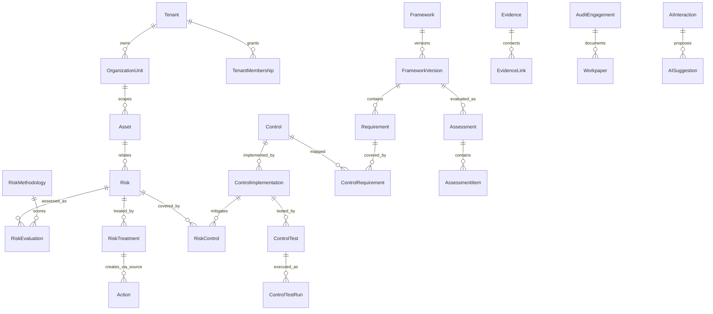

# فرهنگ داده و ERD مفهومی — GRC Platform

> **شناسه:** GRC-DATA-003 · **نسخه:** 0.1.0 · **وضعیت:** DRAFT · **مرجع:** [PRD](GRC-PRD-001_FA.md) / [SRS](GRC-SRS-002_FA.md)  
> **Baseline مدل‌های واقعی:** `main@e7a745c47919f6ec028e429c210bbdfd4589c691`  
> **قاعده:** جدول‌های «موجود» از مدل‌های Django بررسی‌شده استخراج/خلاصه شده‌اند؛ فیلدهای «هدف» هنوز Migration قطعی نیستند.

## ۱. قرارداد نوع داده و مرجع
- `tenant_id`: مرز مالکیت سازمانی؛ روی داده‌های Tenant-scoped اجباری و در Queryهای مجاز شرط است.
- `organization_unit_id`: مرز معمول Scope مجوز؛ با Context کسب‌وکار (Process/Service/Asset) یکسان نیست.
- `id`: شناسه پایدار و غیرمعنایی؛ `code` برای نمایش/جست‌وجو و در محدوده تعریف‌شده یکتا.
- `DateField`: API `YYYY-MM-DD` Gregorian؛ UI فارسی باید Jalali adapter داشته باشد و روز حفظ شود.
- `DateTimeField`: ذخیره UTC/offset-aware؛ نمایش در timezone سازمان، با تفکیک دقیق از date-only.
- `created_at`/`updated_at`/`deleted_at`: زمان/soft-delete زیرساختی، مگر استثنای صریح.
- `status`: وضعیت دامنه‌ای؛ تاریخچه تصمیم جدا از Status جاری.
- `metadata` JSON: فقط الحاقات محدود و versioned؛ نه جایگزین رابطه SQL/FK برای موجودیت‌های اصلی.
- `source_id` همراه `source_type`: تنها برای cross-cutting یا Provenance؛ روابط مهم کسب‌وکار FK/Join صریح داشته باشند.
- `classification`: برچسب محرمانگی؛ مجوز و سیاست Provider/Export به آن متصل است.
- نسخه‌های Standards/Assessment/Document/Methodology/SoA که در تصمیم استفاده می‌شوند باید Snapshot یا شناسه نسخه معتبر داشته باشند.

## ۲. موجودیت‌ها و فیلدهای موجود

### ۲.۱ Tenant، سازمان و هویت
| موجودیت | فیلدهای مهم موجود | ارتباط و قید |
|---|---|---|
| Tenant | `name,code,tenant_type,status,default_language,timezone,settings` | Code یکتا؛ مرز امنیت |
| TenantMembership | `tenant,user,role_code,is_active` | عضو فعال سازمان |
| OrganizationUnit | `tenant,parent,unit_type,code,name,name_en,manager,status,metadata` | Parent همان Tenant و بدون Cycle |
| Permission | `code,module,name,description,is_active` | قابلیت مستقل |
| Role | `tenant,code,name,description,is_system,is_active,permissions` | مجوزهای نقش |
| RolePermission | `role,permission` | رابطه چندبه‌چند |
| UserRoleScope | `user,tenant,role,organization_unit,is_active,valid_from,valid_until` | نقش محدود به Unit/زمان |
| MFADevice | `user,name,encrypted_secret,is_active,confirmed_at,last_used_at,last_used_step` | Secret رمزگذاری‌شده؛ جلوگیری از Replay |

### ۲.۲ استانداردها و نگاشت‌ها
| موجودیت | فیلدها | قید |
|---|---|---|
| Framework | `tenant,code,name,publisher,framework_type,content_source,license_type,license_metadata,description,status,created_by` | حق محتوا و مالکیت |
| FrameworkVersion | `framework,version_code,title,publication_date,effective_date,retirement_date,status,is_locked,checksum,metadata` | نسخه قفل‌شده تغییر نکند |
| Requirement | `framework_version,parent,code,title,body,guidance,assessable,mandatory,weight,sort_order,metadata` | ساختار سلسله‌مراتبی |
| RequirementTranslation | `requirement,language,title,body,guidance` | متن ترجمه‌شده مستقل از نسخه منبع |
| RequirementMapping | `tenant,source_requirement,target_requirement,mapping_type,strength,confidence,source_type,rationale,reviewed_by,approved_at` | پیشنهاد ≠ Approved |

### ۲.۳ کنترل‌ها
| موجودیت | فیلدها | معنای دامنه |
|---|---|---|
| Control | `tenant,code,title,description,objective,category,control_type,nature,frequency,automation_level,status,metadata,created_by` | تعریف مشترک |
| ControlCategory | `tenant,parent,code,name,description` | طبقه |
| ControlRequirement | `tenant,control,requirement,coverage,mapping_type,rationale,source,approved` | نگاشت چند چارچوب |
| ControlImplementation | `tenant,control,organization_unit,owner,operator,implementation_description,implementation_status,effectiveness,implementation_date,review_date,metadata` | اجرای واقعی |
| ControlTest | `control_implementation,title,frequency,owner,automation_type,connector_key` | طرح آزمون |
| ControlTestRun | `control_test,executed_at,result` | اجرای تاریخی |

### ۲.۴ دارایی، فرآیند و اهداف
| موجودیت | فیلدها | قید |
|---|---|---|
| Asset | `tenant,organization_unit,asset_type,code,title,description,owner,custodian,confidentiality,integrity,availability,criticality,status,metadata` | Owner عضو فعال؛ CIA معتبر |
| AssetDependency | `tenant,parent_asset,child_asset,dependency_type,critical` | حلقه/خودوابستگی نباید نامعتبر باشد |
| BusinessProcess | `tenant,organization_unit,parent,code,name,description,owner,criticality,status,metadata` | فرآیند و درخت |
| Objective | `tenant,organization_unit,parent,code,title,description,objective_type,owner,status,target_date,metadata` | هدف و KPI آینده |
| RiskProcess | `tenant,risk,business_process,relationship_type,rationale` | پیوند صریح |
| RiskObjective | `tenant,risk,objective,relationship_type,rationale` | پیوند صریح |
| ControlImplementationProcess | `tenant,control_implementation,business_process,relationship_type,rationale` | پوشش فرآیند |
| AuditProcess | `tenant,audit_engagement,business_process,relationship_type,rationale` | دامنه ممیزی |

### ۲.۵ ریسک
| موجودیت | فیلدها | معنای دامنه |
|---|---|---|
| RiskCategory | `tenant,parent,code,name,description` | طبقه‌بندی |
| RiskMethodology | `tenant,name,methodology_type,likelihood_scale,impact_scale,matrix,thresholds,formula,is_default,status` | روش محاسبه؛ تغییرات نیازمند Versioning هدف |
| Risk | `tenant,organization_unit,asset,category,code,title,scenario,cause,consequence,owner,status,review_date,metadata` | هویت/سناریو، نه یک Score جاری |
| RiskEvaluation | `risk,methodology,evaluation_type,likelihood,impact,score,level,evaluated_by,evaluated_at,rationale` | تاریخچه مستقل |
| RiskControl | `risk,control_implementation,relationship_type` | کنترل متناسب با Scope |
| RiskTreatment | `risk,strategy,description,owner,target_date,target_score,approval_status,status,accepted_by,accepted_at` | طرح پاسخ و تصویب |
| RiskAppetiteStatement | `tenant,organization_unit,code,version,title,description,owner,status,effective_from,effective_until,approved_by,approved_at,metadata` | بیانیه اشتها |
| RiskTolerance | `statement,evaluation_type,maximum_score,description` | حد تحمل |
| RiskAcceptance | `tenant,risk,evaluation,appetite,requested_by,decided_by,status,rationale,decision_note,review_on,expires_on,decided_at,supersedes,evaluation_type_snapshot,score_snapshot,likelihood_snapshot,impact_snapshot,evaluated_at_snapshot,tolerance_max_snapshot,exceeds_tolerance,exception_justification` | Snapshot مستقل تصمیم |

### ۲.۶ ارزیابی/شواهد/یافته‌ها و اقدامات
| موجودیت | فیلدها | قید |
|---|---|---|
| Assessment | `tenant,framework_version,organization_unit,title,assessment_type,owner,start_date,due_date,status,overall_score,progress_percent,metadata` | ارزیابی نسخه مشخص |
| AssessmentItem | `assessment,requirement,requirement_code_snapshot,requirement_title_snapshot,requirement_body_snapshot,weight_snapshot,status,score,maturity_level,applicability,assessor_comment,reviewer_comment,assigned_to,reviewed_by` | Snapshot قابل حسابرسی |
| Evidence | `tenant,organization_unit,title,description,evidence_type,source,owner,collected_at,valid_until,classification,storage_key,original_filename,mime_type,size,sha256,url,text_content,metadata` | منشأ/تمامیت |
| EvidenceLink | `tenant,evidence,object_type,object_id,relation_type` | رابطه نوع‌دار مجاز |
| Finding | `tenant,organization_unit,assessment_item,audit_workpaper,requirement,control_implementation,risk,finding_type,title,description,severity,root_cause,owner,due_date,status,closed_by,closed_at,closure_comment,metadata` | نقص/عدم انطباق |
| Action | `tenant,organization_unit,title,description,owner,reviewer,priority,start_date,due_date,progress,status,completed_at,source_type,source_id,metadata` | اجرای پاسخ |

### ۲.۷ ارزیابی عمومی، ممیزی و SoA
| موجودیت | فیلدها | قید |
|---|---|---|
| AssessmentTemplate | `tenant,organization_unit,code,title,description,owner` | قالب |
| AssessmentTemplateVersion | `template,version_code,status,published_at,published_by,notes` | نسخه منتشرشده |
| TemplateCriterion | `version,code,title,description,response_type,choices,required,weight,applicability_mode,sort_order` | معیار/سؤال |
| GenericAssessmentRun | `tenant,template_version,profile,organization_unit,title,owner,status,completed_at` | اجرای قالب |
| GenericAssessmentItem | `run,criterion,criterion_code_snapshot,criterion_title_snapshot,response_type_snapshot,options_snapshot,weight_snapshot,required_snapshot,applicability_mode_snapshot,answer,score_percent,assessed_by,assessed_at` | پاسخ نسخه‌دار |
| AuditPlan | `tenant,organization_unit,title,period_start,owner,status,approved_by,approved_at,metadata` | برنامه |
| AuditEngagement | `tenant,plan,organization_unit,framework_version,title,audit_type,objective,lead_auditor,start_date,status,conclusion,requirements,controls` | پرونده |
| AuditTeamMember | `engagement,user,role` | تیم |
| Workpaper | `engagement,requirement,control_implementation,title,tester,result,conclusion,reviewed_by,reviewed_at` | کاربرگ |
| SoARegister | `tenant,organization_unit,framework_version,title,revision,status,created_by` | پیش‌نویس، نه سند رسمی |
| SoAControlDecision | `register,control,reference_kind,source_identifier,decision,rationale,control_implementation,risk_treatment,last_edited_by` | توجیه تصمیم |
| SoADraftReviewEvent | `register,review_round,kind,is_response,actor,assigned_reviewer,note,draft_digest` | تاریخچه نظر، نه Approval |

### ۲.۸ سند، Workflow، AI، اتصال و حسابرسی
| موجودیت | فیلدهای مهم | قید |
|---|---|---|
| Document/DocumentVersion/DocumentApproval/DocumentLink | سند، نسخه، تصویب، ارتباط | Contract دقیق در Migration بررسی شود |
| ReportTemplate | قالب گزارش Tenant-scoped | Execution امن بدون SQL/URL دلخواه |
| WorkflowDefinition | `tenant,name,object_type,version,is_active,configuration` | نسخه |
| WorkflowState | `definition,code,name,is_initial,is_terminal,sort_order,metadata` | وضعیت |
| WorkflowTransition | `definition,code,name,from_state,to_state,required_permission_code,condition,actions` | Transition مجاز |
| WorkflowInstance | `tenant,definition,object_type,object_id,organization_unit,current_state,started_by,assigned_to,status,metadata` | اجرای خاص |
| WorkflowEvent | `instance,transition,from_state,to_state,actor,comment,metadata` | تاریخچه |
| Notification | `tenant,user,category,title,body,object_type,object_id,severity,read_at,metadata` | اعلان |
| AIProviderConfig | `tenant,name,provider_type,base_url,model_name,secret_env_var,is_active,is_default,allow_confidential,configuration` | Secret فقط ارجاع |
| AIInteraction | `tenant,user,provider,capability,classification,input_summary,context_manifest,output,confidence,status,error` | Provenance مدل |
| AISuggestion | `tenant,interaction,object_type,object_id,suggestion_type,proposed_value,confidence,status,reviewed_by,reviewed_at,review_comment` | پیشنهاد ≠ Decision |
| KnowledgeChunk | `tenant,organization_unit,source_type,source_id,title,content,content_hash,token_count,classification,metadata,embedding_model,embedding_dimensions,embedded_at` | Retrieval مجاز |
| ConnectorConfig | `tenant,organization_unit,name,connector_type,base_url,username_env_var,secret_env_var,secondary_secret_env_var,verify_tls,is_active,configuration,last_sync_at,last_status,last_error` | بدون Secret value |
| ConnectorRun | `connector,triggered_by,status,started_at,finished_at,summary,error` | Provenance |
| AuditEvent | `tenant,actor,actor_username,action,category,outcome,object_type,object_id,object_repr,metadata,old_data,new_data,ip_address,user_agent,http_method,path,request_id,created_at,chain_sequence,previous_hash,event_hash,integrity_key_id` | تاریخچه تمامیت‌دار |

## ۳. ERD مفهومی کوچک‌شده

**این ERD آموزشی است، نه جایگزین مدل فیزیکی/Migrationها.** رابطه `RiskTreatment→Action` در پیاده‌سازی می‌تواند به‌صورت `source_type/source_id` باشد، نه FK مستقیم؛ برای DDL دقیق باید Migrationها بررسی شوند.

## ۴. توسعه‌های مدل (هنوز Schema مصوب نیست)

| کد تصمیم | توسعه پیشنهادی | دلیل |
|---|---|---|
| DATA-GAP-01 | `BusinessService` مستقل + خدمت ↔ Asset/Process | BCM و وابستگی خدمات |
| DATA-GAP-02 | Versioning/Snapshot مستقل برای RiskMethodology | جلوگیری از تغییر معنای امتیاز تاریخی |
| DATA-GAP-03 | رابط‌های چندبه‌چند Risk↔Asset/Service | ریسک‌های چندسامانه‌ای |
| DATA-GAP-04 | Decision/Approval immutable برای SoA رسمی | تأیید نسخه قطعی و مجاز |
| DATA-GAP-05 | ReportDefinition/ReportRun/TemplateVersion | گزارش‌ساز و کنترل خروجی |
| DATA-GAP-06 | BIA/BCP/DRP و RecoveryExercise | تاب‌آوری |
| DATA-GAP-07 | Vendor/Engagement/ThirdPartyAssessment | TPRM |
| DATA-GAP-08 | Incident/Timeline/Response/Evidence | بحران و رخداد |
| DATA-GAP-09 | ControlSignal/MonitorRule/DetectionWindow | CCM |
| DATA-GAP-10 | ProductLicense/Installation/Entitlement | تجاری‌سازی و فعال‌سازی آفلاین |

این توسعه‌ها باید با معماری `docs/architecture/CANONICAL_DOMAIN_MODEL_V2.md` تطبیق داده شوند؛ هیچ مهاجرتی در این PR مستنداتی انجام نشده است.

## ۵. آزمون صحت داده

- FK یا پیوند Tenant ناسازگار رد شود؛ Soft Delete تاریخچه تصمیم را از بین نبرد.
- Risk دارای دارایی از همان واحد سازمانی باشد؛ آزمون پایلوت `TEST-ASSET-001` و `TEST-RISK-001` این رابطه را نشان داده است.
- Assessment Snapshot پس از تغییر Requirement قبلی ثابت بماند.
- یک Evidence در چند استفاده مجاز، بدون ایجاد کپی متناقض بازاستفاده شود.
- RiskEvaluation جدید، ارزیابی قدیمی را overwrite نکند.
- تاریخ `1405/07/21` در UI پس از Roundtrip به یک `YYYY-MM-DD` صحیح میلادی و برگشت بدون اختلاف روز تبدیل شود.
- Audit Hash Chain و Scope در شرایط Race/Failure بررسی شود.
- کدها و نسخه‌ها یکتا باشند؛ وضعیت Draft/Approved با حدس کلاینت تغییر نکند.

---
**مرجع قطعی schema:** `backend/apps/*/models.py` و Migrationها در SHA مشخص‌شده؛ در صورت اختلاف، این سند باید اصلاح شود، نه داده موجود بدون تصمیم فنی.
