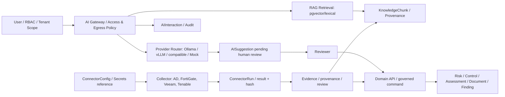

# معماری تفصیلی هوش مصنوعی و یکپارچه‌سازی سامانه‌های سازمانی — GRC Platform

> **شناسه:** GRC-AI-INTEGRATIONS-601 · **نسخه:** 0.1.0 · **وضعیت:** DRAFT / Product, AI, Security, Infrastructure, QA review pending  
> **مبنای بررسی:** `main@e7a745c47919f6ec028e429c210bbdfd4589c691` · **پایلوت امضاشده:** `pilot-20261013-r1` · **تاریخ:** 2026-10-14  
> **اسناد مرتبط:** [PRD](../GRC-PRD-001_FA.md)، [SRS](../GRC-SRS-002_FA.md)، [API/AI](../GRC-API-AI-004_FA.md)، [RTM](../GRC-RTM-006_FA.md)، [UAT](../GRC-UAT-007_FA.md)، [Risk](GRC-RISK-101_FA.md)، [Controls](GRC-CONTROL-201_FA.md)، [Compliance](GRC-COMPLIANCE-301_FA.md)، [Evidence](GRC-EVIDENCE-AUDIT-401_FA.md)، [Documents](GRC-DOCUMENT-SOA-501_FA.md).  
> **واژه‌های وضعیت:** `AS-IS`: در Source موجود (نه لزوماً tested)؛ `GAP`: نارسایی شناسایی‌شده؛ `TO-BE`: نیاز معماری هدف؛ `POST-V1`: توسعه آینده؛ `NOT-RUN`: فاقد شاهد اجرای این نوبت؛ `EXTERNAL-PROOF`: نیازمند دستگاه/محیط واقعی. هیچ مدرکی از AI عملیاتی در نصب پایلوت فعلی در این مرحله تولید نشده است.

## ۱. هدف و اصول معماری
GRC باید بتواند از اطلاعات معتبر در سازمان برای مشاوره، تحلیل شکاف، اولویت‌بندی اقدامات، پیشنهاد کنترل، تهیه پیش‌نویس اسناد، تجمیع شواهد امنیتی و گزارش‌دهی استفاده کند؛ **بدون اعطای اختیار تصمیم رسمی به AI یا اتصال‌دهنده**.

### تفکیک اختیار
- **AIInteraction** ثبت درخواست و پاسخ مدل است؛ **AISuggestion** پیشنهاد بازبینی‌پذیر است؛ **Domain Decision** تنها با Permission/Workflow مستقل ثبت می‌شود.
- **RAG retrieved text** داده نامطمئن است، نه System Prompt و نه نسخه اثبات‌شده استاندارد.
- **ConnectorRun succeeded** فقط اجرای جمع‌آوری را نشان می‌دهد، نه سلامت کنترل، کفایت شواهد، انطباق یا آزمایش بازیابی.
- **KnowledgeChunk classification و source** باید از مرجع مجاز تعیین شود، نه صرفاً برچسب ارسالی درخواست‌کننده.
- AI، Connector، Report و Import همیشه باید از همان Tenant/Unit/Classification/Source Rights مرز Domain Object تبعیت کنند؛ هیچ راه میان‌بر مجوز از این قابلیت‌ها قابل قبول نیست.
- در استقرار مستقل مرکز داده، Egress پیش‌فرض `deny`؛ فعال‌سازی Cloud Provider/LDAP/HTTP Endpoint فقط با سیاست و مجوز محیط مشتری؛ نبود AI نباید CRUD، گزارش و ارزیابی انسانی را مختل کند.

## ۲. معماری و جریان داده



**AS-IS:** AI Gateway، KnowledgeChunk lexical/pgvector، Provider routing و Suggestion Review؛ ConnectorConfig/Run، چهار Client و normalized Evidence. **TO-BE:** Policy Enforcement Point مشترک برای AI و Connector، جداسازی Collection/Normalization/Validation/Human Review، طبقه‌بندی منبع قطعی، immutable data lineage، نرخ و سهمیه، Queue/Scheduler و اعتبارسنجی نسخه قرارداد Provider.

## ۳. فرهنگ داده AI

### ۳.۱ AIProviderConfig
| فیلد موجود | نوع/معنا | قید |
|---|---|---|
| `tenant` | FK | ارائه‌دهنده مخصوص Tenant |
| `name` | Char(120) | یکتا در Tenant |
| `provider_type` | enum | `openai_compatible/ollama/vllm/private/mock` |
| `base_url` | URLField 500 | مقصد Provider؛ Validation فعلی محدود |
| `model_name` | Char(160) | مدل متن |
| `secret_env_var` | نام متغیر محیطی | نه مقدار Secret؛ Serializer Regex |
| `is_active,is_default` | Boolean | مسیر انتخاب Provider |
| `allow_confidential` | Boolean | شرط Provider؛ ناکافی بدون Source-level authorization |
| `configuration` | JSON | `timeout, embedding_model, embedding_dimensions` و تنظیمات دیگر |
| `created_at/updated_at/deleted_at` | Time | تاریخچه/soft delete |

**AS-IS:** `AIProviderViewSet` برای همه عملیات `ai.configure` Whole-Tenant می‌خواهد، Secret-like configuration keys را رد می‌کند، URL با username/password/query/fragment را رد و Base URL را ذخیره می‌کند. Clientها از `urllib.request.urlopen` استفاده می‌کنند. `vllm/private` از OpenAICompatibleProvider عبور می‌کند.

**P0 SECURITY REVIEW #192:** Serializer صریحاً مقصد loopback/metadata و HTTPS production/Egress/Redirect را بررسی نمی‌کند؛ Provider Client نیز قبل از Connect این Boundary را اعمال نکرده. برای مدل‌های بیرونی SSRF و ارسال محتوای محرمانه باید با تست ایزوله بررسی شود، نه فرض وقوع Incident.

**TO-BE:** `approved_destination_id,egress_policy_version,allowlisted_hosts,transport_profile,classification_ceiling,data_residency,rights_policy,token_budget,request_timeout,rate_limit,provider_health,model_version_pin,model_card,security_eval_id,output_retention_class`.

### ۳.۲ AIInteraction
`tenant,user,provider,capability,classification,input_summary,context_manifest,output,confidence,status(pending/completed/failed),error,created_at/updated_at`.

**AS-IS:** `run_ai` پیام User/System می‌سازد، برای Providerهای خارجی متن Prompt را با Regex حداقلی Secret/IP redact می‌کند؛ `output={text,raw_meta}` و نوع خطا ذخیره می‌شود؛ Audit Event ثبت می‌شود. `ai.interactions` برای `ai.use` در Tenant قابل خواندن است ولی کاربران عادی فقط رکورد خود، `ai.audit` Whole-Tenant همه تعاملات را می‌بیند.

**TO-BE:** `request_id,task_schema_version,policy_decision_id,tenant_scope_snapshot,source_manifest_hash,source_rights_snapshot,model_digest,prompt_template_version,token_input/output,cost_estimate,latency_ms,provider_trace_id_redacted,approval_requirement,retention_expires_at,redaction_result,grounding_verdict`. Retention/Encryption/Access از نظر کاربرد خروجی و Prompt مستقل لازم است.

### ۳.۳ AISuggestion
`tenant,interaction,object_type,object_id,suggestion_type,proposed_value,confidence,status(pending/accepted/modified/rejected),reviewed_by,reviewed_at,review_comment`. Target باید در `DomainObjectRegistry` با Capability `ai_target` موجود و هم Tenant باشد.

**AS-IS:** `POST /ai/suggestions/{id}/review/` وضعیت Suggestion را ثبت می‌کند؛ **هیچ DomainCommand خودکاری اعمال نمی‌کند**. در Service `review_suggestion` Guard صریح `status==pending` برای جلوگیری از بازبینی/تغییر مجدد دیده نشد. همچنین Auth آن `ai.use` و owner-of-interaction یا `ai.audit` را کنترل می‌کند ولی تأیید برای تصمیم دامنه جداست. **TO-BE:** Review منحصربه‌فرد/Append-only، policy عدم Self-Review برای موارد حساس، `target_version` و optimistic lock، reject reason و Domain Apply جدا با Permission/Audit.

### ۳.۴ KnowledgeChunk
| فیلد | نوع/رفتار |
|---|---|
| `tenant,organization_unit` | Tenant + Unit nullable |
| `source_type,source_id,title` | منشأ، فعلاً ورودی متنی/UUID |
| `content,content_hash` | متن و SHA256 محتوای normalize شده |
| `token_count` | محاسبه تقریبی تعداد کلمات؛ tokenizer واقعی نیست |
| `classification` | Char(24)، default `internal` |
| `metadata` | JSON |
| `embedding` | pgvector VectorField nullable |
| `embedding_model,embedding_dimensions,embedded_at` | ردیابی مدل embedding |
| Unique | `tenant+content_hash` |

**AS-IS:** POST `/ai/knowledge/` با `ai.knowledge.manage` و Unit، `upsert_knowledge_chunk` بر اساس `tenant+content_hash` رکورد را Create/Update می‌کند. `/ai/knowledge/{id}/embed/` embedding ثبت می‌کند؛ با کلید مدل/ابعاد در جست‌وجوی معنایی محدود می‌شود.

**P0 SECURITY REVIEW #192:** در `update_or_create` قید مالکیت Unit رکورد قبلی هنگام Collision بررسی نمی‌شود؛ User مجاز Unit B می‌تواند با متن یکسان، metadata/source/Unit یک Chunk Unit A را از طریق Upsert تغییر دهد (نیازمند آزمایش). `source_type/source_id` منبع را به‌صورت معتبر Resolve نمی‌کند؛ در طراحی هدف، مستندات منقضی/آلوده/طبقه‌بندی‌شده بدون حق مجاز در Index قرار نگیرند.

**TO-BE:** `source_version,source_hash,rights_status,source_review_state,retention_expiry,index_generation,chunk_sequence,document_section,embedding_policy,trust_label,classification_ceiling` و Unique/Content Addressing شامل Scope/Source.

## ۴. RAG و الگوریتم تولید پاسخ

### ۴.۱ رفتار موجود
1. `rag_answer` Provider فعال را انتخاب می‌کند؛ حالت `AI_RAG_MODE` = `semantic/hybrid/lexical` (fallback به lexical اگر لازم).
2. Semantic با `pgvector.CosineDistance` و `embedding_model`/Dimensions برابر، حداکثر ۸ Chunk؛ lexical روی حداکثر ۲۵۰ رکورد آخر، امتیاز واژگان و ۸ Chunk.
3. Retrieval فقط Tenant و Unitهای دارای `ai.knowledge.view` را لحاظ می‌کند؛ Unit=null فقط اگر `classification=public` برای کاربر غیر Whole-Tenant. **به‌تنهایی بررسی جامع مجوز SourceObject یا Provider Egress نیست**.
4. `build_rag_prompt` متن‌های برگشتی را JSON در مرز `UNTRUSTED_EVIDENCE_JSON` قرار می‌دهد؛ Chunk شماره‌دار است و به مدل اعلام می‌شود دستورات داخل Evidence را دنبال نکند.
5. `run_ai` پاسخ Provider را ذخیره و API `/ai/assist/rag/` `interaction,answer,sources[]` را برمی‌گرداند. در کد، تولید `sources[]` به معنی تطبیق واقعی Citation مدل با Chunk و ادعا نیست.

### ۴.۲ شکاف‌های اصلی
- **Source classification downgrade:** `enforce_classification` بر اساس `classification` خود درخواست اجرا می‌شود، در حالی که Retrieval ممکن است Chunk با Classification محرمانه بیاورد؛ فیلتر سطح Source/Provider ندارد (#192).
- Source Rights/Model Provider Profile و اجازه فرستادن متن دارای حق نشر باید قبل از Embed و Generate کنترل شوند؛ Regex redaction جایگزین DLP نیست.
- متن knowledge دستی می‌تواند به‌اشتباه منبع رسمی معرفی شود؛ اعتبار Reference باید از Registry/Rights گرفته شود.
- پاسخ بدون شواهد، Citation جعلی، زمان‌مند یا یافته متناقض نباید در Dashboard/SoA/Assessment به‌صورت Verified ظاهر شود.
- Embedding Provider خارجی **خودش** دریافت‌کننده متن Chunk است؛ حکم Egress آن مانند Generate و RAG است.
- کنترل منابع پرحجم/هزینه، Rate Limit، CPU/GPU quota، Concurrent Requests و Fallback Policy در UX و Ops هدف باید تعریف شوند.

### ۴.۳ مدل TO-BE RAG
```text
Authenticate user/Tenant → authorize action
→ resolve source IDs under permitted Tenant+Unit+Classification+Rights
→ approved source, freshness, scan and snapshot filtering
→ choose allowed Provider by effective (max) classification & data residency
→ embed/retrieve in authorized indices only
→ build bounded evidence manifest with source IDs/version/hash/trust
→ generate with explicit untrusted-context boundary
→ validate JSON schema, refs, output length, unsupported claims
→ store AISuggestion (human review) + Audit
→ optional DomainCommand requires separate Domain Permission/version gate
```

## ۵. قراردادهای API موجود AI

| Endpoint | وضعیت و قید |
|---|---|
| `GET/POST/PATCH/DELETE /api/v1/ai/providers/` | AS-IS؛ `ai.configure` Whole Tenant |
| `GET /api/v1/ai/interactions/` | AS-IS؛ `ai.use` + فقط user خود مگر `ai.audit` |
| `GET /api/v1/ai/suggestions/` | AS-IS؛ Inbox با `ai.use` و Owner/Auditor |
| `POST /api/v1/ai/suggestions/{id}/review/` | AS-IS؛ Accepted/Rejected/Modified فقط روی Suggestion |
| `GET/POST/DELETE /api/v1/ai/knowledge/` | AS-IS؛ `ai.knowledge.view/manage` Unit |
| `POST /api/v1/ai/knowledge/{id}/embed/` | AS-IS؛ `ai.knowledge.manage` و AI Provider |
| `POST /api/v1/ai/assist/risk/` | AS-IS؛ `ai.use` + `risk.view` Scope اگر risk_id داده شود |
| `POST /api/v1/ai/assist/control-mapping/` | AS-IS؛ `ai.use/control.view/framework.view` و visible Requirements |
| `POST /api/v1/ai/assist/document-draft/` | AS-IS؛ `ai.use` + Title/Purpose، Output Draft Suggestion |
| `POST /api/v1/ai/assist/rag/` | AS-IS؛ `ai.use` + Knowledge Retrieval Scope |
| `POST /api/v1/ai/assist/compliance-gap/` | TO-BE؛ فعلاً endpoint نیست |
| `POST /api/v1/ai/assist/soa-attest/` | **نباید مجاز/تولید شود**؛ SoA رسمی تصمیم AI نیست |

### نمونه درخواست واقعیِ داده مصنوعی
```json
{
  "query": "کدام شواهد آزمایشی بازیابی موجود است؟",
  "provider_id": "00000000-0000-4000-8000-000000000601",
  "classification": "internal"
}
```
مقدار Classification ورودی **تأیید واقعی امنیتی نیست**؛ Backend هدف باید از Source و Policy Classification قطعی به دست آورد.

## ۶. قرارداد ورودی/خروجی AI هدف

### ۶.۱ envelope ورودی (TO-BE، API فعلی نیست)
```json
{
  "schema_version": "grc.ai.task.v1",
  "task_type": "risk.analysis",
  "subject": {"type": "risk", "id": "00000000-0000-4000-8000-000000000602"},
  "scope": {"tenant": "server", "organization_unit": "server", "classification": "derived"},
  "sources": [{"type": "evidence", "id": "00000000-0000-4000-8000-000000000603", "version": "source-snapshot"}],
  "instructions": {"language": "fa", "output_schema": "grc.ai.risk.v1", "human_review_required": true},
  "model_policy": {"provider_policy_id": "approved-policy", "max_tokens": 2048}
}
```
`scope` و Source IDs باید توسط Server Resolve شوند؛ کلاینت نمی‌تواند آنها را جعل کند.

### ۶.۲ envelope خروجی (TO-BE)
```json
{
  "schema_version": "grc.ai.risk.v1",
  "status": "suggestion",
  "analysis": {"statement": "نمونه‌ای از کمبود شواهد بازیابی", "source_ids": [], "certainty": "unknown"},
  "candidate_actions": [{"title": "آزمون بازیابی را مستند و بازبینی کنید", "owner_id": null}],
  "missing_information": ["مدرک نتیجه آزمون مستقل"],
  "scope_verified": false,
  "human_review_required": true,
  "approved_compliance_decision": false,
  "is_formal_soa": false,
  "auto_apply": false
}
```

### ۶.۳ کاربردهای هدف و Data Manifest
| کاربرد | داده مجازِ حداقلی به AI | خروجی مجاز |
|---|---|---|
| Risk Assistant | Risk ID/Scenario/Cause/Impact/Version، Evidence مجاز | علل/کنترل/درمان پیشنهادی؛ بدون پذیرش ریسک |
| Control Mapping | Control ID/Description + Requirement Code/Version/حقوق متن | Candidate Mapping/Confidence/Rationale؛ بدون approve |
| Compliance Gap | Assessment/Item Review/ScorePolicy/Source IDs | Gap/Unknowns/Required Evidence؛ نه امتیاز رسمی |
| Evidence Review | Evidence ID/Source/Hash/ValidUntil/Reviewer State | پرسش‌های اعتبار/کفایت؛ نه Malware Verdict |
| Audit Workpaper | Scope/Requirement/Test Method/Evidence | طرح نمونه‌گیری/سؤال ممیزی؛ بدون امضای گزارش |
| CAPA | Finding/RootCause/Action/Verifier | Draft Correction و Action؛ نه Close |
| Document Draft | Title/Purpose/Approved Facts/Template/Language | بخش‌های پیشنهادی و Placeholder؛ نه publish |
| Executive Summary | Reporting Snapshot/authorized KPIs/time range | خلاصه منبع‌دار با محدودیت‌ها |
| SoA Preparation | Draft Decisions/RiskTreatment/Readiness/Approved Source | سؤالات/پیشنهادهای انسانی؛ **نه SoA رسمی** |

## ۷. چهار Connector موجود و قرارداد Evidence

### ۷.۱ ConnectorConfig
| فیلد | نوع/معنا |
|---|---|
| `tenant,organization_unit` | FK Tenant و Unit nullable |
| `name,connector_type` | Connector Name و `active_directory/tenable/veeam/fortigate` |
| `base_url` | Endpoint؛ HTTPS در HTTP Connector Production الزام دارد |
| `username_env_var,secret_env_var,secondary_secret_env_var` | فقط نام Env؛ Credential حقیقی خارج DB |
| `verify_tls` | Boolean؛ false در Production توسط Serializer برای HTTP Connector رد می‌شود |
| `is_active` | وضعیت |
| `configuration` | تنظیمات نوع Connector |
| `last_sync_at,last_status,last_error` | نتیجه آخرین اجرا؛ ReadOnly Serializer |

### ۷.۲ ConnectorRun
`connector,triggered_by,status(running/succeeded/failed),started_at,finished_at,summary,error`. در Sync موفق، یک Evidence متنی نوع `configuration` با `source=connector:{type}:{id}`، `metadata.connector_run_id`، `payload_sha256`، `provider_schema_version`، `collection_mode=read_only`، `human_review_required=true` و `asserts_compliance=false` ایجاد می‌شود. **این Snapshot به صورت خودکار ControlImplementation.effectiveness یا AssessmentItem.status را تغییر نمی‌دهد.**

**AS-IS normalization fields:**
- FortiGate: `security_configuration`، hostname/serial/version/build/model، شمارنده Admin با 2FA، Policy با Logging، Interface و نمونه محدود تنظیمات. Default Profile `baseline` چهار REST read endpoint، Profile `minimal` یک endpoint.
- Tenable/Nessus: `scan_inventory` شامل شمارنده Scanها، Status و LastModified؛ **Vulnerability Finding تفصیلی یا CVSS Asset Mapping نیست**.
- Veeam Enterprise Manager: `backup_assurance` با Inventory Backupها و نتیجه Session؛ **Restore Test واقعی را اثبات نمی‌کند**.
- Active Directory LDAP: `account_hygiene` شامل کاربران Disabled/PasswordNeverExpires/NoPassword/Privileged؛ `include_sample` پیش‌فرض false است؛ **SSO/Auth Federation یا تغییر کاربر AD در این Connector نیست**.

### ۷.۳ Endpointهای Connector
| Endpoint | Scope |
|---|---|
| `GET/POST/PATCH/DELETE /api/v1/connectors/` | `connector.view/manage` با Unit |
| `POST /api/v1/connectors/{id}/health/` | `connector.run`؛ **در AS-IS همان collect کامل را فراخوانی می‌کند** |
| `POST /api/v1/connectors/{id}/sync/` | `connector.run`؛ Run + normalized Evidence |
| `GET /api/v1/connector-runs/` | `connector.view` با فیلتر Tenant/Unit |

**Client security موجود:** Network destination از طریق DNS بررسی و Loopback/Link-local/Reserved رد، Private RFC1918/ULA برای On-Prem مجاز؛ HTTP Connectors در Production HTTPS دارند، Redirect غیرفعال، Timeout و سقف Response Bytes اعمال می‌شوند. **تضمین DNS pinning/No rebinding/Secret-free vendor errors از این کنترل‌ها به‌تنهایی نتیجه نمی‌شود.**

### ۷.۴ GAPهای امنیت و اعتماد Connector — Issue #193
- `ActiveDirectoryConnector.collect` از `configuration.use_ssl=false` پشتیبانی می‌کند، در حالی که `verify_tls=true` HTTP به معنی LDAPS/StartTLS نیست؛ تولید نباید Simple Bind رمزدار روی LDAP Plaintext اجازه دهد.
- `configuration` arbitrary JSON و فیلتر Secret-like Key سراسری ندارد؛ Secret می‌تواند برخلاف Env-reference-only policy در آن ذخیره شود.
- `ConnectorConfigViewSet.perform_update` فقط Unit مقصد را Manage-check می‌کند، نه صریحاً Unit قبلی؛ Scope reassign باید هر دو را بررسی کند.
- `run_connector` Evidence را `classification=internal` ثابت می‌گذارد؛ AD usernames/FortiGate admin+Policy ممکن است طبق سیاست مشتری Confidential باشند.
- `_redacted_error` مقدار Secret Envهای شناخته‌شده را حذف می‌کند اما متن Vendor Exception همچنان ممکن است Info حساس/Hostname/Path داشته باشد.
- `health()` = `collect()`: نام عملیات ممکن است با رفتار جمع‌آوری واقعی یکسان فرض نشود؛ باید Health lightweight و sync محدود/مجزا باشد.
- نیاز به Idempotency/Retry/Atomicity، Scheduler، Cursor/Pagination و تاریخچه Sync Fail/Partial جداگانه؛ Source Evidence فقط اگر Schema معتبر و Provenance کامل باشد قابل Review شود.

## ۸. توسعه Integration هدف، بدون ادعای پیاده‌سازی

| Connector هدف | کاربرد قابل فروش | سطح و محدودیت |
|---|---|---|
| Active Directory / LDAP | بهداشت حساب‌ها/Privileged Accounts | AS-IS جمع‌آوری فقط‌خواندنی؛ SSO جدا |
| FortiGate | Snapshot Policy/Interface/Admin/Logging | AS-IS محدود به read endpoints؛ FortiManager/FortiAnalyzer جدا |
| Veeam | Backup/Session Inventory | AS-IS؛ Restore Proof و RPO/RTO از آزمون مستقل |
| Tenable/Nessus | Scan Inventory | AS-IS؛ CVE/CVSS/Asset Correlation TO-BE |
| Microsoft Entra ID / M365 | Identity/MFA/Access Review | TO-BE، API permission و residency |
| Windows/Linux/Syslog/SIEM | Host compliance و رویدادها | TO-BE؛ Parsing، retention، sampling |
| EDR/XDR/SOC | Findings/Evidence/Incident links | TO-BE، حقوق داده، هشدارهای false positive |
| CMDB/VMware/vCenter | Asset Inventory/Dependency | TO-BE، Discovery read-only |
| Jira/ServiceNow/GLPI | Ticket/Action synchronization | TO-BE با idempotency و Domain Approval |
| Backup tools دیگر | RPO/RTO و Test Evidence | TO-BE، vendor/version profiles |
| ERP/DMS/HR | Owner, Unit, Asset, Supplier data | TO-BE، حداقل‌سازی PII و حقوق تجاری |

**انتخاب دقیق نسخه API، endpointها، Credential Scope و سازگاری با Vendor فقط پس از تست Sandbox/Customer واقعی مجاز است**؛ این جدول هیچ تعهد اتصال عملیاتی جدید ایجاد نمی‌کند.

## ۹. صفحه‌ها و UX

| Screen | AS-IS | TO-BE |
|---|---|---|
| `/ai` | سؤال RAG و ساخت Document Draft با Status پاسخ | انتخاب Task/Model/Source و Confidence/Unknowns |
| `/ai/suggestions` | Inbox Pending، Accept/Reject | Modify/Reason/History، Apply دومرحله‌ای با مجوز دامنه |
| `/settings/ai` | UI مدیریت Provider | وضعیت Egress/Data residency/Security evaluation |
| `/connectors` | List/Run History/Health/Read-only Sync، نشان‌دادن Env reference name | Wizard Config با Schema/Permissions، Test Connection/Sync Plan، Diff/Alerts |
| `/evidence` | Evidence generated from Connector قابل مشاهده | Provenance/Classification/TTL/Review/Linking/Source Verification |
| `/work` | Work Center مشترک | Reviewer inbox برای AI/Connector Evidence |
| `/admin/operations` | Monitor عملیات | GPU/Model budget, queue, egress, connector last success/failure |
| `/reports` | Report Catalog | AI/Connector coverage، Source Freshness و Audit confidence |
| `/integrations/catalog` | **در Baseline وجود ندارد** | Connector Marketplace / License/Version/Contract |
| `/ai/evaluations` | **UI مستقل در Baseline شناسایی نشد** | Human-reviewed red-team/model security scorecard |

در UI از `success` اتصال برداشت `compliant` ممنوع است. `source confidence`, `last_sync`, `classification`, `freshness`, `review status`, `external disclosure allowed` برای هر Snapshot به صورت تفکیکی نمایش داده شوند.

## ۱۰. گزارش‌ها، شاخص‌ها و خروجی‌ها

| Report ID | ورودی | وضعیت |
|---|---|---|
| RPT-AI-01 | Provider Register، Allow Egress، Health/Status | TO-BE گزارش اختصاصی |
| RPT-AI-02 | AIInteraction Count/Latency/Status/Failures/Cost | TO-BE، آمار Source دارد نه report کامل |
| RPT-AI-03 | AISuggestion Review SLA/Outcome/Reject reasons | TO-BE |
| RPT-AI-04 | RAG Source Attribution، stale/unknown/citation coverage | TO-BE |
| RPT-AI-05 | AI Red-Team Security Evaluation JSON و Human Review | AS-IS Command Report **تأیید انسانی نشده** |
| RPT-CON-01 | Connector Inventory/LastSync/Errors/Scope | AS-IS List/Run API، Export رسمی TO-BE |
| RPT-CON-02 | Run summary/provenance/payload SHA/Source | AS-IS Run+Evidence API، printable report TO-BE |
| RPT-CON-03 | AD hygiene/FortiGate policy/Veeam sessions/Tenable scans | AS-IS normalized evidence، Interpretation report TO-BE |
| RPT-CON-04 | Evidence Freshness/Reviewed/Expired/Missing | TO-BE |
| RPT-CON-05 | GRC Control Assurance Coverage by Data Source | TO-BE؛ verified ≠ collected |
| RPT-CON-06 | Vendor API compatibility/Failures/Retry/Drift | TO-BE |
| RPT-CON-07 | Customer Data Residency/Egress Audit | TO-BE |
| RPT-AI-CON-08 | Executive AI-assistance transparency and limitations | TO-BE |

**روش KPI:** AI Calls موفق ≠ پاسخ درست؛ Chunk Citation ≠ تأیید سند؛ Scan Inventory ≠ Scan کامل؛ Backup Success ≠ Restore Verified؛ Connector Runs موفق ≠ Control Effective. Missing Data به صورت `unknown/not assessed` نه صفر یا تیک سبز نمایش داده شود. خروجی فارسی RTL و تاریخ شمسی #182 تا آزمون عملی هنوز هدف است.

## ۱۱. مدل تهدید و استقرار مرکز داده مشتری
1. **Identity & tenancy:** Auth+RBAC روی Provider، Chunk، Subject، Raw Evidence، Report و All GET/PATCH، از جمله direct URL.
2. **SSRF/Network egress:** Allowlist مقصد، TLS CA/hostname، منع redirect/rebinding، شبکه مجزا و محدودیت outbound؛ برای Airgap هیچ درخواست Provider خارجی برقرار نشود.
3. **Prompt injection/data contamination:** جداکردن System Instruction/Untrusted Evidence، Reference resolver، Rights، نسخه سند، ارزیابی adversarial با Test Canary و Human Review واقعی.
4. **Secret management:** فقط Env/Vault mount در Server، نه Database/URL/metadata/repo/log، rotation/revocation؛ ترجیحاً API tokens محدود ReadOnly.
5. **Data residency:** Provider Local/External تحت سیاست رسمی و حداقل‌سازی؛ source-classification authoritative، DLP/PII, encryption-at-rest, retention.
6. **Availability:** Token/context limit، GPU/CPU budget، timeout، concurrency، backoff، circuit-breaker، Queue، حجمی و دورۀ Sync.
7. **Evidence integrity:** signed source checksum/collection timestamp، normalization contract، full run identity، verified scan/review و detection drift.
8. **Supply chain:** Model weights/license, SBOM, provider image pin, connector API compatibility matrix, signature/digest, offline updates.
9. **Observability:** Audit trace without secret, redacted failure codes, SIEM/metrics, DLQ و Retest Evidence.
10. **No automated critical write:** Approval/SoA/Finding Close/Control Effectiveness/Risk Acceptance تنها با مسیر Domain+Human؛ مدل/Connector تنها Draft/Collected دارد.

## ۱۲. قواعد اعتبارسنجی

| ID | نوع | قانون |
|---|---|---|
| AII-VAL-01 | AS-IS | AIProvider Tenant و `ai.configure` Whole-Tenant |
| AII-VAL-02 | GAP P0 | Provider URL HTTPS/Egress/No redirect/SSRF policy (#192) |
| AII-VAL-03 | AS-IS | Secret Env names validate، configuration AI حساس رد |
| AII-VAL-04 | GAP P0 | Classification واقعی Source بر Request user precedence داشته باشد (#192) |
| AII-VAL-05 | GAP P0 | KnowledgeChunk hash-upsert نمی‌تواند Scope دیگر را بازنویسی کند (#192) |
| AII-VAL-06 | AS-IS | Tenant/Unit restriction در RAG retrieval اولیه |
| AII-VAL-07 | TO-BE | Rights/Reference/source integrity برای هر retrieved chunk |
| AII-VAL-08 | AS-IS | Untrusted evidence JSON boundary و Citation hints |
| AII-VAL-09 | TO-BE | Citation IDs باید با آدرس واقعی/Scope/Version reconcile شوند |
| AII-VAL-10 | AS-IS | AISuggestion status review، بدون Auto Domain Apply |
| AII-VAL-11 | GAP | Suggestion replay/independent approval policy needs test |
| AII-VAL-12 | TO-BE | Embedding/GPU/Cloud request همان Data Egress Policy |
| AII-VAL-13 | AS-IS | AI disabled → select_provider rejects؛ CRUD مستقل |
| AII-VAL-14 | AS-IS | Connector 4 types / Scoped config+sync |
| AII-VAL-15 | AS-IS | Connector HTTP redirect off, TLS production, response size cap |
| AII-VAL-16 | GAP P1 | LDAP use_ssl=false با credential در production رد شود (#193) |
| AII-VAL-17 | GAP P1 | Connector.configuration sensitive keys رد شود (#193) |
| AII-VAL-18 | GAP P1 | Connector scope reassignment check old+new Unit (#193) |
| AII-VAL-19 | GAP P1 | Connector Evidence classification طبق محتوا تعیین شود (#193) |
| AII-VAL-20 | AS-IS | ConnectorRun success→Evidence+Hash+Metadata/audit |
| AII-VAL-21 | AS-IS | Connector data هیچ Control Effectiveness/Compliance auto write نکند |
| AII-VAL-22 | GAP | Health lightweight و Sync مستقل بدون جمع‌آوری ناخواسته |
| AII-VAL-23 | TO-BE | Normalizer source schema/version/provider compatibility |
| AII-VAL-24 | TO-BE | Retry/Idempotency/partial Failure/Backpressure |
| AII-VAL-25 | TO-BE | Safe error codes، redacted log، no raw vendor exception |
| AII-VAL-26 | TO-BE | Classification/Evidence Source Rights قبل از Knowledge Index |
| AII-VAL-27 | TO-BE | AI outputs without Human Approval never Formal State |
| AII-VAL-28 | TO-BE | Airgap Deployment Network Capture no unexpected egress |
| AII-VAL-29 | TO-BE | AI red-team human review beyond automatic canary |
| AII-VAL-30 | TO-BE | RTL/Jalali و Export status/trace دقیق |

## ۱۳. شکاف‌های مشخص

| Gap ID | توصیف | اولویت |
|---|---|---|
| AII-GAP-01 | Provider URL/Egress SSRF/Redirect/TLS Guard (#192) | P0 Security Review |
| AII-GAP-02 | RAG Classification client-label و source-level egress (#192) | P0 Security Review |
| AII-GAP-03 | Cross-unit Knowledge hash collision update (#192) | P0 Security Review |
| AII-GAP-04 | Knowledge SourceType/ID بدون Resolver معتبر | P1 Security/Data |
| AII-GAP-05 | Embedding external disclosure قبل از Policy Gate | P1 Security |
| AII-GAP-06 | Suggestion Review Replay/Policy Integrity | P1 Workflow |
| AII-GAP-07 | Citation Grounding/Source Rights/NotAssessed semantics | P1 AI Quality |
| AII-GAP-08 | Prompt/output/token budget و Model Version/Cost Trace ناقص | P1 Operations |
| AII-GAP-09 | AD plaintext LDAP optional، TLS policy gap (#193) | P1 Security |
| AII-GAP-10 | Connector configuration arbitrary sensitive keys (#193) | P1 Secrets |
| AII-GAP-11 | Connector old Unit reassignment permission (#193) | P1 RBAC |
| AII-GAP-12 | Connector Evidence `internal` ثابت به‌جای derived Class (#193) | P1 Privacy |
| AII-GAP-13 | Connector Health full collect و Error sensitive detail (#193) | P1 Operations |
| AII-GAP-14 | Real vendor connectors/AI inference not validated on customer host | P0/P1 External-Proof |
| AII-GAP-15 | Scheduler, reliable retry, drift, pagination and version pin | P1 Reliability |
| AII-GAP-16 | Tenant data egress monitoring/Airgap proof و human red-team pending | P0/P1 Deployment |
| AII-GAP-17 | UI advanced reviewer/edit suggestion/model scorecard limited | P1 UX |
| AII-GAP-18 | سایر Connectors (CMDB, SIEM, EDR, ticketing, Entra) و AI task orchestration | POST-V1 |

## ۱۴. معیارهای پذیرش

| ID | شرط PASS در Build واقعی |
|---|---|
| AII-AC-01 | AI Provider create/select/configure با Tenant/Role و بدون Credential DB |
| AII-AC-02 | Provider transport endpoint و redirects با Egress/TLS/SSRF Gate (#192) |
| AII-AC-03 | RAG/Embedding Confidential Source به External Provider غیرمجاز نرود (#192) |
| AII-AC-04 | Collision KnowledgeChunk بین Unitها هیچ Scope/Provenance را تغییر ندهد (#192) |
| AII-AC-05 | RAG Sources فقط Tenant/Unit/Classification/Rights مجاز باشند |
| AII-AC-06 | Citation/unknown/uncertainty درست؛ prompt injection و source poisoning رد |
| AII-AC-07 | AISuggestion pending→human review، بدون Domain Apply خودکار یا Replay |
| AII-AC-08 | AI Disabled/Provider Failure هسته GRC را مختل نکند |
| AII-AC-09 | AD/FortiGate/Veeam/Tenable فقط‌خواندنی و Contract versioned باشند |
| AII-AC-10 | Connector Configuration Secrets و LDAP plaintext در Production رد (#193) |
| AII-AC-11 | Connector update/move هر دو Unit و Tenant را Auth کند (#193) |
| AII-AC-12 | Connector Run با Evidence+Hash+Source/Timestamp و Classification معتبر |
| AII-AC-13 | Connector Health/Sync به‌روشنی جدا و محدودیت Collection را رعایت |
| AII-AC-14 | Connector Failure Secret-safe، Retry/Timeout و Audit بدون نشت |
| AII-AC-15 | Generated Evidence هیچ وضعیت Effective/Compliant/Approved ایجاد نکند |
| AII-AC-16 | AI/task end-to-end Risk/Control/Document به Suggested Review با Audit برسد |
| AII-AC-17 | AI/Connector UI وضعیت واقعی و Provenance/Scope/Review/Expiry نشان دهد |
| AII-AC-18 | Airgap/External Provider switch بدون Data leakage در Host تست واقعی باشد |
| AII-AC-19 | AI Red-Team real model با Human Review و Prompt Injection Suite اجرا شود |
| AII-AC-20 | Real connector Vendor APIs + compatibility/permissions با داده تست PASS |
| AII-AC-21 | گزارش‌های Source/Tenant/Classification قابل ردیابی و فایل واقعی بازشوند |
| AII-AC-22 | بدون تست/حقوق منبع/انطباق حقوقی، هیچ Certification/SoA/Restore Verdict ادعا نشود |

## ۱۵. تصمیم‌های باز و Definition of Done

**تصمیم‌های معماری:** AI local-only برای R1 یا Cloud اختیاری؟ طبقه‌بندی و Egress مشتری چگونه enforce شود؟ آیا Connector جمع‌آوری روی Agent داخل شبکه مشتری لازم دارد؟ Active Directory برای جمع‌آوری و SSO دو فاز مجزا باشند؟ هزینه GPU/CPU و Quota مشتری چگونه تعیین شود؟ چه منابعی حق embedding خارج سازمان دارند؟ هم‌معنایی کدهای Vendor در Normalization چگونه نسخه‌بندی شود؟ صلاحیت برای قبول AI Suggestion و انتقال آن به DomainCommand با چه Policy تعیین گردد؟

**Definition of Done:**
1. تمام ACها Test و Build SHA/Digest/Actor/Time/Evidence مستقل داشته باشند.
2. P0 #192 و مسائل امنیتی قبلی با تست ایزوله بازتولید/رفع/رد مستند شده و در Build جدید Retest شوند.
3. P1 #193 دارای CA/LDAP/Safe Config/Old+New Scope/Classification QA باشد.
4. هیچ Provider/Connector تا پیش از Secrets Vault، Egress policy، Tenant/Unit isolation و Human Review واقعی به Customer Production متصل نشود.
5. Test واقعی علیه Vendor Sandbox و Model امنیتی (حتی روی سیستم آفلاین) نیازمند محیط/مجوز است؛ Mock PASS معادل Customer Acceptance نیست.
6. نسخه نصب‌شده/Sign Digest، Backup/Restore و Health Gate شواهد جداگانه داشته باشند. PR مستنداتی **هیچ runtime، Schema یا config در پایلوت را تغییر نمی‌دهد**.

---
**فایل‌های Source مرورشده:** `backend/apps/ai_gateway/{models,serializers,views,urls,services,providers,security_evaluation,tests,test_security_evaluation}.py`، `backend/apps/connectors/{models,serializers,views,urls,clients,services,normalizers,tests}.py`، `backend/apps/connectors/fixtures/provider_contracts.json`، `frontend/app/{ai,ai/suggestions,connectors}/page.tsx`، `backend/apps/identity/` برای مفاهیم Permission و اسناد قبلی.
