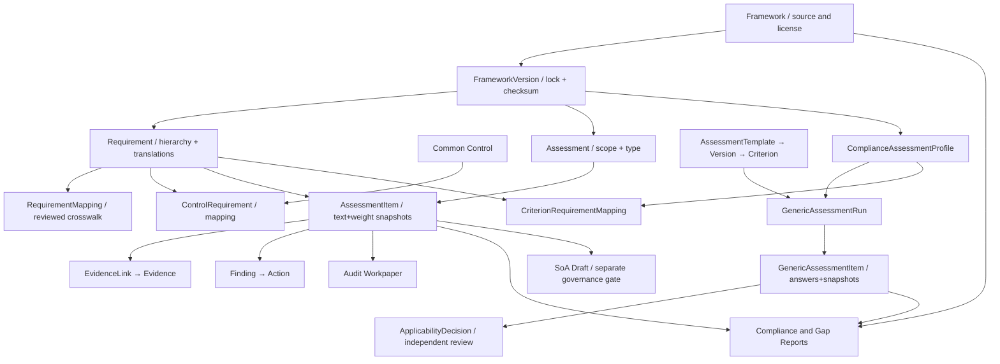

# مشخصات تفصیلی موتور استانداردها و ارزیابی انطباق — GRC Platform

> **شناسه:** GRC-COMPLIANCE-301 · **نسخه:** 0.1.0 · **وضعیت:** DRAFT / نیازمند بازبینی Product، Tech، Security، QA و مالک حقوق محتوا  
> **تاریخ:** ۱۴۰۵/۰۷/۲۲ (2026-10-14) · **Baseline اجرای بررسی‌شده:** `main@e7a745c47919f6ec028e429c210bbdfd4589c691` · **پایلوت:** `pilot-20261013-r1`  
> **اسناد وابسته:** [PRD-001](../GRC-PRD-001_FA.md)، [SRS-002](../GRC-SRS-002_FA.md)، [DATA-003](../GRC-DATA-003_FA.md)، [API-AI-004](../GRC-API-AI-004_FA.md)، [UX-005](../GRC-UX-005_FA.md)، [RTM-006](../GRC-RTM-006_FA.md)، [UAT-007](../GRC-UAT-007_FA.md)، [CONTROL-201](GRC-CONTROL-201_FA.md) و [RISK-101](GRC-RISK-101_FA.md).
>
> **اصطلاحات وضعیت:** `AS-IS` مدل/رفتار بررسی‌شده در Source؛ `OBSERVED` شواهد آزمون اپراتور؛ `GAP` نقص/ابهام؛ `TO-BE` الزام هدف؛ `POST-V1` توسعه آتی؛ `RIGHTS-DEPENDENT` استفاده/بازنشر مجاز محتوا. این سند هیچ گواهی ISO، افتا یا انطباق رسمی صادر نمی‌کند.

## ۱. هدف و حدود دامنه

یک موتور چارچوب‌مستقل برای نگهداری داده قانونی/مجاز استانداردها، نسخه‌ها و بندها؛ نگاشت‌های بین چارچوب‌ها و کنترل‌های مشترک؛ ارزیابی دوره‌ای بندها با Evidence و Findings؛ محاسبه شاخص‌های قابل ردیابی؛ و پشتیبانی از ارزیابی عمومیِ نسخه‌دار بدون اجبار به FrameWork خاص.

**حداقل جریان ارزش:** `Framework -> FrameworkVersion (frozen) -> Requirement (snapshot) -> Assessment -> AssessmentItem -> Evidence/Control/Workpaper -> Finding -> Action -> Report`. مسیر `Control ↔ Requirement` و `Risk ↔ ControlImplementation` با اسناد دیگر مشترک است.

**دو موتور موجود را ادغام ناسازگار نکنیم:**
- **Legacy/Framework Assessment (`apps.assessments`):** ارزیابی الزام‌های یک FrameworkVersion فعال با `AssessmentItem` و Score/Progress فعلی.
- **Generic Assessment (`apps.generic_assessments`):** Template/Version/Criterion عمومیِ منتشرشده، اجرای `GenericAssessmentRun`، پاسخ typed و تصمیم کاربردپذیری با بازبینی مستقل؛ می‌تواند از طریق `ComplianceAssessmentProfile` به FrameworkVersion و `CriterionRequirementMapping` وصل شود.
هر دو مدل با نگهداری تاریخچه مستقل و گزارش سوابق مشترک، همچنان موجودیت و قانون خود را دارند. Conversion/Migration خودکار بدون طرح داده و آزمون سازگاری ممنوع است.

**چارچوب‌های هدف محتوایی (تعهد محتوا نیست):** ISMS/ISO/IEC 27001 و 27002، افتا، الزامات مرتبط پدافند غیرعامل، ISO 9001، ISO 31000، COBIT، CIS، NIST، ISO 22301، استاندارد/مقررات اختصاصی مشتری و پرسش‌نامه‌های داخلی. بارگذاری باید تابع حق استفاده باشد؛ داشتن PDF به معنی اجازه توزیع متن کامل همراه محصول نیست.

## ۲. مفهوم و روابط



**معنای حیاتی روابط:** `RequirementMapping` نگاشت دو بند از دو چارچوب است؛ `ControlRequirement` ارتباط یک کنترل مشترک با بند است؛ `CriterionRequirementMapping` نگاشت معیار قالب ارزیابی عمومی به بند استاندارد است؛ هیچ‌کدام برابر «انطباق تحقق‌یافته» نیستند. `SoAControlDecision` جریان حقوقی/تصویبی جداگانه دارد و در پایلوت فقط Draft/Review است.

## ۳. فرهنگ داده Framework

### ۳.۱ Framework — شناسنامه چارچوب
| فیلد واقعی | نوع/دامنه | شرح/قید |
|---|---|---|
| `id` | UUID | شناسه پایدار |
| `tenant` | FK nullable | `null` مرجع global؛ Tenant-owned قابل مدیریت محلی |
| `code` | Slug(120) | یکتا در Tenant یا global |
| `name` | Char(255) | عنوان |
| `publisher` | Char(255) | ناشر |
| `framework_type` | enum | `standard/regulation/law/maturity_model/internal_policy/questionnaire/best_practice` |
| `content_source` | enum | `built_in/imported/customer/internal`؛ create API محلی به `customer` تنظیم می‌کند |
| `license_type` | enum | `public/licensed/customer_provided/internal` |
| `license_metadata` | JSON | توضیح مبنای حق استفاده، محدودیت انتقال/بازتوزیع و مستندات آن |
| `description` | Text | هدف/دامنه کلی |
| `status` | enum | `draft/active/archived` |
| `created_by` | FK User | Actor اولیه |
| `created_at/updated_at/deleted_at` | Timestamp | تاریخچه/آرشیو |

**AS-IS:** چارچوب global فعال برای Tenant قابل مشاهده ولی ویرایش مستقیم آن ممنوع است؛ `/frameworks/{id}/duplicate/` Clone اختصاصی Draft با Versionهای Draft/Unlocked می‌سازد. آرشیو Framework دارای Version قفل‌شده رد می‌شود.

**TO-BE اطلاعات حقوقی:** `rights_owner, license_document_ref, scope_of_use, distribution_allowed, allowed_tenants, expiry, official_source_uri, source_hash, language_rights, reviewer, approved_at`. LicenseType خوداظهاری نباید به‌تنهایی مجوز بازنشر تلقی شود.

### ۳.۲ FrameworkVersion — نسخه استاندارد
| فیلد | نوع/دامنه | قانون |
|---|---|---|
| `framework` | FK Framework | مرجع نسخه؛ جابه‌جایی پس از ایجاد ممنوع |
| `version_code` | Char(80) | یکتا در همان Framework |
| `title` | Char(255) | نام نسخه |
| `publication_date/effective_date/retirement_date` | Date nullable | ذخیره ISO؛ UI شمسی |
| `status` | `draft/active/retired` | وضعیت انتشار/استفاده |
| `is_locked` | Boolean server-managed | جلوگیری از ویرایش Requirementها |
| `checksum` | SHA-256 hex server-managed | اثرانگشت محتوای Canonical Version |
| `metadata` | JSON | اطلاعات Scoring Model و Provenance در صورت معتبر |
| `created_by` | FK User | Actor |
| `created_at/updated_at/deleted_at` | Timestamp | سوابق |

**AS-IS Lock:** `POST /framework-versions/{id}/lock/` از `canonical_version_payload` شامل Framework Code، Version Code، بندها، ترتیب، وزن، متن و ترجمه‌ها checksum می‌سازد؛ `is_locked=true` و اگر status=draft، آن را active می‌کند. تغییر بندها و ترجمه از Serializer/Service نسخه قفل‌شده جلوگیری می‌شود. Checksum محافظ رمزنگاریِ امضا‌شده نیست و به‌تنهایی اثبات حقوق محتوا/تمامیت خارج از DB نیست.

**TO-BE:** تعریف رسمی فرآیند `draft→content_review→rights_review→approved→active/retired` و ثبت Approval نسخه/منبع/حوزه حقوق؛ قفل باید در تمام مسیرهای Import، ORM، Bulk Update، Archive و Workflow کنترل شود. معیار عدم امکان تغییر بعد از Snapshot در Migration و API سنجیده شود.

### ۳.۳ Requirement و RequirementTranslation
| فیلد | نوع | قید |
|---|---|---|
| `framework_version` | FK | هر بند متعلق به یک نسخه |
| `parent` | self FK nullable | در همان Version، بدون خودارجاع/چرخه |
| `code` | Char(160) | یکتا در Version |
| `title` | Text | عنوان |
| `body` | Text | متن مجاز برای ذخیره/نمایش |
| `guidance` | Text | راهنمای پیاده‌سازی/تفسیر با منشأ |
| `assessable` | Boolean default true | بند قابل ارزیابی |
| `mandatory` | Boolean default true | ماهیت الزام؛ با `applicability` یکی نیست |
| `weight` | Decimal(8,3), >=0 | وزن امتیازدهی |
| `sort_order` | Integer | ترتیب درختی |
| `metadata` | JSON | با Schema محدود |
| `translations` | one-to-many | هر زبان `title/body/guidance`، یکتا در Requirement+Language |

**AS-IS:** فقط Requirement متعلق به نسخه Tenant-owned و Unlocked قابل تغییر است؛ Serializer ترجمه‌ها را transactional ذخیره و ارسال فهرست ترجمه‌ها در UPDATE می‌تواند ترجمه‌های حذف‌شده از Payload را حذف کند. **TO-BE:** برای جلوگیری از حذف ناخواسته، Patch ترجمه‌ها با عملیات صریح Add/Update/Remove و Audit معنایی طراحی شود؛ حق ترجمه/بازتوزیع لحاظ گردد.

### ۳.۴ RequirementMapping — Crosswalk بین بندها
| فیلد | نوع/قید |
|---|---|
| `tenant` | FK؛ فقط در Scope همان Tenant |
| `source_requirement, target_requirement` | FK؛ نباید یکسان باشند |
| `mapping_type` | `exact/strong/partial/related/weak` |
| `strength,confidence` | Decimal(5,4) بین 0 و 1 |
| `source_type` | `manual/imported/ai/vendor` |
| `rationale` | Text |
| `reviewed_by,approved_at` | از Action اختصاصی Approve |
| Unique | `tenant + source + target`، با قید عدم خودنگاشت |

**GAP تأیید mapping:** `POST /requirement-mappings/{id}/approve/` `reviewed_by` و `approved_at` را تنظیم می‌کند، ولی در `perform_update` این دو مقدار باطل نمی‌شوند و شرط صریح Reviewer مستقل از ایجادکننده دیده نشد. **TO-BE:** هر تغییر معنایی در `source/target/type/strength/confidence/rationale` باعث `stale`شدن Approval قبلی و نیازمند بازبینی مجدد شود؛ Source Snapshot/Version و No Self-Approval برقرار باشد.

### ۳.۵ ControlRequirement (مرجع ماژول کنترل)
`control,requirement,coverage(0..100),mapping_type(exact/strong/partial/related),rationale,source,approved`. پوشش کنترل بر بند با نتیجه ارزیابی انطباق **متفاوت** است؛ از نظر حقوقی/فنی استفاده از استاندارد و متن اصلی به حقوق منبع بستگی دارد.

## ۴. Import/Export بسته استاندارد

### ۴.۱ ورودی‌های واقعی AS-IS
- `POST /api/v1/frameworks/import/?dry_run=true|false` با فایل JSON یا XLSX و permission `framework.import` برای کل Tenant.
- JSON: `framework{code,name,publisher,framework_type,license_type,license_metadata,...}`، `version{version_code,title,publication_date,effective_date,...}`، `requirements[]`.
- XLSX: شیت `manifest` اختیاری و شیت `requirements` الزامی؛ حداقل ستون `code,title`، ستون‌های `parent_code,body,guidance,assessable,mandatory,weight,sort_order` و `title_fa,body_fa,guidance_fa` یا زبان‌های دیگر قابل استخراج هستند.
- Validation: خالی‌نبودن Requirements، Code/Title لازم، Code تکراری، Parent ناموجود، Cycle درخت، Boolean/Decimal معتبر و فایل با پسوند مجاز.
- `dry_run=true`: بدون Commit، Summary با Error/Warning/Source SHA256.
- `dry_run=false`: Transactional Commit، ساخت Framework/Version/Requirement/Translation، نسخۀ Draft؛ اگر Error موجود باشد Commit نشود.
- Export Version با `GET /api/v1/framework-versions/{id}/export/?format=json|xlsx`؛ Audit Event.

### ۴.۲ نقص‌ها و کنترل‌های TO-BE برای Content Pack
- تأیید اسناد مجوز و حد استفاده توسط Content/Legal Reviewer مستقل از Metadata ادعایی Package.
- محدودیت اندازه Upload، تعداد بند، ساختار Nested/ZIP و Memory/CPU؛ بررسی XLSX غیرمجاز/خراب.
- تغییر نسخه معنادار با Snapshot Diff و Impact Analysis بر Assessment، Mapping و SoA.
- Import نباید کنترل Frozen Version را دور بزند.
- تغییر بسته حقوقاً محدود باید با سیاست Mask/Redaction هنگام Export، AI و گزارش انجام شود.
- Preview باید دقیقاً رکوردهای در معرض Commit و Validation را نشان دهد، نه اینکه Commit بدون تأیید همان SHAِ فایل دیگری انجام شود (TO-BE).
- کنترل ارجاع خارجی و فایل‌های پیوست با Malware/Egress Policy، بدون بارگیری خودکار URLها.

### ۴.۳ نمونه بسته مجازِ **ساختگی**
```json
{
  "framework": {
    "code": "internal-demo",
    "name": "خط‌مشی داخلی آزمایشی",
    "publisher": "Example Organization",
    "framework_type": "internal_policy",
    "license_type": "internal",
    "license_metadata": {"rights_basis": "Original synthetic test content"}
  },
  "version": {"version_code": "1.0", "title": "نسخه اول آزمایشی"},
  "requirements": [
    {
      "code": "1",
      "title": "حاکمیت کنترل‌ها",
      "body": "مسئول کنترل باید مشخص باشد.",
      "assessable": true,
      "mandatory": true,
      "weight": "1",
      "sort_order": 1
    },
    {
      "code": "1.1",
      "parent_code": "1",
      "title": "آزمون اثربخشی",
      "body": "شواهد آزمون باید ثبت شود.",
      "assessable": true,
      "mandatory": true,
      "weight": "2",
      "sort_order": 2,
      "title_fa": "آزمون اثربخشی"
    }
  ]
}
```
این متن نمونه دارای حق نشر استاندارد خارجی نیست و فقط Fixture آموزشی است.

## ۵. موتور ارزیابی انطباقِ مبتنی بر Framework (AS-IS)

### ۵.۱ Assessment
| فیلد | نوع/حدود | کاربرد |
|---|---|---|
| `tenant` | FK از سرور | جداسازی |
| `framework_version` | FK PROTECT | نسخه فعال و قابل مشاهده؛ **پس از ایجاد Immutable** |
| `organization_unit` | FK nullable | کل Tenant با اختیار whole؛ پس از ایجاد Immutable |
| `title` | Char(255) | عنوان کار |
| `assessment_type` | `compliance/maturity/internal/self` | نوع |
| `owner` | FK User | عضو فعال Tenant |
| `start_date,due_date` | Date nullable | UI جلالی هدف، API ISO |
| `status` | `draft/in_progress/in_review/completed/cancelled` | چرخه حیات |
| `overall_score` | Decimal(7,3) nullable read-only | نمره مشتق‌شده |
| `progress_percent` | Decimal(7,3) read-only | پیشرفت ارزیابی، نه انطباق |
| `metadata` | JSON | `status_scores` سفارشی در وضعیت کنونی قابل استفاده |
| `created_at,updated_at,deleted_at` | تاریخچه | Snapshot/Cancel |

**AS-IS ساخت:** `POST /assessments/` یک نسخه Framework `active` انتخاب می‌کند؛ اگر محلی و هنوز قفل نشده باشد آن را قفل می‌کند؛ برای Requirements با `assessable=true` `AssessmentItem` می‌سازد و `code/title/body/weight` را snapshot می‌کند. Status را `in_progress` می‌گذارد. Version/Scope پس از ایجاد تغییر نمی‌کنند.

### ۵.۲ AssessmentItem
| فیلد واقعی | نوع/محدودیت |
|---|---|
| `assessment,requirement` | FK؛ یک Requirement در Assessment یکتا |
| `requirement_code_snapshot,requirement_title_snapshot,requirement_body_snapshot` | متن نسخه ثابت در زمان ساخت |
| `weight_snapshot` | Decimal(8,3) |
| `status` | `not_assessed/compliant/partial/non_compliant/not_applicable/compensating_control` |
| `score` | Decimal(7,3), 0..100 nullable |
| `maturity_level` | Decimal(7,3) nullable |
| `applicability` | `applicable/not_applicable/undetermined` |
| `assessor_comment,reviewer_comment` | Text |
| `assigned_to,reviewed_by` | FK User nullable |
| `created_at,updated_at,deleted_at` | Timestamp |

**AS-IS:** `PATCH /assessment-items/{id}/` برای `status,score,maturity_level,applicability,assessor_comment,assigned_to` و `POST /assessment-items/{id}/review/` برای `reviewer_comment,reviewed_by`; Reviewer Comment از PATCH عمومی ReadOnly است.

### ۵.۳ فرمول محاسبه واقعی
`DEFAULT_STATUS_SCORES`: `compliant=100`, `partial=50`, `non_compliant=0`, `compensating_control=75`. مقدارهای سفارشی `Assessment.metadata.status_scores` می‌توانند این نگاشت را تغییر دهند؛ مقدار `Item.score` اگر ارائه شده باشد نسبت به Score وضعیت **اولویت** دارد.

- `progress_percent = 100 × (تعداد آیتم با status غیر not_assessed) / تعداد همه آیتم‌ها`.
- `overall_score = (Σ(value_i × weight_i)) / Σ(100 × weight_i) × 100`؛ مجموعه Σ فقط آیتم‌هایی با status نه `not_assessed`، نه `not_applicable` و مقدار نمره قابل تعیین است.
- اگر هیچ Item قابل امتیاز نباشد `overall_score=null`، نه صفر.
- Item با `not_applicable` در **Progress** کامل‌شده حساب می‌شود ولی در مخرج **Overall Score** نیست.
- مخلوط داده نمره اختصاصی/Status، وزن صفر و Metadata سفارشی می‌تواند معنی نتیجه را تغییر دهد؛ روش مصوب امتیازدهی و نسخه آن باید در گزارش آشکار و کنترل‌شده باشد.

**مثال واقعی از فرمول کد** (Fixture آموزشی): یک Requirement با وزن ۱ و `compliant=100`، یک Requirement با وزن ۲ و `partial=50` → `(100×1+50×2)/(100×(1+2))×100 = 66.667%`؛ اگر هر دو پاسخ ثبت شوند، `progress=100%`. این نتیجه **امتیاز روش آزمایشی است، نه مدرک رسمی ISO**.

### ۵.۴ محدودیت‌های حاکمیتی شناسایی‌شده
- `AssessmentItemSerializer` امکان نوشتن مستقل `status,score,applicability` را دارد؛ تطبیق الزام‌آور N/A با `ApplicabilityDecision` مصوب در مسیر Legacy بر اساس کد بررسی‌شده دیده نمی‌شود.
- `POST /assessments/{id}/complete/` فقط نبود Item با `not_assessed` را کنترل می‌کند؛ وجود `reviewed_by` برای تمام آیتم‌ها یا Evidence معتبر الزام عمومی آن نیست.
- `POST /assessment-items/{id}/review/` در View نقش `assessment.review` را کنترل می‌کند، ولی شرط صریح `reviewed_by != item.assessor` یا Freeze نتیجه بررسی‌شده در همان Action دیده نشد.
- `AssessmentItemSerializer.get_mapped_controls` در مرور کد، ControlRequirementها را با `requirement_id` واکشی می‌کند، **بدون فیلتر صریح Tenant/Global و Approved**؛ برای بند استاندارد مشترک باید آزمون جداسازی داده بین Tenant و تصحیح احتمالی اجرا شود. این **یافته بررسی امنیتی کد است، نه ادعای نشت اثبات‌شده در محیط مشتری**.
- Score سفارشی در Metadata، بدون قرارداد اعتبارسنجی و تصویب نسخه محاسبات، قابلیت تغییر معنای گزارش ایجاد می‌کند.
- UI Workspace `/assessments/[id]` در ساخت Finding و EvidenceLink از **اولین User/Evidence موجود** استفاده می‌کند و از `prompt()` برای عنوان Finding بهره می‌برد؛ این کار نباید جای انتخاب آگاهانه Owner/Evidence مجاز را بگیرد.
- `get_mapped_controls` حتی Mapping تأییدنشده را به‌عنوان «کنترل مرتبط» نمایش می‌دهد؛ باید وضعیت و منشأ را تفکیک کند.
- آزمون خالص Endpointها و مدل‌ها در Repo وجود دارد؛ UAT کامل مرورگر/Export/حقوق محتوا هنوز در نصب فعلی اثبات نشده است.

## ۶. موتور ارزیابی عمومی قالب‌محور (AS-IS)

### ۶.۱ AssessmentTemplate
`tenant,organization_unit,code,title,description,owner`، Code یکتا در Tenant، Owner عضو فعال و Unit همان Tenant. قالب به‌خودی‌خود Framework نیست.

### ۶.۲ AssessmentTemplateVersion
`template,version_code,status(draft/published/retired),published_at,published_by,notes`. Version منتشرشده در مدل دارای سیاست Immutability است؛ در Service `publish_template`، **Owner قالب نمی‌تواند نسخه خودش را منتشر کند** و حداقل یک Criterion لازم است.

### ۶.۳ TemplateCriterion
`version,code,title,description,response_type(boolean/number/choice/text),choices,required,weight,applicability_mode(always/review),sort_order`. `choice` به ۲ تا ۴۰ گزینه یکتا و غیرتهی محدود می‌شود؛ در Version منتشرشده Criterion قابل ویرایش نیست.

### ۶.۴ ComplianceAssessmentProfile و CriterionRequirementMapping
Profile: `tenant,template_version,framework_version,title`. CriterionRequirement: `profile,criterion,requirement` با قید اینکه Criterion از نسخه Template و Requirement از FrameworkVersion همان Profile باشد. این مدل به ارزیابی عمومی اجازه می‌دهد *در صورت نیاز* به الزامات نسخه‌دار متصل شود؛ Generic Run بدون Profile نیز مجاز است.

### ۶.۵ GenericAssessmentRun
`tenant,template_version,profile?,organization_unit?,title,owner,status(draft/in_progress/completed/cancelled),completed_at`. فقط نسخه منتشرشده اجرا می‌شود؛ Scope و TemplateRun غیرقابل انتقال‌اند؛ اجرای Completed مجدداً به In Progress بازنمی‌گردد.

### ۶.۶ GenericAssessmentItem
`run,criterion,criterion_code_snapshot,criterion_title_snapshot,response_type_snapshot,options_snapshot,weight_snapshot,required_snapshot,applicability_mode_snapshot,answer,score_percent,assessed_by,assessed_at`. انتخاب نوع پاسخ به‌صورت `typed_answer`: Boolean → 0/100، Number → 0..100، Choice/Text → **بدون امتیاز عددی** تا زمانی که Rubric مجاز تعریف شود. Snapshot پس از ایجاد immutable است.

### ۶.۷ ApplicabilityDecision
`tenant,generic_item XOR legacy_item,decision(applicable/not_applicable),rationale,created_by,reviewed_by,reviewed_at`. قید: فقط یک نوع Item، Reason اجباری، Reviewer فعال و **مستقل از Creator**، تاریخچه تصمیم پس از ثبت و تصویب تغییرپذیر نیست. Review مورد خاص با `assessment.review` انجام می‌شود.

### ۶.۸ امتیازدهی Generic و خاتمه
- `score_summary` فقط معیارهای **قابل اعمال، پاسخ‌داده‌شده و عددی** را در میانگین وزنی Score وارد می‌کند؛ متن/Choice بدون Rubric صفر نیستند.
- `answered_count`, `required_unanswered`, `scored_count`, `applicability_reviews_missing`, `is_partial_score` مجزا هستند.
- `complete_run` فقط وقتی Review کاربردپذیری‌های موردنیاز تکمیل شده، Pending Decision وجود ندارد و پاسخ‌های اجباری قابل‌اعمال درج شده‌اند مجاز است.
- نتیجه عددی جزئی باید با برچسب `partial_score` و تعداد پوشش معیارها نمایش داده شود؛ بدون داده، Score=`null` نه Zero.

**نتیجه معماری:** Generic engine از نظر Versioning/Applicability Review دارای مدل کامل‌تری است، ولی نباید به‌صورت غیرکنترل‌شده جایگزین Assessment فعلی شود؛ باید Compatibility/Backfill Plan با حفظ مقایسه تاریخچه و Score اجرا شود.

## ۷. صفحه‌ها، فرم‌ها و رفتار UI

### CMP-SCR-01 — کتابخانه چارچوب‌ها `/frameworks`
**AS-IS:** نام/کد/ناشر/وضعیت/License/Global، جست‌وجو، لینک Crosswalk، Import و New.  
**TO-BE:** فیلتر نوع/ناشر/نسخه فعال/منشأ/وضعیت مجوز/آخرین بازبینی؛ هشدار «محتوا تأیید حقوقی نشده»؛ نسخه/حقوق محتوا در همه خروجی‌ها.

### CMP-SCR-02 — ایجاد `/frameworks/new`
**AS-IS:** Form کوتاه Code, Name, Publisher, Version؛ دو درخواست مستقل Framework سپس Version. برای فرم جدید `license_type=internal` ارسال می‌شود.  
**GAP:** ساخت Framework موفق ولی Version ناموفق ممکن است رکورد نیمه‌کاره باقی بگذارد؛ فرم باید امکان Retry/بازگشت و قرارداد تراکنش سرویس کسب‌وکار داشته باشد. LicenseType «internal» نباید بدون تأیید حق محتوا توسط کاربر یا سیاست سیستم پیش‌فرض غیرمجاز شود.
**TO-BE:** انتخاب نوع، منبع و حقوق استفاده، نسخه، Reviewer و Preview؛ Save Draft یکپارچه و Audit.

### CMP-SCR-03 — جزئیات نسخه و درخت بندها `/frameworks/[id]`
**AS-IS:** انتخاب Version، نمایش درخت Requirement، متون/Guidance، Lock+Checksum، ایجاد Requirement Code/Title ساده، Export JSON/XLSX.  
**TO-BE:** Schema کامل Requirement/Translation/Parent/Weight/Assessable/Mandatory، تغییرات نسخه، حقوق متن، آخرین Snapshot و تفکیک نسخه Active/Retired، هشدار قفل.

### CMP-SCR-04 — Import `/frameworks/import`
**AS-IS:** JSON/XLSX Preview/Dry-run و Commit + Summary Error؛ Commit در فرم بدون اثبات جدید بودن Preview/Hash حتماً همان Payload قبلی نیست.  
**TO-BE:** Stepper Load→Rights→Validate→Diff→Review→Commit→Lock، خطای سطح Row و Field و Label; File SHA و Info حقوقی.

### CMP-SCR-05 — Crosswalk `/frameworks/crosswalk`
**AS-IS:** انتخاب دو Framework/Version/Requirement، MappingType، Strength/Confidence مقدارگذاری‌شده در Frontend، Create و Approve؛ UI انتخاب Version اول لیست را به‌صورت خودکار انجام می‌دهد.  
**TO-BE:** انتخاب آگاهانه نسخه، نمایش Rationale/Source/Reviewer، Approval مستقل، Conflict/Change Invalidation و Diff؛ نمایش Confidence به‌عنوان «پیشنهاد»، نه احتمال صحت اثبات‌شده.

### CMP-SCR-06 — دفتر ارزیابی `/assessments`
**AS-IS:** ایجاد Assessment با انتخاب FrameworkVersion فعال، Owner، Unit، Type و تاریخ؛ لیست/Score/Progress و لینک Generic/History.  
**TO-BE:** Scope، Reviewer، Methodology/Scoring Policy version، نام پروژه، محدودیت، Evidence readiness، برنامه کار، فیلتر وضعیت و Export.

### CMP-SCR-07 — Workspace ارزیابی `/assessments/[id]`
**AS-IS:** فهرست Snapshot بندها، انتخاب Item، Status و AssessorComment، شمارنده Evidence/Findings، Mapping Control، ایجاد EvidenceLink/Finding به‌صورت میان‌بر.  
**TO-BE:** تب بند/راهنما/کنترل‌های *approved and visible*، مدارک با Source/Validity/Review، وضعیت کاربردپذیری و Rationale با بازبین مستقل، Editor Score و Maturity با Rubric، Assignment، Save/Submit/Review، Change History، Findings/Actions، Complete با گیت؛ بدون انتخاب خودکار `users[0]` یا `evidence[0]`.

### CMP-SCR-08 — ارزیابی عمومی `/assessments/generic`
**AS-IS:** ساخت Template→DraftVersion→Criteria→Publish مستقل→Run→Typed Answer→Applicability Proposal/Review→Complete.  
**TO-BE:** فرم‌بندی چندصفحه‌ای و Wizard، تطبیق Criterion/Requirement، نسخه/حقوق Profile، انتخاب Owner/Reviewer آگاهانه، خروجی رسمی، Scoring Rubric قابل تنظیم، Pagination و راهنمای خطا.

### CMP-SCR-09 — سوابق مشترک `/assessments/history`
**AS-IS:** نمای read-only `assessment-history` با فیلتر نوع Legacy/Generic، Unit و Search؛ صریحاً نمره Generic را جایگزین Score قدیمی نمی‌کند.  
**TO-BE:** Snapshot/version/diff، داده اندازه‌گیری و Evidence، دانلود نسخه گزارش تاریخی، عدم مقایسه Score ناهمگن بدون تبدیل مصوب.

### CMP-SCR-10 — فضای تحلیل شکاف و خروجی (TO-BE)
Report preview با FrameworkVersion، Unit، تاریخ، روش Score، Item Status/Review/Evidence، Finding و CAPA؛ Risk/Control Coverage، Gap priority، Export و Traceability.

## ۸. API موجود و قرارداد طراحی

| عملیات | Endpoint واقعی AS-IS | Permission/محدودیت |
|---|---|---|
| Framework CRUD | `/api/v1/frameworks/`, `/{id}/` | `framework.view/manage`؛ مرجع global read-only |
| Duplicate | `POST /api/v1/frameworks/{id}/duplicate/` | `framework.manage`، Source visible |
| Version CRUD | `/api/v1/framework-versions/` | `framework.view/manage` |
| Lock Version | `POST /api/v1/framework-versions/{id}/lock/` | `framework.manage`؛ local only |
| Export Version | `GET /api/v1/framework-versions/{id}/export/?format=json|xlsx` | `framework.view` + Content Rights policy هدف |
| Requirement CRUD/tree | `/api/v1/requirements/`, `/tree/?framework_version={id}` | `framework.view/manage` و Version lock |
| Requirement Mapping CRUD | `/api/v1/requirement-mappings/` | `framework.mapping.view/manage` |
| Mapping Approval | `POST /api/v1/requirement-mappings/{id}/approve/` | `framework.mapping.manage`؛ SoD هدف |
| Import/Dry-run | `POST /api/v1/frameworks/import/?dry_run=true|false` | `framework.import` whole Tenant |
| Framework Assessment CRUD | `/api/v1/assessments/` | `assessment.view/manage` Scoped |
| Assessment Summary | `GET /api/v1/assessments/{id}/summary/` | `assessment.view` |
| Assessment Complete | `POST /api/v1/assessments/{id}/complete/` | `assessment.review`، نبود NotAssessed |
| Item Read/PATCH | `/api/v1/assessment-items/{id}/` | `assessment.view/perform` |
| Item Review | `POST /api/v1/assessment-items/{id}/review/` | `assessment.review` |
| Template/Version/Criterion | `/api/v1/assessment-templates/`, `assessment-template-versions/`, `assessment-criteria/` | ارزیابی عمومی، Scoped |
| Publish Template Version | `POST /api/v1/assessment-template-versions/{id}/publish/` | `assessment.manage`، انتشار مستقل از Owner |
| Compliance Profile/Mapping | `/api/v1/assessment-profiles/`, `assessment-criterion-mappings/` | Permissions Generic |
| Generic Run/Item | `/api/v1/generic-assessments/`, `generic-assessment-items/` | `assessment.view/manage/perform` |
| Generic Answer/Complete | `POST /api/v1/generic-assessment-items/{id}/answer/`، `generic-assessments/{id}/complete/` | `assessment.perform/review` |
| Applicability Create/Review | `/api/v1/assessment-applicability-decisions/`, `/{id}/review/` | `assessment.perform/review` |
| Combined History | `GET /api/v1/assessment-history/` | Scoped/ReadOnly |
| Evidence and Links | `/api/v1/evidence/`, `evidence-links/` | Unit/Classification/Download Malware Gates |

`ControlRequirement` endpoints در سند CONTROL-201؛ `SoA` و Report Export در PRD/API مربوطه. APIهای پیشنهادی `assessment-item/{id}/submit-review/`, `assessment-item/{id}/approve/`, `assessment-scoring-policies/`, `framework-versions/{id}/rights-approve/`, `assessments/{id}/gap-report/` **TO-BE** و در این Baseline پیاده‌شده تلقی نمی‌شوند.

### ۸.۱ نمونه Create Legacy Assessment (ساختگی)
```json
{
  "framework_version": "00000000-0000-4000-8000-000000000301",
  "organization_unit": "00000000-0000-4000-8000-000000000302",
  "title": "خودارزیابی پایلوت استاندارد داخلی",
  "assessment_type": "compliance",
  "owner": 1,
  "start_date": "2026-10-14",
  "due_date": "2026-11-14",
  "metadata": {}
}
```
`tenant` از نشست معتبر Resolve می‌شود. شناسه‌ها و کاربر ساختگی‌اند.

### ۸.۲ نمونه PATCH Item (AS-IS)
```json
{
  "status": "partial",
  "score": "50",
  "applicability": "applicable",
  "assessor_comment": "کنترل اجرا شده؛ آزمون مستقل کافی موجود نیست"
}
```
در کد فعلی این دو محور مستقل قابل نوشتن‌اند. **TO-BE** وضعیت/امتیاز باید با ScoringPolicy و Evidence/Review Validate شود؛ Status=Compliant و Score=0 بدون توضیح منسجم نباید به گزارش رسمی راه یابد.

### ۸.۳ نمونه خروجی هدف «گزارش شکاف» (نه Endpoint موجود)
```json
{
  "schema_version": "grc.compliance.gap.v1",
  "assessment_id": "00000000-0000-4000-8000-000000000303",
  "framework_version_id": "00000000-0000-4000-8000-000000000301",
  "scoring_policy_version": "draft-pending",
  "scope": "unit-uuid",
  "summary": {
    "items_total": 2,
    "assessed_count": 1,
    "applicability_pending": 1,
    "score_percent": null,
    "assurance_state": "not_verified"
  },
  "gaps": [{
    "requirement_code": "1.1",
    "status": "partial",
    "evidence_state": "insufficient",
    "finding_ids": [],
    "candidate_action": "تکمیل آزمون اثربخشی"
  }],
  "limitations": ["بازبینی مستقل کامل نشده است"]
}
```

## ۹. مجوزها، حقوق محتوا و تصمیم‌گیری

| عملیات | Permission فعلی در کد | قید هدف |
|---|---|---|
| Framework/Version/Requirement خواندن | `framework.view` | Rights/Visibility |
| مدیریت Framework/Version/Requirement | `framework.manage` | Global read-only، Frozen Version |
| Import محتوا | `framework.import` whole Tenant | Legal Rights Owner و SHA/Preview |
| Requirement Crosswalk مشاهده/ویرایش | `framework.mapping.view/manage` | Reviewer مستقل و Change Invalidation |
| Assessment List/Detail | `assessment.view` Scoped | Evidence/Controls نیز Scoped |
| Create/Update Assessment | `assessment.manage` Scoped | Scope/Version immutable |
| ارزیابی Item | `assessment.perform` Scoped | نگاشت ScoringPolicy |
| Review/Complete | `assessment.review` Scoped | No Self-Approval و Evidence Gate TO-BE |
| Evidence View/Link | `evidence.view/manage` Scoped | Classification + Object Scope |
| SoA Draft/Review | مجوزهای SoA مستقل | تصویب رسمی موجود نیست |
| AI تحلیل انطباق | `ai.use` + مجوز تمام منابع | Rights/Provider Egress |

**قاعده اصلی:** `assessment.view` مجوز دیدن همه ControlRequirementهای Tenant دیگر نیست؛ `framework.view` به معنی حق Export متن دارای حق نشر نیست؛ در AI نیز Access به Source قبل از Retrieval کنترل می‌شود.

## ۱۰. سناریوهای سرتاسری و تصمیم‌های عملیاتی

### CMP-FLOW-01 — ایجاد بسته و نسخه مجاز
دریافت منبع با حقوق قانونی → ثبت Provenance/License → Preflight/Dry-run/Warnings → Approval مالک محتوا → Commit Draft → بررسی درخت/ترجمه → Lock/Checksum → Activate → اعلان نسخه قابل ارزیابی. `Lock` فنی جایگزین Approval حقوقی نیست.

### CMP-FLOW-02 — اتصال الزامات/کنترل
FrameworkVersionهای مرجع انتخاب شوند → Requirement Crosswalk به‌عنوان Draft با Rationale ثبت → Reviewer نسخه مشخص را تأیید کند → ControlRequirementهای مشترک ارتباط یابند → تأیید Crosswalk نافی نیاز به Implementation/Evidence در Scope نیست.

### CMP-FLOW-03 — ارزیابی چارچوب
نسخه فعال/قفل‌شده → Scope و Owner → Snapshot Items assessable → Assignment → پاسخ Status/Score/Rationale → Evidence Link/Review → Finding/Action → Item Review مستقل → Complete Gate → Report و Version Freeze.

### CMP-FLOW-04 — ارزیابی عمومی بدون استاندارد
Template → Version Draft → Criteria (Boolean/Number/Choice/Text) → Publish مستقل → Run → Typed Answer → Applicability Decision/Review → Summary (Scored vs Unscored) → Complete و حفظ Snapshot.

### CMP-FLOW-05 — مقایسه دو دوره
Version/ScoringPolicy یکسان؟ اگر خیر، اختلاف باید در گزارش آشکار شود؛ مقایسه Raw Percent بدون روش همسان مجاز نیست. Requirement Snapshot و تاریخ Evidence برای هر دوره جدا بماند.

### CMP-FLOW-06 — آماده‌سازی SoA
ControlApplication و Requirement Mapping فقط ورودی Worksheet پیش‌نویس‌اند؛ تصمیم Included/Excluded با Rationale، Evidence و درمان ریسک بررسی و برای Human Review ارسال می‌شود. صدور رسمی SoA نیازمند مراحل حقوقی/حاکمیتی جداست.

## ۱۱. هوش مصنوعی و بسته Context

### ۱۱.۱ AS-IS
قابلیت `control-mapping` و `rag` و `document-draft` در AI Gateway وجود دارد؛ **Endpoint تخصصی `/ai/assist/compliance-gap/` در این بررسی موجود شناسایی نشد** و صرفاً قابلیت TO-BE است. مدل محلی در نصب پایلوت قبلی خاموش است.

### ۱۱.۲ ورودی هدف به AI با حداقل داده
| زمینه | فیلدهای لازم | شرط |
|---|---|---|
| Framework | `framework_id,version_id,code,rights_status` | Rights و Scope |
| Requirement | کد/عنوان/متن مجاز/Guidance/Translation Version | عدم افشای متن محدود |
| Assessment | ID/Scope/Type/Status/ScoringPolicy version | Read Authorization |
| Item | snapshot, status, rationale, review_state | مجوز Item |
| Control | ID/Mapping Approval/Implementation verified state | Tenant/Unit و Approval |
| Evidence | ID/Source/Date/Expiry/Classification/Review | Classification و Clean Gate |
| Finding/Action | عنوان/شدت/موعد/وضعیت واقعی | Scoped |
| Task | gap analysis/checklist/mapping/report draft | Provider Policy |
| Output | `schema_version`, `language=fa`, `require_citations` | Server-side validation |

### ۱۱.۳ خروجی ساختاریافته پیشنهادی
```json
{
  "schema_version": "grc.compliance.ai.v1",
  "status": "suggestion",
  "subject": {"type": "assessment_item", "id": "00000000-0000-4000-8000-000000000311"},
  "summary": "برای این الزام به مدارک بیشتری نیاز است",
  "potential_gaps": [
    {"statement": "نتیجه آزمون اثربخشی موجود نیست", "source_ids": [], "certainty": "unknown"}
  ],
  "candidate_questions": ["آخرین آزمون بازیابی در چه تاریخی انجام شد؟"],
  "candidate_evidence": ["گزارش ثبت‌شده آزمون بازیابی"],
  "proposed_actions": [{"title": "جمع‌آوری مدرک معتبر", "priority": "medium"}],
  "unknowns": ["نتیجه ارزیابی مستقل"],
  "is_approved_compliance_decision": false,
  "human_review_required": true
}
```
**محدودیت:** Source ID ساخته‌شده توسط مدل بدون کنترل مجوز/وجود منبع پذیرفته نشود؛ هیچ `score/status/approved_at` قطعی مستقیماً از جواب AI نوشته نشود؛ متن استاندارد محدود نباید به Provider خارجی فاقد حقوق/اجازه ارسال شود.

## ۱۲. گزارش‌ها و KPIهای انطباق

| شناسه | گزارش هدف | ورودی / معیار |
|---|---|---|
| RPT-CMP-01 | Framework Catalog / حقوق محتوا | نسخه/ناشر/حق استفاده/اعتبار |
| RPT-CMP-02 | Register الزامات | سلسله‌مراتب، نسخه، assessable/mandatory |
| RPT-CMP-03 | Crosswalk Matrix | Approved/Unreviewed/Stale، strength/rationale/source |
| RPT-CMP-04 | Control Coverage per Requirement | approved mapping و Implementation در Scope؛ نه ادعای انطباق |
| RPT-CMP-05 | Compliance Assessment Register | FrameworkVersion/Unit/Owner/Status/Score/Progress |
| RPT-CMP-06 | Item Assessment Detail | Snapshot/Status/Score/Reviewer/Evidence |
| RPT-CMP-07 | Gap / Non-Conformity | وضعیت جزئی/عدم انطباق/شواهد ناکافی/یافته |
| RPT-CMP-08 | Corrective Action Tracking | مالک/موعد/منبع و وضعیت CAPA |
| RPT-CMP-09 | Maturity Trend | Rubric/Scoring Version و مقایسه معتبر |
| RPT-CMP-10 | Generic Assessment Results | `answered,scored,required,applicability_review_missing,is_partial_score` |
| RPT-CMP-11 | SoA Draft Readiness | تصمیم‌ها/شواهد/بازبینی، با هشدار Draft |
| RPT-CMP-12 | Executive Gap Summary | محدوده، روش امتیاز، Missing Evidence، محدودیت‌ها |

**ملاحظات:** کاتالوگ واقعی `apps.reporting` برای همه این گزارش‌ها خروجی اختصاصی ندارد؛ جداول فوق **طرح هدف** هستند. هر Export باید Tenant/Unit/Rights و نسخه Framework را رعایت کند و در فارسی A4/RTL/Jalali ارائه شود؛ نبود داده با `—/ارزیابی‌نشده` نمایش یابد، نه Zero سبز.

## ۱۳. قواعد اعتبارسنجی و امنیت

| Rule | وضعیت | الزام |
|---|---|---|
| CMP-VAL-01 | AS-IS | Global Framework فعال ReadOnly برای Tenant |
| CMP-VAL-02 | AS-IS | Version/Requirement فقط اگر local و unlocked قابل ویرایش |
| CMP-VAL-03 | AS-IS | Requirement Parent در همان Version و بدون Cycle |
| CMP-VAL-04 | AS-IS | Mapping self-reference رد، strength/confidence 0..1 |
| CMP-VAL-05 | AS-IS | Import Empty/Duplicate/Unknown Parent/Cycle رد |
| CMP-VAL-06 | AS-IS | Assessment version/scope بعد از ایجاد immutable |
| CMP-VAL-07 | AS-IS | Item فقط از Requirementهای assessable نسخه مرجع ساخته شود |
| CMP-VAL-08 | AS-IS | Progress و Overall Score مستقل و Nullable |
| CMP-VAL-09 | GAP | `AssessmentItem.mapped_controls` باید Tenant/Visible/Approval filter داشته باشد |
| CMP-VAL-10 | GAP | Approval RequirementMapping پس از UPDATE باطل نمی‌شود |
| CMP-VAL-11 | GAP | Legacy Complete بدون Evidence/Review/Applicability Gate کافی |
| CMP-VAL-12 | GAP | N/A در Legacy نیازمند Decision مستقل و Justification معتبر |
| CMP-VAL-13 | GAP | Status و Score در Item ناسازگار بدون Scoring Policy Version مجاز است |
| CMP-VAL-14 | GAP | انتخاب `Evidence[0]` و `User[0]` در Workspace ناامن/گمراه‌کننده از نظر UX |
| CMP-VAL-15 | AS-IS | Generic Template Owner نمی‌تواند نسخه خودش را Publish کند |
| CMP-VAL-16 | AS-IS | Generic Criterion Published immutable، Typed Answer و Score partial |
| CMP-VAL-17 | AS-IS | ApplicabilityDecision مستقل، Immutable و Reviewer≠Requester |
| CMP-VAL-18 | GAP/TO-BE | Export و AI باید Rights Policy واقعیِ تأییدشده را enforce کنند |
| CMP-VAL-19 | GAP/TO-BE | Clone/Import نیازمند کنترل حقوق محتوا و عدم دورزدن مجوز |
| CMP-VAL-20 | TO-BE | تاریخ جلالی UI/Report و ISO API بدون drift |
| CMP-VAL-21 | GAP | Legacy Item ReviewedBy ممکن است Assessor باشد؛ SoD کامل نیست |
| CMP-VAL-22 | TO-BE | امتیازهای Legacy/Generic بدون Scoring Rubric همسان مقایسه نشوند |
| CMP-VAL-23 | TO-BE | Requirement Translation Update نباید بدون تأیید متن‌های قبلی را حذف کند |
| CMP-VAL-24 | TO-BE | هر خروجی دارای Provenance، Scope، Rights، Version، Reviewer، Timestamp |

## ۱۴. شکاف‌های اجرایی شناسایی‌شده

| Gap ID | شرح | اولویت پیشنهادی | شاهد |
|---|---|---|---|
| CMP-GAP-01 | احتمال اختلاط نگاشت کنترل Tenantهای متفاوت در `AssessmentItem.mapped_controls` | **P0 امنیتی برای بررسی/تست فوری** | Serializer query فاقد filter صریح |
| CMP-GAP-02 | تغییر Crosswalk پس از Approval، `approved_at` قبلی را معتبر نگه می‌دارد | P1 اعتبار تصمیم | Framework ViewSet |
| CMP-GAP-03 | خاتمه Assessment قدیمی بدون الزام Review مستقل و Evidence معتبر | P1 حاکمیت | Assessment complete |
| CMP-GAP-04 | `Applicability`, `Status`, `Score` Legacy بدون قواعد سازگاری کامل قابل ویرایش‌اند | P1 دقت گزارش | AssessmentItem |
| CMP-GAP-05 | Workspace انتخاب اولین Evidence و Owner و Browser Prompt دارد | P1 UX/Scope | Frontend Assessment Detail |
| CMP-GAP-06 | حقوق متن استاندارد بیشتر متکی به Metadata و فرآیند انسانی خارج سامانه است | P1 Legal/Content | Framework Import |
| CMP-GAP-07 | فرم Framework+Version دو POST دارد و شکست دوم نتیجه نیمه‌تمام می‌دهد | P1 UX/Transaction | Framework New |
| CMP-GAP-08 | Crosswalk UI برای Source/Target نسخه اول و Confidence پیش‌فرض می‌گذارد | P1 UX/Quality | Crosswalk |
| CMP-GAP-09 | Scoring Model و Custom `status_scores` در Metadata به Approval/Version رسمی متصل نیست | P1 Assessment Integrity | Assessment Service |
| CMP-GAP-10 | Reviewer Legacy می‌تواند بدون قید مستقل بودن و Freeze نتیجه نظر بدهد | P1 SoD | Assessment Item Review |
| CMP-GAP-11 | Generic و Legacy از نظر Score ناهمگن‌اند؛ گزارش مقایسه رسمی نیاز به سیاست دارد | P1 Data Semantics | History/Scoring |
| CMP-GAP-12 | تجربه UX مدیریت کامل Requirements/Translations و Import Review محدود است | P1 UX/Content | Frontend Framework |
| CMP-GAP-13 | ساخت گزارش Gap تخصصی چنداستاندارد و چاپ رسمی فارسی هنوز UAT نشده | P1 Reporting | Report Catalog |
| CMP-GAP-14 | تست واقعی end-to-end Standards→Controls→Assessment→Evidence→Finding→Report در پایلوت اجرا نشده | P0/P1 UAT | Issue #161 |
| CMP-GAP-15 | در پروژه تقویم شمسی هنوز نقص ثبت‌شده دارد | P1 ایران | Issue #182 |

**مرز یافته امنیتی:** CMP-GAP-01 یک نارسایی مشهود در Query Serializer است و باید با داده ساختگی چند Tenant تأیید، سپس وصله شود؛ بدون اجرای تست نباید وقوع افشای واقعی گزارش شود.

## ۱۵. معیارهای پذیرش

| AC | PASS فقط وقتی |
|---|---|
| CMP-AC-01 | Framework local/global طبق Scope نمایش و Global فقط ReadOnly باشد |
| CMP-AC-02 | Version Draft با Requirements و Translation معتبر وارد، Lock+Checksum و Immutable شود |
| CMP-AC-03 | Import Dry-run و Commit از فایل مجاز، Parent/Cycle/Duplicate را درست مدیریت کنند |
| CMP-AC-04 | Crosswalk دو بند با Rationale/Mapping و Review مستقل ثبت، UPDATE قبلی را stale کند |
| CMP-AC-05 | ControlRequirement approved/visible درست به Item نمایش داده شود؛ Cross-Tenant نشت نکند |
| CMP-AC-06 | Assessment فقط نسخه Active مجاز را Snapshot کند و Scope/Version immutable باشد |
| CMP-AC-07 | Score وزنی و Progress جدا و مطابق ScoringPolicy معتبر و ثابت محاسبه شوند |
| CMP-AC-08 | N/A با Rationale و Review مستقل، با حفظ Snapshot و عدم ورود به مخرج صحیح باشد |
| CMP-AC-09 | Item Review با Assessor متفاوت باشد؛ Complete با گیت Review/Evidence معتبر |
| CMP-AC-10 | Generic Template Version را Owner خودش Publish نکند؛ Criterion پس از انتشار ثابت باشد |
| CMP-AC-11 | Typed Answer و Partial Scoring، Missing Review/Required را درست نمایش دهد |
| CMP-AC-12 | Generic Run Completed Immutable و History Legacy بدون تغییر باقی بمانند |
| CMP-AC-13 | EvidenceLink و Finding/Action به Item واقعی و User/Scope مجاز متصل شوند |
| CMP-AC-14 | Rights Policy جلوی Export/AI نامجازِ متن استاندارد را بگیرد |
| CMP-AC-15 | UI Workspace انتخاب صریح Evidence/Owner، خطای قابل فهم و RTL/Jalali داشته باشد |
| CMP-AC-16 | Compliance Gap Report با Scope/Version/Scoring/Source و فایل بازشدنی چاپ شود |
| CMP-AC-17 | AI تنها Draft/Suggestion با Citation معتبر بسازد؛ نتیجه انطباق خودکار ثبت نشود |
| CMP-AC-18 | Negative Security (Tenant/Unit/IDOR/Permissions) و Audit کامل PASS شود |

## ۱۶. تصمیم‌های طراحی باز
- **DEC-CMP-01:** چه سطح رسمی از Approval/اعتماد برای بسته‌های محتوایی خریداری‌شده، تأمین‌شده توسط مشتری و متن داخلی لازم است؟
- **DEC-CMP-02:** کدام چارچوب‌ها در R1 واقعاً محتوا و مجوز دارند و کدام فقط موتور سازگار خواهند داشت؟
- **DEC-CMP-03:** آیا Legacy Score باید به Model ScoringPolicy مستقل مهاجرت کند یا Metadata آن تا R1 با محدودیت رسمی باقی بماند؟
- **DEC-CMP-04:** مقدار `not_applicable` چه قواعد اثبات/بازبینی مستقلی برای مشتری دارد؟
- **DEC-CMP-05:** چه ترکیبی از Evidence/ControlTest/Reviewer برای `compliant` کافی است؟
- **DEC-CMP-06:** الزام No Self-Review در Mapping و Assessment چگونه به Role و Workflow تبدیل شود؟
- **DEC-CMP-07:** چگونه Approved Mapping بعد از تغییر Requirement/Version Stale شود؟
- **DEC-CMP-08:** مقایسه Legacy/Generic با Rubricهای متفاوت در گزارش مدیریتی چه محدودیتی دارد؟
- **DEC-CMP-09:** چه حقوقی برای ترجمه، واردسازی و Export متن کامل استاندارد لازم است؟
- **DEC-CMP-10:** خروجی‌های مورد نیاز افتا/ISMS، قالب Word رسمی، امضا و تایید چگونه تعریف می‌شوند؟

## ۱۷. Definition of Done
1. همه فیلدها و Permissionها به `models/serializers/views` و OpenAPI نسخه اجراشده قابل اتصال باشند.
2. UAT از Import→Lock→Assessment→Item→Evidence→Review→Finding/Action→Report در محیط مجاز واقعاً اجرا شود.
3. هیچ Mapping/Control از Tenant دیگر یا خارج Scope/Permission در پاسخ Item/API/Report/AI نشت نکند.
4. Scope و Version اسناد تاریخی، Assessmentهای تکمیل‌شده و Generic Snapshots با Migration حفظ شوند.
5. روش Score و N/A برای هر Report و Approval قابل حسابرسی، قابل بازتولید و تاریخ‌دار باشند.
6. تفاوت `mapping coverage`، `progress`، `assessed score`، `verified compliance` و `formal attestation` در UI/Report آشکار باشد.
7. Content Rights توسط Legal Owner تأیید شده و صادرات/AI/لینک‌دهی تحت همان سیاست باشد.
8. UAT منفی و آزمون فایل واقعی، RTL/Jalali و Recovery/Traceability در Build دقیق اجرا شود.
9. هیچ PASS برای آزمون اجرا‌نشده یا اخذ گواهی رسمی بدون اختیار قانونی اعلام نشود.

---
**کد مرورشده:** `backend/apps/frameworks/{models,serializers,services,views,importers,exporters,tests}.py`؛ `backend/apps/assessments/{models,serializers,services,views,tests}.py`؛ `backend/apps/generic_assessments/{models,services,views,tests}.py`؛ `frontend/app/frameworks/{page.tsx,[id]/page.tsx,new/page.tsx,import/page.tsx,crosswalk/page.tsx}`؛ `frontend/app/assessments/{page.tsx,[id]/page.tsx,generic/page.tsx,history/page.tsx}` و اسناد PRD/SoA موجود.
