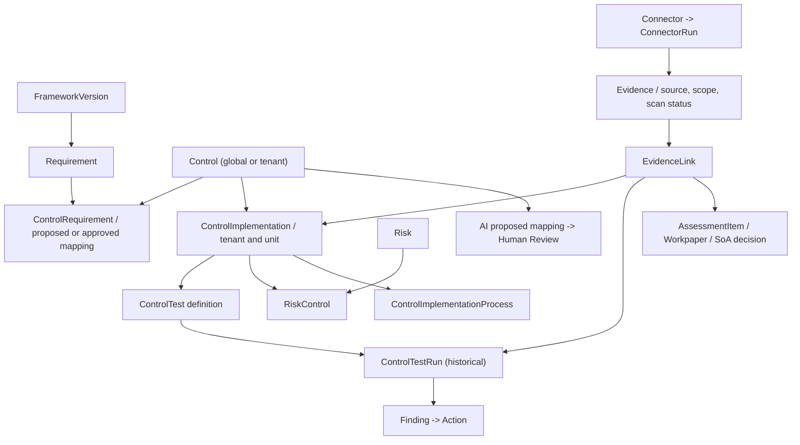

# مشخصات تفصیلی مدیریت کنترل‌ها (Control Management) — GRC Platform

> **شناسه:** GRC-CONTROL-201 · **نسخه:** 0.1.0 · **وضعیت:** DRAFT / برای بررسی تخصصی  
> **تاریخ مبنا:** ۱۴۰۵/۰۷/۲۲ / 2026-10-14 · **Baseline کد:** `main@e7a745c47919f6ec028e429c210bbdfd4589c691`  
> **نسخه پایلوت:** `pilot-20261013-r1` · **ارجاعات:** [PRD](../GRC-PRD-001_FA.md)، [SRS](../GRC-SRS-002_FA.md)، [DATA](../GRC-DATA-003_FA.md)، [API/AI](../GRC-API-AI-004_FA.md)، [UX](../GRC-UX-005_FA.md)، [RTM](../GRC-RTM-006_FA.md)، [UAT](../GRC-UAT-007_FA.md)، [Risk Spec](GRC-RISK-101_FA.md)  
> **واژگان وضعیت:** `AS-IS` رفتار تأییدشده از کد، `OBSERVED` شواهد اجرای محلی، `GAP` شکاف مشخص در قرارداد/UX/آزمون، `TO-BE` طراحی هدف، `POST-V1` توسعه بعدی. **موجود بودن API، سبز بودن CI یا نوشته‌شدن این سند، معادل UAT عملی یا تأیید انطباق نیست.**

## ۱. هدف، محدوده و اصول پایه

### ۱.۱ چرا این ماژول هسته GRC است؟
هدف، مدیریت مشترک **تعریف کنترل**، **نگاشت آن به یک یا چند الزام**، **نحوه اجرای کنترل در واحد واقعی**، **گردآوری شواهد**، **روش و اجرای آزمون اثربخشی** و **ارتباط با ریسک/یافته/اقدام** است. یک کنترل عمومی مانند «پشتیبان‌گیری و بازیابی» می‌تواند برای چند نسخه/چارچوب مفید باشد ولی عملکرد آن در واحد مالی، دیتاسنتر و سایت تولیدی متفاوت است.

اصل طراحی: `Control ≠ ControlRequirement ≠ ControlImplementation ≠ ControlTest ≠ ControlTestRun ≠ Evidence ≠ Compliance Decision`. هیچ یک صرف وجود یا ثبت، تأیید اثربخشی و انطباق دیگری نیست.

### ۱.۲ محدوده R0/R1
- کتابخانه کنترل‌های مرجع سراسری و کنترل‌های متعلق به Tenant.
- دسته‌بندی سلسله‌مراتبی کنترل.
- نگاشت چندبه‌چند به Requirementهای نسخه‌دار با درصد پوشش و وضعیت بازبینی.
- ایجاد/ویرایش/آرشیو کنترل و پیاده‌سازی‌های سازمانی، RBAC و Audit.
- تعریف آزمون، اجرای آزمون، نگهداری نتیجه و Evidence.
- اتصال اجرای کنترل به ریسک و ارزیابی انطباق، نقص و اقدام اصلاحی.
- گزارش‌گیری وضعیت کنترل‌ها، شکاف شواهد و پوشش چارچوب‌ها.
- پیشنهاد نگاشت AI به‌شکل بازبینی‌پذیر و فاقد اختیار تصویب.
- تجربه فارسی/RTL و تاریخ جلالی در UI، ISO در API.

### ۱.۳ خارج از دامنه نسخه نخست
پایش دائم کنترل‌ها (CCM)، تصمیم انطباق بی‌نیاز از بازبین، اسکنر آسیب‌پذیری اختصاصی GRC، Asset Discovery گسترده و اتوماسیون Remediation بدون اختیار انسانی؛ این موارد برای فازهای بعدی‌اند.

## ۲. مدل مفهومی و کاردینالیتی



**روابط موجود:** `ControlRequirement` جدول رابطه بین Control و Requirement؛ `ControlImplementation` برای `tenant,control,organization_unit` یکتا است؛ `ControlTest` به Implementation و `ControlTestRun` به Test متصل‌اند؛ `EvidenceLink` ارجاع عمومی به Domain Object دارد و `control_implementation` و `control_test_run` در رجیستری مشترک Evidence قابل لینک‌اند. `RiskControl` کنترل را از راه *پیاده‌سازی مشخص* به Risk وصل می‌کند. ارتباط ControlImplementation با فرآیند نیز در Context موجود است.

## ۳. فرهنگ داده تفصیلی

### ۳.۱ ControlCategory — طبقه کنترل
| فیلد واقعی | نوع/قید | شرح/UX |
|---|---|---|
| `id` | UUID سیستم | شناسه تغییرناپذیر |
| `tenant` | FK nullable | `null` دسته مرجع global؛ Tenant category محلی |
| `parent` | self FK nullable | والد باید مالکیت یکسان داشته باشد، چرخه ممنوع |
| `code` | Slug 100 | یکتا در مالکیت (Tenant/global) |
| `name` | Char 200 | عنوان فارسی/انگلیسی بر اساس سیاست محتوا |
| `description` | Text اختیاری | تعریف دامنه دسته |
| `deleted_at,created_at,updated_at` | زمان | soft-delete و سابقه |

**AS-IS:** دسته global خواندنی است، دسته محلی توسط `control.manage` سراسری ساخته/ویرایش می‌شود؛ آرشیو دسته دارای فرزند یا کنترل فعال مسدود است. **TO-BE:** UI درخت دسته، جست‌وجو و Copy/Reference برای مرجع.

### ۳.۲ Control — تعریف مشترک کنترل
| فیلد | نوع و مقدار | اجباری | منبع/قاعده |
|---|---|---|---|
| `id` | UUID | خودکار | شناسه پایدار |
| `tenant` | FK nullable | از سرور | `null` = global/reference، برای Tenant فقط کنترل محلی قابل نوشتن |
| `code` | Slug(120) | بله | یکتا در `tenant,code` یا کد global |
| `title` | Char(255) | بله | عنوان کوتاه |
| `description` | Text | خیر | روش یا شرح کلی کنترل |
| `objective` | Text | خیر | خروجی مورد انتظار کنترل |
| `category` | FK nullable | خیر | دسته global یا هم-Tenant |
| `control_type` | enum | پیش‌فرض administrative | `administrative/technical/physical/process` |
| `nature` | enum | پیش‌فرض preventive | `preventive/detective/corrective/directive` |
| `frequency` | Char(80) | خیر | دوره اجرای کنترل؛ AS-IS متن آزاد |
| `automation_level` | enum | پیش‌فرض manual | `manual/semi_automated/automated` |
| `status` | enum | پیش‌فرض draft | `draft/active/archived` |
| `metadata` | JSON | پیش‌فرض {} | فقط Extensions دارای قرارداد |
| `created_by` | FK nullable | از سرور | Actor سازنده |
| `created_at/updated_at/deleted_at` | timestamp | سیستم | کنترل نسخه/آرشیو |

**قواعد:** global control در Tenant قابل ویرایش نیست؛ `POST /controls/{id}/duplicate/` کپی Tenant-specific به حالت draft می‌سازد و mappings مرجع قابل رؤیت را با `approved=false` کپی می‌کند. آرشیو Control دارای پیاده‌سازی غیرآرشیوی رد شود. **حذف global توسط Tenant مجاز نیست.**

**TO-BE:** `test_guidance`, `evidence_expectations`, `risk_reduction_objective`, `applicability_criteria`, `cadence`, `version/revision`, `review_owner`, `review_due`, `standardized_tags`. تا تصویب Data Contract این فیلدها صرفاً پیشنهادند و نباید مخفیانه در Metadata بدون اعتبارسنجی گذاشته شوند.

### ۳.۳ ControlRequirement — نگاشت Control ↔ Requirement
| فیلد | نوع/قید | معنی |
|---|---|---|
| `tenant` | FK nullable | مالکیت محلی/مرجع |
| `control` | FK | Control محلی/مرجع قابل مشاهده |
| `requirement` | FK | بند یک `FrameworkVersion` مشخص و مجاز |
| `coverage` | Decimal(5,2)، 0..100 | **برآورد پوشش نگاشت**، نه امتیاز انطباق |
| `mapping_type` | enum | `exact/strong/partial/related` |
| `rationale` | Text | دلیل متخصص |
| `source` | Char(24) | manual/duplicated/human-reviewed-crosswalk؛ هر منبع باید provenance معتبر داشته باشد |
| `approved` | Boolean | در CREATE همیشه false، ویرایش آن را false می‌کند |
| `created_at/updated_at` | Timestamp | سابقه آخرین وضعیت |

**AS-IS:** `POST /control-requirements/{id}/approve/` با `control.manage` whole-Tenant، نگاشت را `approved=true` و Audit را ثبت می‌کند. **نکته:** داشتن Permission `control.manage` به‌خودی‌خود بازبینی مستقل را تضمین نمی‌کند؛ در کد مرورشده «Approver مستقل از پیشنهاددهنده» شرط صریح نداشت.

**TO-BE:** `mapping_version`, `proposed_by`, `reviewed_by`, `review_comment`, `approved_at`, `source_framework_version_snapshot`، Validation همپوشانی‌های غیرمنطقی، کنترل مستقل Reviewer، منسوخ‌کردن تصویب پس از تغییر Requirement/Control و Version-aware crosswalk. `coverage=100` نباید بر اساس UI به «الزام ۱۰۰٪ رعایت‌شده» ترجمه شود.

### ۳.۴ ControlImplementation — اجرای کنترل در واحد
| فیلد | نوع | قید |
|---|---|---|
| `tenant` | FK | الزامی، از سرور |
| `control` | FK | کنترل همان Tenant یا global فعال |
| `organization_unit` | FK | الزامی؛ **پس از ایجاد قابل جابه‌جایی نیست** |
| `owner` | FK User | عضو فعال Tenant، مسئول پاسخ‌گو |
| `operator` | FK User nullable | عضو فعال Tenant |
| `implementation_description` | Text | چگونه و با چه ابزاری اجرا می‌شود |
| `implementation_status` | enum | `not_implemented/planned/in_progress/implemented/suspended` |
| `effectiveness` | enum | `not_assessed/ineffective/partial/effective` |
| `implementation_date` | Date nullable | در UI جلالی، API ISO |
| `review_date` | Date nullable | موعد بازنگری |
| `metadata` | JSON | توسعه محدود |
| `created_at/updated_at/deleted_at` | زمان | ثبت/آرشیو |

**قید DB:** `unique(tenant,control,organization_unit)`. تغییر واحد یا Control ممنوع؛ اجرای جدید ایجاد شود.

**شکاف مهم AS-IS:** `ControlImplementationSerializer` وضعیت `effectiveness` را به‌عنوان فیلد قابل نوشتن می‌پذیرد؛ تست موجود API حتی ایجاد با `implementation_status=implemented` و `effectiveness=effective` را معتبر فرض می‌کند. بنابراین **نباید مقدار Effectiveness را در گزارش به‌تنهایی معادل آزمون تأییدشده دانست.** ایجاد فرم Detail فعلی محافظه‌کارانه `planned/not_assessed` می‌فرستد؛ اما محدودسازیِ سمت سرور در همه مسیرها ثابت نشده است.

**TO-BE:** `effectiveness_source`, `last_effectiveness_review_id`, `last_verified_test_run_id`, `implementation_evidence_status`, `scope/asset_ids`, `control_owner_approval`, `next_review_at`. مقدار `effectiveness` از نتیجه بررسی معتبر و با مالکیت روشن مشتق شود؛ در مسیر عمومی بدون Review قابل ارتقا نباشد.

### ۳.۵ ControlTest — برنامه/روش آزمون
| فیلد | نوع/مقادیر |
|---|---|
| `control_implementation` | FK لازم |
| `title` | Char(255) |
| `method` | Text لازم، دستورالعمل آزمون |
| `expected_result` | Text |
| `frequency` | `on_demand/monthly/quarterly/semiannual/annual` |
| `owner` | FK User عضو فعال Tenant |
| `automation_type` | `manual/semi_automated/automated` |
| `connector_key` | Char(120) |
| `is_active` | bool |
| `created_at/updated_at/deleted_at` | تاریخچه |

**قواعد TO-BE:** روش آزمون باید شامل دامنه، نمونه/جمعیت، معیار قبول و رد، پیش‌نیاز، گام‌ها، مسئول/بازبین، نمونه Evidence و کنترل نسخه باشد. `connector_key` فقط ارجاع تعریف اتصال مجاز است؛ وجود آن مجوز اجرای دستور دلخواه یا گرفتن داده بیرون از Scope نیست.

### ۳.۶ ControlTestRun — نتیجه هر اجرای آزمون
| فیلد | نوع/مقادیر |
|---|---|
| `control_test` | FK ControlTest |
| `executed_at` | DateTime |
| `executed_by` | FK User nullable، در `run` از Request User |
| `result` | `pass/fail/partial/not_applicable/error` |
| `result_value` | JSON؛ خروجی ساختاریافته آزمون |
| `conclusion` | Text |
| `next_test_date` | Date nullable |
| `created_at/updated_at/deleted_at` | زمان |

**AS-IS مهم:** `POST /control-tests/{id}/run/` یک TestRun ثبت می‌کند و سپس **در همان عملیات** `implementation.effectiveness` را بر اساس `pass→effective`، `partial→partial`، `fail→ineffective` تغییر می‌دهد؛ برای `not_applicable/error` مقدار قبلی حفظ می‌شود. بنابراین آخرین نتیجه آزمون به‌طور مستقیم وضعیت اثربخشی را عوض می‌کند، بدون وجود Gate بازبین مستقل در همان Action. این رفتار باید در محصول رسمی یا با معیار کنترل‌شده پذیرفته شود یا در توسعه بعد اصلاح شود؛ در هر دو حالت نتیجه خام آزمون با «تأیید انسانی اثربخشی» یکسان نیست.

**TO-BE:** اجرای آزمون `Draft→Submitted→Reviewed→Accepted/Rejected`، عکس/فایل/لینک Evidence و Hash، `sample_size`, `population`, `measurement_period`, `reviewed_by/at`, `test_version_snapshot`, `interpretation`، تکرارپذیری و عدم ویرایش خام Run پس از تصویب.

### ۳.۷ Evidence و EvidenceLink مربوط به کنترل
**Evidence (AS-IS):** `tenant,organization_unit,title,description,evidence_type,source,owner,collected_at,valid_until,classification,storage_key,original_filename,mime_type,size,sha256,url,text_content,metadata`.

**EvidenceLink (AS-IS):** `tenant,evidence,object_type,object_id,relation_type` و `supports/proves/references/generated_from`؛ نوع هدف باید در Domain Object Registry با Capability `evidence` تعریف شده باشد. `control_implementation` و `control_test_run` در Registry قابل ارجاع هستند؛ Link باید در Tenant/Scope مجاز باشد.

**Malware boundary واقعی:** آپلود فایل در حالت `pending` برای اسکن قرار می‌گیرد. دانلود فقط وقتی `EVIDENCE_REQUIRE_CLEAN_DOWNLOAD=true` باشد از `status!=clean` منع می‌شود؛ پیش‌فرض در `APP_ENV=production` روشن و در محیط‌های دیگر خاموش است، بنابراین **تنظیم محیط بخشی از معیار پذیرش امنیت فایل است**. Scanner واقعی به اتصال/آزمون جدا نیاز دارد؛ وضعیت اسکن به‌تنهایی صحت محتوای مدرک یا انطباق را ثابت نمی‌کند.

### ۳.۸ موجودیت‌های در ارتباط
- `RiskControl`: Risk ↔ ControlImplementation، نوع `existing/treatment/compensating`، هم‌Tenant/Unit.
- `ControlImplementationProcess`: Scope پیاده‌سازی به فرآیند مشخص.
- `AssessmentItem`: Requirement Snapshot و ارزیابی انطباق؛ نگاشت کنترل فقط یک داده پشتیبان است.
- `Workpaper`: پیوند ممیزی به پیاده‌سازی کنترل و Requirement.
- `Finding`: نقص اثربخشی یا اجرای کنترل و `Action` برای رفع.
- `SoAControlDecision`: گزینش/استثنای کنترل فقط Draft در نسخه فعلی؛ Approve رسمی موجود نیست.
- `ConnectorRun`: منشأ گردآوری خودکار Evidence، نه سند تأیید انطباق.
- `AISuggestion`: متن پیشنهادی نگاشت، نه نگاشت تأییدشده.

## ۴. وضعیت‌ها و چرخه عمر

### ۴.۱ Control — وضعیت واقعی
`draft → active → archived` وضعیت‌های ذخیره‌شدنی‌اند. شرط فعال‌سازی نسخه/تأیید مستقل کامل در کد جاری تضمین نشده و باید در Product Decision تعریف شود.

### ۴.۲ Implementation — سه وضعیت مستقل
| محور | حالت‌ها | تفاوت |
|---|---|---|
| اجرای کنترل | not_implemented, planned, in_progress, implemented, suspended | «کنترل مستقر شده؟» |
| اثربخشی | not_assessed, ineffective, partial, effective | «آیا نتیجه کنترل مناسب است؟» |
| کیفیت Evidence/Review | pending/clean/expired/insufficient/reviewed (ترکیب چند منبع) | «آیا مدرک/آزمون کافی و پذیرفته است؟» |

**قاعده پیشنهاد‌شده:** حتی `implemented+effective` بدون شواهد/آزمون مورد پذیرش باید در داشبورد با نشان `unverified` نمایش داده شود. تبدیل یک Status به «درصد انطباق» بدون روش و تأیید ارزیاب ممنوع.

### ۴.۳ Mapping — تصمیم
`proposed/unapproved → review → approved/rejected → stale/superseded` (**TO-BE**). در AS-IS فقط Boolean `approved` و رکورد Audit وجود دارد؛ پس Rejected/ReviewerVersion هنوز Schema قطعی نیست.

### ۴.۴ TestRun — نتیجه
`created → submitted → reviewed → accepted` (**TO-BE**). `pass/fail/partial/NA/error` نتیجه فنی است و جای Status بازبینی را نمی‌گیرد.

## ۵. تمام صفحات و عملکرد UX

### CTL-SCR-01 — کتابخانه کنترل `/controls`
**AS-IS:** جست‌وجوی Control، ایجاد Draft با Code/Title/Objective/Description، جدول و آمار **نتایج بارگذاری‌شده** شامل تعداد کنترل/نگاشت/پیاده‌سازی.  
**TO-BE:** فیلتر Tenant/global، Framework/Version، Category، Type/Nature/Frequency/Automation/Status، Owner، بدون Implementation/Mapping، Pagination و Export؛ Create/Edit/Archive/Clone متناسب با RBAC؛ خطای Field-level و وضعیت‌های Empty/Loading/Forbidden.

### CTL-SCR-02 — جزئیات کنترل `/controls/[id]`
**AS-IS:** مشخصات/هدف، پوشش نگاشت‌ها، وضعیت `approved`، پیاده‌سازی‌ها؛ فرم «+ نگاشت الزام» به‌صورت تأییدنشده و «+ برنامه پیاده‌سازی» با `planned/not_assessed`.  
**GAP:** UI فعلی از عملیات `approve` نگاشت در همان صفحه استفاده نمی‌کند؛ مسیر API موجود است. ویرایش کامل Control/Mapping/Implementation از همین صفحه دیده نمی‌شود.  
**TO-BE تب‌ها:** معرفی، الزامات/FrameworkVersion، پیاده‌سازی‌ها، آزمون‌ها و آخرین نتیجه، Evidence و اعتبار، ریسک‌های مرتبط، یافته‌ها/اقدامات، تاریخچه/Audit، گزارش‌ها.

### CTL-SCR-03 — فرم کنترل
- هویت: Code*, Title*, Category، Tenant/global readonly، وضعیت/Owner.
- هدف: Objective، Description، Type/Nature/Frequency/Automation.
- راهنمای پیاده‌سازی: Expected Evidence، Typical Tests، References، Retention.
- عملیات: Save Draft، Request Review، Publish/Activate (TO-BE)، Clone Reference، Archive.
- متن هشدار: «تعریف/فعال‌سازی کنترل، اثبات اجرای آن نیست».

### CTL-SCR-04 — فرم نگاشت Control↔Requirement
- انتخاب Framework و Version مجاز → Requirement، `mapping_type`, `coverage` 0..100، `rationale`, `source` معتبر.
- نمایش متن/کد بند فقط طبق حقوق محتوا، بدون ارسال استاندارد محدود به Repo یا AI خارجی.
- Save Draft → Review → Approve مستقل و Audit → Revalidation بعد از تغییر نسخه.
- نمایش واضح «پوشش نگاشت = تخمین ارتباط، نه انطباق».

### CTL-SCR-05 — فرم پیاده‌سازی
- Control*، Unit* (قفل پس از ثبت)، Owner*، Operator، Description، Status، Date، ReviewDate، Asset/Process (در صورت پشتیبانی).
- UI ایجاد باید `planned/not_assessed` را پیش‌فرض بگذارد؛ مقدار `effective` تنها با مسیر Review قابل استناد باشد.
- بررسی امکان‌نداشتن همان `control+unit` دوبار؛ برای تغییر Unit ایجاد Implementation مستقل لازم است.

### CTL-SCR-06 — آزمون‌ها `/control-tests`
**AS-IS:** صفحه صرفاً جدول فهرست Testها با عنوان، کنترل، تناوب، Automation و Active دارد؛ فرم ایجاد/ویرایش/اجرای Run/نمایش History از این صفحه وجود ندارد؛ APIهای ControlTest و ControlTestRun هستند.  
**TO-BE:** فیلتر واحد/کنترل/Owner/NextDue، Create Test، Test Procedure و Expected Result، اجرای امن، انتخاب Result، Evidence، Run History، Reviewer Approval، Issue/Action در Fail، اعلان موعد بعدی.

### CTL-SCR-07 — Evidence `/evidence`
**AS-IS:** دریافت فایل/متن/URL، طبقه‌بندی، منشأ، اعتبار، وضعیت اسکن، Download و شمارنده Link؛ لزوماً در Detail کنترل مسیر Link/Unlink گرافیکی کامل دیده نمی‌شود.  
**TO-BE:** انتخاب Evidence مجاز، Link به Implementation/TestRun، Required Evidence checklist، Pending/Expired/Rejected، مرور/تأیید، نمایش SHA/Source/Run، عدم دانلود فاقد Clean در محیط production.

### CTL-SCR-08 — صفحه نظارتی کنترل‌ها (TO-BE)
شاخص‌های `coverage by requirement`، `implementation by scope`، `effectiveness verified/unverified`، `test pass/fail/stale`، `evidence freshness`، `unowned/unreviewed`، `open findings`. هر شاخص Drill-down به داده منبع و نمایش N/A برای داده خالی دارد.

## ۶. قرارداد API: موجود و هدف

| Capability | مسیر AS-IS | سطح مجوز/شرط |
|---|---|---|
| Category CRUD | `/api/v1/control-categories/` | `control.view` read؛ `control.manage` کل Tenant write |
| Control CRUD | `/api/v1/controls/`, `/{id}/` | `control.view` خواندن؛ `control.manage` whole-Tenant و کنترل local برای نوشتن |
| Clone Reference | `POST /api/v1/controls/{id}/duplicate/` | `control.manage` whole-Tenant؛ کپی در Draft |
| Mapping CRUD | `/api/v1/control-requirements/` | `control.view` خواندن؛ `control.manage` کل Tenant برای نوشتن |
| Approve Mapping | `POST /api/v1/control-requirements/{id}/approve/` | `control.manage` whole-Tenant، Audit؛ استقلال Reviewer **GAP** |
| Implementation CRUD | `/api/v1/control-implementations/` | `control.implementation.view/manage` بر حسب Unit |
| Test CRUD | `/api/v1/control-tests/` | `control.test.view/manage` |
| Execute Test | `POST /api/v1/control-tests/{id}/run/` | `control.test.execute` + Scope (مسیر دریافت Object ممکن است view لازم داشته باشد) |
| TestRun read-only | `/api/v1/control-test-runs/` | `control.test.view` + Scope |
| Evidence | `/api/v1/evidence/`, `/{id}/download/` | `evidence.view/manage` + Scope و Malware Policy |
| EvidenceLink | `/api/v1/evidence-links/` | `evidence.view/manage` + Scope هر دو طرف |
| AI Mapping | `POST /api/v1/ai/assist/control-mapping/` | AI-use + `control.view` و `framework.view` و Provider Policy |

**TO-BE Endpointهای پیشنهادی** مانند `control-implementation/{id}/effectiveness-review/`, `control-tests/{id}/submit-review/`, `control-tests/{id}/review/`, `control-requirements/{id}/review/` و `control-assurance/dashboard/` تنها پس از تصمیم معماری و تولید OpenAPI نسخه‌دار قابل استفاده هستند. وجود آن‌ها در این متن به معنی کد اجرایی نیست.

### ۶.۱ نمونه Payload ایجاد Control
```json
{
  "code": "CTL-BACKUP-001",
  "title": "پشتیبان‌گیری و بازیابی قابل آزمون",
  "objective": "تضمین قابلیت بازیابی سرویس حیاتی",
  "description": "اجرای نسخه پشتیبان و آزمون بازیابی متناسب با RPO/RTO مصوب",
  "control_type": "technical",
  "nature": "corrective",
  "frequency": "daily backup; quarterly restore test",
  "automation_level": "semi_automated",
  "status": "draft"
}
```
`tenant` نباید از payload گرفته شود. این نمونه داده ساختگی است.

### ۶.۲ نمونه Payload ایجاد Implementation
```json
{
  "control": "00000000-0000-4000-8000-000000000101",
  "organization_unit": "00000000-0000-4000-8000-000000000102",
  "owner": 1,
  "operator": null,
  "implementation_description": "Veeam job and scheduled recovery exercise",
  "implementation_status": "planned",
  "effectiveness": "not_assessed"
}
```
شناسه‌ها نمونه‌اند؛ رفتار ایجاد `implemented/effective` از API کنونی در Serializer امکان‌پذیر است و در R1 باید Policy آن مشخص شود.

### ۶.۳ نمونه Payload تعریف آزمون و اجرای آن
```json
{
  "control_implementation": "00000000-0000-4000-8000-000000000103",
  "title": "آزمون بازیابی پرونده",
  "method": "بازیابی فایل آزمایشی در فضای ایزوله و بررسی SHA-256",
  "expected_result": "فایل بدون خطا و با Hash مطابق بازگردانی شود",
  "frequency": "quarterly",
  "owner": 1,
  "automation_type": "manual",
  "is_active": true
}
```
برای `POST /control-tests/{id}/run/` بدنه‌ای مانند زیر پذیرفته می‌شود:
```json
{
  "result": "partial",
  "conclusion": "بازگردانی انجام شد؛ اثبات یکپارچگی ناقص است",
  "result_value": {"files_checked": 2, "files_mismatch": 1},
  "next_test_date": "2026-11-15"
}
```
Server زمان `executed_at` را در صورت فقدان مقدار تعیین می‌کند و `executed_by` را از User فعلی می‌گیرد. `result_value` باید فاقد Secret/PII غیرضروری باشد و Schema کنترل‌شده TO-BE داشته باشد.

### ۶.۴ شکل خطای هدف
```json
{
  "error": {
    "code": "CONTROL_REVIEW_REQUIRED",
    "message": "اثربخشی کنترل هنوز به‌صورت مستقل تأیید نشده است.",
    "fields": {"effectiveness": ["ثبت وضعیت مؤثر، نیازمند آزمون و بازبینی مجاز است."]},
    "request_id": "request-uuid"
  }
}
```
**این Schema پیشنهادی است**؛ API فعلی DRF ممکن است خطا را در ساختار ساده فیلدی برگرداند و تغییر آن نیازمند سازگاری مشتریان API است.

## ۷. RBAC و تفکیک مسئولیت

| عملیات | AS-IS Permission | قید تکمیلی TO-BE |
|---|---|---|
| مشاهده Control/Category/Mapping | `control.view` | Scope و Content Rights |
| ایجاد/ویرایش Control/Category | `control.manage` whole-Tenant | Review قبل از فعال‌سازی با Role جدا |
| Clone Global | `control.manage` whole-Tenant | بازبینی مستقل نگاشت کپی |
| Create/Edit/Approve Mapping | `control.manage` whole-Tenant | `control.mapping.approve` مستقل و No Self-Approve |
| مشاهده Implementation | `control.implementation.view` بر حسب Unit | مخفی‌سازی شواهد محرمانه مرتبط |
| مدیریت Implementation | `control.implementation.manage` بر حسب Unit | اثربخشی confirmed از User عمومی گرفته نشود |
| مشاهده Test/TestRun | `control.test.view` | Scope و Confidentiality |
| مدیریت Test | `control.test.manage` | جدا از Execute/Review |
| اجرای TestRun | `control.test.execute` | `control.test.review` مستقل در TO-BE |
| Evidence View/Link | `evidence.view/manage` | Unit هر دو طرف + Classification |
| تحلیل AI نگاشت | AI-use + `control.view` + `framework.view` | Policy AI و Human Approval |

**Security guardrail:** پنهان‌کردن Button کافی نیست؛ Direct API، UUID قابل حدس و Queryهای جست‌وجو نیز باید RBAC را اعمال کنند.

## ۸. گردش‌کارهای سرتاسری

### CTL-FLOW-01 — تعریف و انتشار کنترل
انتخاب Scope → ایجاد Draft Control → بررسی دسته/هدف/شرح → پیشنهاد Review → Activate/Approve طبق نقش (TO-BE) → ثبت History؛ تعریف کنترل خودش هیچ Evidence یا پیاده‌سازی ایجاد نمی‌کند.

### CTL-FLOW-02 — نگاشت به چند استاندارد
انتخاب Control → FrameworkVersion/Requirement مجاز → Coverage, MappingType,Rationale,Source → ایجاد Unapproved → بازبینی متخصص و تأیید → استفاده در گزارش Coverage؛ تغییر نگاشت یا منبع، تصمیم قبلی را stale کند (TO-BE).

### CTL-FLOW-03 — برنامه و اجرای کنترل
انتخاب Control فعال/محلی → Unit و Owner → پیاده‌سازی `planned/not_assessed` → برنامه اجرا/Action → ثبت اجرایی با Evidence → تأیید وضعیت `implemented` → تعیین نیاز آزمون مستقل. اگر Unit تغییر کند Implementation جدید ساخته شود.

### CTL-FLOW-04 — آزمون اثربخشی
Test Definition (method/expected/frequency/owner) → اجرای ایمن در زمان مشخص → TestRun با Result/Conclusion/Reference Evidence → Reviewer مستقل نتیجه را بپذیرد/رد کند (TO-BE) → تغییر محاسبه Effectiveness معتبر → در صورت Fail، Finding/Action و موعد تکرار آزمون.

### CTL-FLOW-05 — گردآوری Evidence خودکار
Connector مجاز، Read-only Sync → Normalized Facts/Provenance + `ConnectorRun` → Evidence در Scope/Classification درست → Malware/Validation در صورت فایل → Link به Implementation/TestRun → Human Review → فقط در صورت کفایت ممکن است به نتیجه ارزیابی کمک کند؛ **Sync موفق ≠ Control Effective**.

### CTL-FLOW-06 — ارتباط کنترل و ریسک
Risk → `RiskControl` به Implementation هم‌دامنه → Inherent/Residual ارزیابی مستقل → Treatment/Action → آزمون کنترل/شواهد → ارزیابی مجدد Residual → گزارش RTP؛ تغییر Status Control اثر خودکار بی‌مجوز بر امتیاز Risk نداشته باشد.

### CTL-FLOW-07 — گزارش و داشبورد
Scope/FrameworkVersion/Date/Status/Owner → ساخت Dataset مجاز → شمارش نگاشت‌های approved با معنای درست → وضعیت Implemented جدا از Verified Effective → N/A برای Test/Evidence نداشته‌ها → Drill-down، زمان استخراج و Audit Export.

## ۹. هوش مصنوعی اختصاصی کنترل

### ۹.۱ AS-IS
`POST /api/v1/ai/assist/control-mapping/` با ورودی `control_id, requirement_ids[], provider_id?, classification?`؛ Handler نیازمند مشاهده Control/Framework بوده و در نسخه بررسی‌شده تعداد Candidate Requirements را محدود می‌کند. خروجی `AIInteraction + AISuggestion` از نوع `control_mapping` با متن پیشنهادی است؛ **هیچ `ControlRequirement.approved` را خودکار تغییر نمی‌دهد.**

### ۹.۲ Contract هدف ورودی (Data minimization)
| دسته | داده مجاز از Backend | ممنوع/شرط |
|---|---|---|
| Control | ID, Code, Title, Objective, Description, Type/Nature | Scoped authorization |
| Requirement | Framework/Version/Code/متن مجاز | Rights Review و Redaction |
| Implementation | Unit/Owner/Status/Description حداقلی | Confidentiality و Scope |
| Test | Method, Expected, latest Run, Review Status | شواهد واقعی، نه Score مصنوعی |
| Evidence | Source/Date/Validity/Hash/Abstract | فایل حساس فقط مطابق Provider Policy |
| Risk | Related Risk Scenario و سطح ارزیابی معتبر | Risk scope permission مستقل |
| Task | `control_mapping, test_design, evidence_gap, draft` | versioned response schema |
| Provider | ID/Model/Policy/Egress/Token Budget | Secret فقط Server-side |

### ۹.۳ Contract هدف خروجی
```json
{
  "schema_version": "grc.control.ai.v1",
  "status": "suggestion",
  "subject": {"type": "control", "id": "00000000-0000-4000-8000-000000000101"},
  "mapping_candidates": [
    {"requirement_id": "00000000-0000-4000-8000-000000000201", "mapping_type": "partial", "coverage_proposal": 60, "rationale": "نیازمند بازبینی", "source_ids": []}
  ],
  "test_proposals": [
    {"title": "آزمون بازیابی آزمایشی", "method": "بازیابی در محیط ایزوله", "expected_result": "صحت فایل‌ها"}
  ],
  "evidence_gaps": [
    {"statement": "نتیجه آزمون بازیابی معتبر موجود نیست", "source_ids": [], "certainty": "unknown"}
  ],
  "unknowns": ["اثربخشی مستقل تأیید نشده است"],
  "human_review_required": true,
  "is_compliance_decision": false
}
```
**TO-BE:** تمام `source_ids` و `requirement_id` در سرور بازاعتبارسنجی شوند؛ داده بازیابی‌شده دستور معتبر نیست؛ AI نباید Approval، Effective یا Compliance Status نهایی ایجاد کند.

## ۱۰. گزارش‌ها، معیارها و فرمول‌های هدف

| شناسه | نام/هدف | محاسبه و مرز |
|---|---|---|
| RPT-CTL-01 | کتابخانه کنترل‌ها | کنترل به تفکیک global/local/category/status؛ تعداد visible نه لزوماً کل Tenant |
| RPT-CTL-02 | Requirement Coverage | نسبت Requirementهای در دامنه با Mapping مصوب؛ **نه Compliance Score** |
| RPT-CTL-03 | Mapping Quality | تعداد approved/unapproved/stale + Coverages و Reviewer |
| RPT-CTL-04 | Implementation Status | تفکیک Not Implemented/Planned/In Progress/Implemented/Suspended |
| RPT-CTL-05 | Verified Effectiveness | تعداد/نسبت اجراهای دارای Review و Test معتبر؛ unknown جدا |
| RPT-CTL-06 | Test Run Trend | Pass/Fail/Partial/NA/Error با دامنه/تاریخ |
| RPT-CTL-07 | Test Due/Overdue | تاریخ آزمون بعدی از Plan و آخرین Run معتبر و Timezone |
| RPT-CTL-08 | Evidence Freshness | معتبر/منقضی/فاقد مدرک/اسکن‌نشده؛ Hash و Provenance |
| RPT-CTL-09 | Risk-Control-Action | Risk مرتبط، Treatment، Finding، CAPA و Actor |
| RPT-CTL-10 | Comparative Framework | یک Control در چند Requirement/FrameworkVersion |
| RPT-CTL-11 | Connector Assurance | تعداد Evidence/Run موفق/شکست/تأخیر، بدون اعلام Compliance |

**قالب‌ها:** در طراحی هدف PDF/DOCX/XLSX/CSV به اقتضای گزارش؛ لازم است `ReportCatalog` واقعی گسترش داده شود. نسخه فعلی Catalog مستقل و اختصاصی برای همه RPT-CTL-xxهای بالا **وجود ندارد یا در این مرور اثبات نشده است**؛ نباید آن‌ها را محصول آماده معرفی کرد.

**فرمول پیشنهادی:** `verified_effectiveness_rate = #Implementations with valid approved test evidence / #Implementations in assessed scope`، اما *مخرج، تعریف اعتبار، Scope و سیاست رد N/A* باید تصویب و برای هر گزارش کنار درصد نشان داده شوند.

## ۱۱. ماتریس قواعد اعتبارسنجی و شکاف‌ها

| Rule | وضعیت | انتظار |
|---|---|---|
| CTL-VAL-01 | AS-IS | Code یکتا برای Tenant/global؛ Global read-only |
| CTL-VAL-02 | AS-IS | Control Category از Scope معتبر؛ بدون چرخه |
| CTL-VAL-03 | AS-IS | Implementation Control/Unit/Owner/Operator مجاز و در Tenant |
| CTL-VAL-04 | AS-IS | Implementation واحد/Control تغییرناپذیر |
| CTL-VAL-05 | AS-IS | Mapping Requirement/Control قابل رؤیت؛ Coverage 0..100 |
| CTL-VAL-06 | AS-IS | Mapping create/update `approved=false`؛ Approval Action جدا |
| CTL-VAL-07 | GAP | Mapping Approver مستقل و تاریخچه تصمیم/نسخه کامل |
| CTL-VAL-08 | GAP | Effectiveness `effective` مستقیم در Serializer عمومی قابل نوشتن است |
| CTL-VAL-09 | GAP | TestRun `pass` می‌تواند بدون Review مستقل Effectiveness را تغییر دهد |
| CTL-VAL-10 | GAP | ایجاد/اجرای TestRun/History در UI `/control-tests` کافی نیست |
| CTL-VAL-11 | GAP | اعتبارسنجی Evidence لازم/کفایت/Review قبل از Effective |
| CTL-VAL-12 | GAP | Mapping/Control/Test تغییرپذیر بدون Snapshot تصویب‌شده مستقل |
| CTL-VAL-13 | TO-BE | تاریخ جلالی در UI با ISO API و Timezone صحیح |
| CTL-VAL-14 | TO-BE | Global Clone بدون سرایت `approved=true` |
| CTL-VAL-15 | TO-BE | Failure Test به Finding/Action با سیاست انتخاب و بازبینی وصل شود |
| CTL-VAL-16 | TO-BE | N/A و Error آزمون نباید به Pass تبدیل شوند |
| CTL-VAL-17 | AS-IS config-dependent | Download فایل در Production باید Clean Gate را پاس کند |
| CTL-VAL-18 | TO-BE | Evidence/Link مربوط به Unit/Classification/Target Object معتبر |
| CTL-VAL-19 | GAP | فرم/نمای جزئیات Control برای ویرایش، Approval، Test و Evidence کامل نیست |
| CTL-VAL-20 | TO-BE | KPI انطباق از Coverage/Effectiveness خوداظهاری ساخته نشود |

### فهرست شکاف‌ها برای Issue/PR
| Gap | یافته | اولویت پیشنهادی | نوع شاهد |
|---|---|---|---|
| CTRL-GAP-01 | `ControlImplementation.effectiveness` از API بدون Review مستقل قابل ارسال است | P1 حاکمیت/دقت | بررسی Serializer و تست API |
| CTRL-GAP-02 | اجرای `ControlTest.run` مستقیماً Effectiveness را تغییر می‌دهد | P1 حاکمیت | بررسی View |
| CTRL-GAP-03 | تست‌ها در UI فقط فهرست‌اند؛ Create/Run/History/Review ندارند | P1 UX | بررسی Frontend |
| CTRL-GAP-04 | تأیید نگاشت API دارد اما UI جزئیات فقط نمایش می‌دهد | P1 UX | بررسی Frontend |
| CTRL-GAP-05 | تأیید Mapping توسط `control.manage` مستقل از Creator در کد enforce نشده | P1 SoD | بررسی View/Policy |
| CTRL-GAP-06 | Versioning/Snapshot صریح Control/Mapping/TestMethod برای Decisionهای تاریخی کامل نیست | P1 Data Integrity | بررسی Model |
| CTRL-GAP-07 | وضعیت `implemented/effective` و Evidence کیفیتی در گزارش باید تفکیک شوند | P1 Reporting | Domain design |
| CTRL-GAP-08 | Evidence malware download به Config وابسته است؛ نیاز به Gate محیط مشتری و اسکن واقعی | P0 در Customer Gate | settings + evidence |
| CTRL-GAP-09 | فیلدهای دوره آزمون/نمونه/Reviewer و معیار قبول تکمیل نشده‌اند | P1 Assurance | بررسی Model |
| CTRL-GAP-10 | نمایش و مدیریت لینک‌های Evidence/ControlTest/Action از Detail ناقص است | P1 Traceability | بررسی UI |
| CTRL-GAP-11 | تقویم جلالی، خطای دقیق و گزارش چاپی RTL نیازمند تکمیل است | P1 | #182 + UX |
| CTRL-GAP-12 | همه سناریوهای Create→Mapping→Implementation→Test→Evidence→Finding→Report روی پایلوت واقعی آزمون نشده‌اند | P0/P1 UAT | #161 |

هیچ‌یک از GAPهای فوق به‌تنهایی ادعای وقوع حادثه امنیتی در محیط مشتری نیست؛ معیارهای بازبینی و Gateها باید بر نسخه دقیق نرم‌افزار آزمایش شوند.

## ۱۲. ACهای ماژول
| AC | معیار پذیرش قابل آزمون |
|---|---|
| CTL-AC-01 | Control Draft با داده کامل ایجاد و بعد از Reload باقی بماند |
| CTL-AC-02 | Global Control فقط Read-only و Clone آن Draft با Mapping تأییدنشده باشد |
| CTL-AC-03 | یک Control به دو Requirement از دو FrameworkVersion مجاز Mapping شود |
| CTL-AC-04 | Mapping Create/Update تأییدنشده و Review/Approval با Actor و Audit معتبر باشد |
| CTL-AC-05 | Implementation هم-Unit/Owner معتبر باشد؛ Cross-Tenant/Unit رد شود |
| CTL-AC-06 | ثبت Implementation به‌تنهایی KPI مؤثرِ تأییدشده ایجاد نکند |
| CTL-AC-07 | Test Definition با Method/Expected/Frequency/Owner قابل ثبت و نمایش باشد |
| CTL-AC-08 | TestRun تاریخی با Result/Conclusion/Actor/Time ذخیره، بعد از Refresh باقی بماند |
| CTL-AC-09 | ارتقای Effectiveness منوط به Review/شواهد معتبر و تفکیک وظایف باشد (TO-BE) |
| CTL-AC-10 | Evidence مجاز به Implementation و Run لینک شود، Cross-Scope و malware gate enforce شوند |
| CTL-AC-11 | Fail آزمون بتواند Finding/Action با لینک منبع بسازد بدون Closure خودکار |
| CTL-AC-12 | RiskControl به Implementation هم-Unit وصل شود و Assessment از Test جدا بماند |
| CTL-AC-13 | داشبورد Verified/Unverified/NotAssessed/Expired را جدا نشان دهد |
| CTL-AC-14 | تاریخ و خروجی چاپ فارسی بدون drift و افشای داده باشد |
| CTL-AC-15 | AI فقط پیشنهاد مستند بدهد و Approval خودکار انجام ندهد |
| CTL-AC-16 | تست منفی Tenant/Unit/Role/Global/Approval و Audit PASS باشد |

## ۱۳. Definition of Done و ملاک قبول تحویل
- کد/داده/صفحه/Report مرتبط با AC در PR/Issue قابل ردیابی باشند.
- تست Backend API و Frontend واقعی برای Role/Scope + Negative IDOR و پایداری بعد از Reload داشته باشیم.
- مسیر `Control → Mapping → Implementation → Test → Evidence → Review → Finding/Action → Report` با داده ساختگی و Screenshot مجاز اجرا شود.
- `effective` صرفاً از ثبت دستی یا `pass` خوداظهاری به‌عنوان VERIFIED گزارش نشود.
- Scanner و Download Gate روی Production Profile واقعی آزمون شوند؛ mock CI جای آزمون خارجی نیست.
- محتوای استاندارد دارای حق نشر و Credentials به Repository عمومی یا Prompt خارجی وارد نشوند.
- گزارش واقعی در PDF/DOCX/XLSX صرفاً برای قالب‌های پیاده‌شده PASS اعلام شود.
- Release امضاشده جدید و SHA دقیق پس از Merge و QA لازم است؛ این سند هیچ Runtime تغییر نمی‌دهد.

## ۱۴. تصمیم‌های باز برای Product/Tech/Security
- **DEC-CTL-01:** Global Control در گزارش‌های Tenant چگونه نشان داده شود و آیا Clone الزامی است؟
- **DEC-CTL-02:** `coverage` برای Mapping چگونه تعریف/بازبینی شود تا با Compliance Score اشتباه نشود؟
- **DEC-CTL-03:** Permission جدید `control.mapping.approve` و جدایی Creator/Reviewer در R1 ضروری است؟
- **DEC-CTL-04:** چه مدرک/آزمونی برای اعلام `effectiveness=effective` کفایت می‌کند؟
- **DEC-CTL-05:** آیا Result خودکار فقط Draft Assurance ایجاد می‌کند یا می‌تواند با Policy Approval وضعیت مؤثر دهد؟
- **DEC-CTL-06:** بازه زمانی اعتبار Test، میزان نمونه و مدیریت N/A چیست؟
- **DEC-CTL-07:** آیا Effectiveness پس از انقضا به `not_assessed` برگردد یا با «stale» مستقل نمایش داده شود؟
- **DEC-CTL-08:** تکلیف فایل‌های Scanner disabled در محیط آزمایشی و شرط تشخیص Production چیست؟
- **DEC-CTL-09:** Versioning استاندارد/Control/Test/Evidence برای تأیید رسمی چه Snapshotهایی لازم دارد؟
- **DEC-CTL-10:** قالب گزارش فارسی و امکان امضای مسئول کنترل در چه نسخه‌ای تعهد می‌شود؟

---
**منابع کد بررسی‌شده:** `backend/apps/controls/{models,serializers,services,views,urls,tests}.py`، `backend/apps/evidence/{models,serializers,services,views}.py`، `backend/config/settings.py`، `backend/apps/common/domain_objects.py`، `backend/apps/ai_gateway/views.py`، `backend/apps/reporting/formal_reports.py`، `frontend/app/controls/{page.tsx,[id]/page.tsx}`، `frontend/app/control-tests/page.tsx`، `frontend/app/evidence/page.tsx`. 
