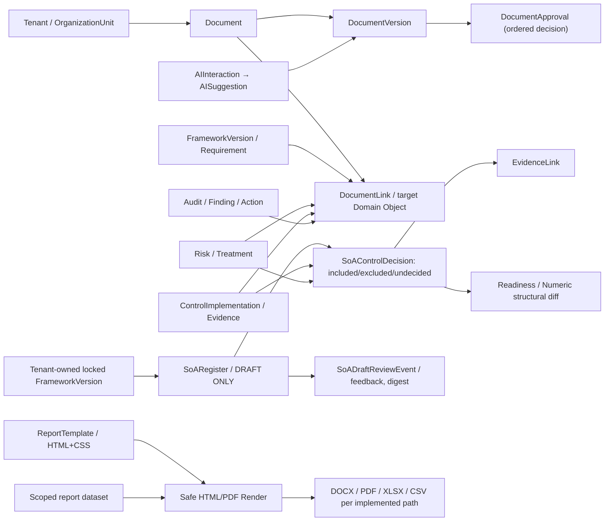

# مشخصات تفصیلی مدیریت اسناد، قالب‌ها، تولید گزارش و SoA — GRC Platform

> **شناسه سند:** GRC-DOCUMENT-SOA-501 · **نسخه:** 0.1.0 · **وضعیت:** DRAFT — در انتظار تصویب مالک محصول، معمار، امنیت، QA و مسئول حقوق محتوا  
> **تاریخ مبنا:** ۱۴۰۵/۰۷/۲۲ / 2026-10-14 · **Source Baseline:** `main@e7a745c47919f6ec028e429c210bbdfd4589c691` · **پایلوت ثابت:** `pilot-20261013-r1`  
> **وابستگی‌ها:** [PRD-001](../GRC-PRD-001_FA.md)، [SRS-002](../GRC-SRS-002_FA.md)، [DATA-003](../GRC-DATA-003_FA.md)، [API/AI-004](../GRC-API-AI-004_FA.md)، [UX-005](../GRC-UX-005_FA.md)، [RTM-006](../GRC-RTM-006_FA.md)، [UAT-007](../GRC-UAT-007_FA.md)، [Risk-101](GRC-RISK-101_FA.md)، [Control-201](GRC-CONTROL-201_FA.md)، [Compliance-301](GRC-COMPLIANCE-301_FA.md)، [Evidence/Audit-401](GRC-EVIDENCE-AUDIT-401_FA.md).
>
> **وضعیت‌ها:** `AS-IS` رفتار منطبق با کد بررسی‌شده؛ `OBSERVED` خروجی آزمایش واقعی؛ `GAP` نارسایی/ابهام؛ `TO-BE` نیازمندی هدف؛ `POST-V1` توسعه آتی. تأیید نسخه **Document**، تأیید متن یک استاندارد دارای حق نشر، بازخورد پیش‌نویس **SoA** و تأیید رسمی انطباق **چهار مفهوم جداگانه** هستند.

## ۱. چشم‌انداز محصول و مرز ادعا

هدف: فراهم کردن یک **سامانه کنترل مستندات (DMS)** و **کارخانه تولید مستندات قابل ردیابی GRC** برای سیاست‌ها، رویه‌ها، دستورالعمل‌ها، طرح‌ها، صورتجلسات، گزارش ممیزی، برنامه درمان ریسک، فرم‌ها و گزارش‌های قابل ارائه به مدیران/ممیزان. سند باید نسخه، مالک، محدوده، متن/ضمیمه، تأییدکننده، ارتباط با الزام/ریسک/کنترل/شاهد و تاریخچه داشته باشد. خروجی‌های Word/PDF/XLSX تنها اگر **واقعاً پیاده و آزمایش شده‌اند** اعلام شوند.

### مفاهیم غیرقابل‌جایگزینی
- **Controlled Document:** سند داخلی با نسخه و تصمیم‌های تأیید مشخص؛ لزوماً متن مقرره یا گزارش انطباق نیست.
- **DocumentVersion:** محتوای نسخه؛ `APPROVED` آن فقط تأیید داخلی همان نسخه است، نه انطباق کل سازمان.
- **DocumentApproval:** رأی تخصیص‌یافته به یک نسخه، نه مجوز کلی ممیزی یا اعتبار ISO.
- **ReportTemplate:** قالب چاپ/رندر؛ وجود قالب به معنی معتبر بودن Dataset یا امضای خروجی نیست.
- **FormalReport:** Dataset فیلترشده از رکوردهای سیستم + renderer/format، با Scope و زمان استخراج.
- **AI document draft:** پیشنهاد برای **پیش‌نویس** با فرضیات مشخص؛ فاقد اختیار انتشار/تصویب.
- **SoA Draft Register:** پرونده انتخاب/عدم انتخاب کنترل با استدلال و ارتباطات؛ در نسخه فعلی فقط Draft.
- **SoA Draft Review Event:** ثبت نظر بازبین مستقل روی همان پیش‌نویس؛ **نه Approve و نه امضای SoA رسمی**.
- **SoA رسمی (TO-BE):** بیانیه کاربردپذیری مبتنی بر فهرست کامل کنترل‌های لازم، منابع دارای حقوق استفاده، توجیه تصمیم‌ها، وضعیت پیاده‌سازی و بررسی انسانی سازمان؛ امضای مجاز و نسخه ثابت مستقل لازم دارد.

## ۲. نقشه ارتباط ماژول‌ها



**توجه:** `DocumentLink` در مدل/Serializer موجود است ولی در `documents/urls.py` Router مستقلی برای CRUD آن در این Baseline ثبت نشده است؛ بنابراین نباید «رابط اتصال اسناد به همه رکوردها» را پیاده‌شده اعلام کنیم. ارتباط SoA Decision با Evidence از `EvidenceLink` عمومی با `object_type=soa_decision` انجام می‌شود.

## ۳. فرهنگ داده مدیریت اسناد

### ۳.۱ Document
| فیلد مدل | نوع/محدوده | قاعده |
|---|---|---|
| `id` | UUID | شناسه پایدار |
| `tenant` | FK، Server-managed | از نشست؛ Cross-Tenant ممنوع |
| `organization_unit` | FK nullable | `null` کل سازمان، Whole-Tenant permission |
| `document_type` | enum | `policy/procedure/standard/guideline/plan/charter/form/record/report/minutes` |
| `code` | Char(120) | unique(Tenant,Code) |
| `title` | Char(255) | عنوان |
| `owner` | FK User | عضو فعال همان Tenant با `document.view` در Scope |
| `status` | enum | `draft/review/approved/published/deprecated`، از API نوشتنی نیست |
| `review_date` | Date nullable | API ISO، UI شمسی هدف |
| `current_version` | FK DocumentVersion nullable | Server-managed |
| `metadata` | JSON | توسعه محدود به Schema تأییدشده |
| `created_at/updated_at/deleted_at` | تاریخ/حذف نرم | تاریخچه |

**AS-IS:** `GET/POST/PATCH/DELETE /api/v1/documents/` با `document.view/manage` Scoped؛ تغییر Unit در حالتی که نسخه جاری وارد Governance شده یا Approval دارد محدود می‌شود؛ آرشیو در حالت Review ممنوع و با `status=deprecated` soft-delete است. وضعیت دستی از Serializer نمی‌تواند جای Transition را بگیرد.

**TO-BE فیلدهای تکمیلی:** `document_classification,confidentiality,distribution_list,external_reference,document_purpose,review_interval,retention_class,legal_hold,required_roles,withdrawn_reason,approval_policy_id,signature_policy_id,language,organization_branding`. هرکدام Migration/Rule مستقل نیاز دارد.

### ۳.۲ DocumentVersion
| فیلد | نوع و رفتار |
|---|---|
| `document` | FK Document، بعد از ایجاد ثابت |
| `version` | Char(40)، یکتا در همان سند |
| `content` | Text، محتوای نسخه |
| `storage_key` | Char(512)، در Serializer کنونی **قابل نوشتن** است، اما مسیر آپلود امن نسخه در ماژول اسناد مشاهده نشده |
| `change_summary` | Text |
| `created_by` | FK User، از سرور |
| `status` | `draft/review/approved/published/superseded`، Server-managed |
| `created_at/updated_at/deleted_at` | تاریخ و حذف نرم |

**AS-IS:** ایجاد نسخه در Transaction، `document.current_version` را تنظیم می‌کند؛ Draft جاری قابل PATCH/Archive است؛ Submit فقط با Approval Assignmentهای Pending و دارای دسترسی معتبر، Status را Review کرده و تغییر محتوا را متوقف می‌کند. خروجی `GET /document-versions/{id}/export/` یک **DOCX ساده از Title و Content** تولید می‌کند؛ وجود rich text/sections/header/footer/watermark/تضمین RTL در این Export در کد مشاهده نشد.

**TO-BE:** `content_format,content_hash,attachment_id,source_snapshot,generated_from_report_dataset_id,locked_at,document_owner_review,change_impact,diff,previous_version_id,approval_snapshot,publication_time`، File/Blob versioning و ضدبدافزار مستقل؛ اجازه ویرایش `storage_key` آزاد از Client نیازمند بازطراحی است.

### ۳.۳ DocumentApproval
| فیلد | نوع/قید |
|---|---|
| `version` | FK DocumentVersion |
| `approver` | FK کاربر فعال دارای `document.view` + `document.approve` در Scope |
| `approval_order` | PositiveInteger (مرحله تصمیم) |
| `decision` | `pending/approved/rejected/changes_requested` |
| `comment` | Text |
| `decided_at` | Timestamp |
| `created_at/updated_at/deleted_at` | Audit/History |
| Unique | `version + approver` |

**AS-IS:** Approver Assignment فقط روی Current Draft با `document.manage` قابل ایجاد/تغییر/حذف Pending است. `POST /document-versions/{id}/submit/` نیازمند حداقل یک Approver و عضویت/مجوز فعال است. `POST /document-approvals/{id}/decide/` فقط برای Approver همان Assignment، Version در Review و پس از تأیید مراحل قبلی قابل انجام است؛ یک Decision دوباره اعمال نمی‌شود. آخرین Approval مثبت، Version را `approved` می‌کند؛ `rejected/changes_requested` نسخه جاری را `superseded` و سند را Draft بدون Current Version می‌کند؛ Audit و اعلان مرحله بعد وجود دارد.

**GAP:** در `DocumentApprovalSerializer.validate` و `decide` شرط صریح `approver != document.owner` یا `approver != version.created_by` دیده نشد؛ اگر همان Actor مجوز و Assignment داشته باشد، ممکن است Self-Approval را انجام دهد. برای اسناد رسمی استقلال بازبین باید به‌صورت Policy اجباری/پیکربندی‌پذیر طراحی و **آزمون شود**؛ این مشاهده به معنی دورزدن مجوز نیست.

**TO-BE:** `approval_policy_version,approval_role,decision_reason,content_hash_snapshot,valid_from,reviewer_independence,delegation,signature_ref,expiry`؛ موافقت صرف به منزله امضای دیجیتال حقوقی نیست.

### ۳.۴ DocumentLink
`tenant,document,object_type,object_id,relation_type` و Unique `tenant+document+object_type+object_id+relation_type`. Serializer وجود Target در `DomainObjectRegistry` با capability `document_link` و هم‌Tenant بودن را کنترل می‌کند.

**GAP:** Model/Serializer موجود، ولی ViewSet/Route اختصاصی در `documents/urls.py` وجود ندارد؛ به همین دلیل ایجاد/حذف لینک سند از UI/API به‌عنوان قابلیت کامل موجود قابل پذیرش نیست. برای افزودن Route باید Scoped Unit، Classification، Change/Source Target و SoftDelete/Audit مثل `EvidenceLink` سنجیده شود.

### ۳.۵ ReportTemplate
| فیلد | نوع/قید |
|---|---|
| `tenant` | FK nullable؛ `null` = قالب global مرجع |
| `template_type` | `rtp/soa/audit/assessment/executive/custom` |
| `name` | Char(255) |
| `language` | Char(12)، default `fa` |
| `storage_key` | Char(512) |
| `configuration` | JSON، مثلاً `html_template,css` |
| `version` | Char(40)، default `1.0` |
| `is_active` | Boolean |
| `created_at/updated_at/deleted_at` | تاریخ |

**AS-IS:** `/report-templates/` فهرست Tenant و Global را با `report.view` می‌دهد؛ Create نیازمند `report.generate` Whole Tenant است. رندر `POST /reports/render-template/` فقط با Whole-Tenant `report.generate` و Template موجودِ خود یا Global، فرمت `html/pdf` و `context` ارسالی انجام می‌شود. Jinja2 `SandboxedEnvironment` با AutoEscape و StrictUndefined، WeasyPrint فقط با fetcher منابع `data:`، نه HTTP/file، استفاده می‌شوند. **مسیر رندر سند Word از ReportTemplate در این بخش موجود نیست.**

**GAP با اولویت امنیتی (#190):** ViewSet از نوع `ModelViewSet` و `get_queryset` تنها `report.view` را چک می‌کند؛ `perform_update/perform_destroy` ویژه برای `report.generate` یا منع تغییر قالب Global در کد دیده نشد. امکان تغییر Global/قالب محلی به دست Viewer باید فوراً در تست ایزوله بررسی و در صورت بازتولید اصلاح شود؛ Incident اثبات نشده است.

**TO-BE:** `template_revision/content_hash/owner/approver/allowed_dataset_schema/required_context_fields/default_brand/language/font_policy/retention/active_revision/preview_policy/resource_limits`، منع Template Injection/مصرف زیاد CPU/HTML Unsafe و Change Approval؛ Global فقط از مسیر Platform Owner.

## ۴. کنترل SoA پیش‌نویس — مدل واقعی

### ۴.۱ SoARegister
| فیلد | AS-IS |
|---|---|
| `tenant` | FK PROTECT |
| `organization_unit` | FK **اجباری**؛ هم‌Tenant |
| `framework_version` | FK PROTECT؛ باید **tenant-owned** و Locked باشد (Global مرجع به‌تنهایی کافی نیست) |
| `title` | Char(255) |
| `revision` | PositiveInteger >=1 |
| `status` | تنها `draft`؛ فاقد `approved` در مدل |
| `created_by` | FK User |
| Unique | `tenant+unit+framework_version+revision` |
| `created_at/updated_at/deleted_at` | تاریخ |

**AS-IS:** `POST /soa/registers/` فقط `title,organization_unit,framework_version,revision` را قبول می‌کند؛ هرگونه `approved/status/attested` نامجاز است. Whole-Tenant `report.generate` برای ایجاد/ویرایش تصمیم الزامی و `report.view` Scope برای مشاهده لازم است. Endpoint هیچ امضای رسمی صادر نمی‌کند.

### ۴.۲ SoAControlDecision
| فیلد | نوع/قید |
|---|---|
| `register` | FK SoARegister |
| `control` | FK Control مجاز، Global فقط Active |
| `reference_kind` | `annex_a/additional` |
| `source_identifier` | Char(120)، فقط شناسه‌ای که انسان با منبع مطابقت داده |
| `decision` | `undecided/included/excluded` |
| `rationale` | Text، برای included/excluded اجباری |
| `control_implementation` | FK nullable؛ Tenant/Unit/Control یکسان |
| `risk_treatment` | FK nullable؛ همان Tenant/Unit، نیازمند `RiskControl` مرتبط |
| `last_edited_by` | FK User |
| Unique | register+control و register+reference_kind+source_identifier |

**AS-IS:** Excluded نباید Implementation/Treatment داشته باشد. Import فهرست Annex A با متن رسمی استاندارد موجود نیست؛ فقط `source_identifier` دستی و کنترل‌های خود سازمان. Readiness با EvidenceLink/Implementation/RiskTreatment وضعیت‌های ناقص را بررسی می‌کند، نه صلاحیت حقوقی/علمی کل فهرست را.

### ۴.۳ SoADraftReviewEvent
| فیلد | نوع/معنا |
|---|---|
| `register,review_round` | پرونده و شماره دور |
| `kind` | `requested/changes_requested/feedback_recorded/superseded` |
| `is_response` | Request در مقابل Response |
| `actor,assigned_reviewer` | اعضای فعال همان Tenant |
| `note` | Feedback مستدل |
| `draft_digest` | Hash محتوای Draft در زمان درخواست |
| Unique | یک Request و یک Response در هر Round |

**AS-IS:** Review feedback append-only، Reviewer نباید درخواست‌کننده/سازنده یا ویرایشگر تصمیم‌های کنترل همان Draft باشد؛ Digest ناسازگار Feedback قبلی را Stale می‌کند؛ پاسخ مجدد یک Round رد می‌شود. Return flags صریح `formal_attestation_allowed=false` و `is_formal_statement_of_applicability=false` دارند. ثبت `feedback_recorded` **به معنی تصویب SoA نیست**.

### ۴.۴ Readiness و Reference Diff
- `GET /soa/registers/{id}/readiness/`: diagnostic خواندنی؛ Included/Excluded/Undecided، نبود Rationale/Implementation/ارتباط RiskControl/Evidence، وضعیت RiskTreatment و integrity محتوا را گزارش می‌کند. **حقوق استفاده، کافی‌بودن شواهد، پوشش کامل کنترل‌های سازمان و امضای رسمی را تأیید نمی‌کند.**
- `GET /soa/registers/{id}/reference-diff/?reference=iso-iec-27001-2022-annex-a-structure-only`: صرفاً فهرست **۹۳ شناسه عددی** ساختار Annex A را با Source Identifiers Draft مقایسه می‌کند؛ **۹۳ مورد نه الزام به انتخاب ۹۳ کنترل در هر سازمان است و نه اثبات ویرایش/متن قانونی استاندارد**.
- مسیر قدیمی `GET /reports/soa/{assessment_id}/` و `type=soa` در Report Catalog صرفاً کاربرگ `DRAFT / NOT APPROVED` می‌سازند. این‌ها با SoARegister Draft و فرآیند رسمی آینده هم‌معنی نیستند.
- **TO-BE:** `SoASourceApproval`, `SoASelectionReview`, `SoAFormalVersion`, `SoASignature`, `applicability_classification`, `justification`, `implementation_status_snapshot`, `evidence_verification`, `risk_treatment_snapshot`, `effective_date`, `supersedes` و Gateهای استقلال؛ تنها پس از بازبینی حقوقی/محصولی/انطباق قابلیت Approved ایجاد شود.

## ۵. چرخه حیات جداگانه

### ۵.۱ Document (AS-IS)
```text
Document Draft
  └─ Create current Version Draft
       ├─ Edit/Remove current Draft (with manage permission)
       ├─ Assign approvers + ordered stages
       └─ Submit -> Version REVIEW / Document REVIEW
             ├─ Approver 1 approved -> next stage (pending)
             ├─ all stages approved -> Version APPROVED / Document APPROVED
             └─ rejected/changes_requested -> Version SUPERSEDED / Document DRAFT
                 (new Draft Version is needed)
```
`PUBLISHED` در Enum وجود دارد، ولی در Viewهای مرورشده Endpoint مستقل `publish` برای نسخه مشاهده نشد؛ پس عبارت «انتشار رسمی سند» تا پیاده‌سازی مسیر مستقل و UAT نباید وضعیت عملیاتی قطعی تلقی شود.

**GAP:** وضعیت `document.status` و `current_version` بعد از رد/تغییرخواسته نیازمند UX واضح است؛ UI باید نسخه ردشده را در History قابل بازیابی و ایجاد نسخه اصلاحی را روشن کند. Approval باید با Content Hash مشخص همراه باشد تا تغییرات بیرون از مسیر API باعث بازبینی نادیده گرفته‌شده نشوند.

### ۵.۲ SoA (AS-IS در مقایسه با هدف)
```text
AS-IS: Locked tenant-owned framework + Unit
  -> Draft Register -> Control Decisions -> Readiness + Structural Diff
  -> Draft Review Request -> Independent Feedback / Stale Round
  -> Draft continues. NO formal approval, signing or attestation.
TO-BE (separate future model):
  Licensed source and inventory review -> full selection rationale
  -> implementation/evidence verification -> independent approval package
  -> controlled, immutable signed version -> supersession/expiry/review
```
تا ساخت مسیر رسمی، «آمادگی» صرفاً تشخیص نواقص است، نه `Ready for Attestation`.

### ۵.۳ Workflow engine عمومی
`WorkflowDefinition/State/Transition/Instance/Event` برای ObjectTypeهای دارای Registry Capability `workflow` و Tenant/Unit موجود است، اما تعریف یک Workflow `approved` به معنای تغییر خودکار `DocumentVersion` یا `SoARegister` نیست. **TO-BE** باید Domain Eventها، قفل داده، استقلال نقش و تفاوت تصویب‌های سند با SoA را در Integration مشخص کند.

## ۶. کاتالوگ صفحه‌ها

| Screen ID | مسیر فعلی | AS-IS | TO-BE |
|---|---|---|---|
| DOC-UI-01 | `/documents` | دفتر اسناد با جست‌وجو، نوع/وضعیت، Create/Edit/Archive، نسخه‌ها، Approval Assignment و Decision | داشبورد طبقه‌بندی/سررسید/نسخه، Full-text Search، Tag، Preview، Header و Template |
| DOC-UI-02 | `/documents` بخش نسخه | Create/Edit Draft، Change Summary، Export DOCX، Submit Review | Editor حرفه‌ای RTL، Compare Versions، Attachments/Evidence/AI import & review |
| DOC-UI-03 | `/documents` بخش Approval | Approver Candidates، Order، Submit، Approve/Reject/Changes Requested | Inbox مستقل، Delegation، Policy و Content Hash، امضا/Notified |
| DOC-UI-04 | `/reports` | Catalog + Preview + خروجی فرمت‌های پشتیبانی‌شده | قالب اختصاصی برند، Word/PDF تست‌شده، نسخه/داده منبع |
| DOC-UI-05 | `/soa` | دفتر SoA Draft، Create با Unit/Locked Version، Link Detail | Wizard تأمین منبع قانونی و مدیریت نسخه |
| DOC-UI-06 | `/soa/[id]` | Decision CRUD، Readiness، Numeric Diff، ارتباط Implementation/Treatment | بررسی کامل فهرست کنترل‌های لازم، Evidence/Reviewer/Decision Timeline |
| DOC-UI-07 | `/soa/[id]/draft-reviews` | Review Request، Reviewer Candidates، Feedback، Stale Detection | Review مستقل و Formal Approval **فقط در مدل جدید پس از Gate** |
| DOC-UI-08 | `/ai` و `/ai/suggestions` | Document Draft Suggestion و بازبینی پیشنهاد | AI Draft Editor با Sources/Unknowns/Classification |
| DOC-UI-09 | `/workflows` | موتور گردش‌کار عمومی | اتصال رویدادهای نسخه سند/بازبین با قواعد رسمی |
| DOC-UI-10 | مسیر هدف `/documents/templates` | هنوز صفحه اختصاصی در Baseline شناسایی نشد | قالب‌های سند و سیاست Brand/Language/Print |
| DOC-UI-11 | مسیر هدف `/documents/[id]/history` | Version UI در `/documents` هست | صفحه History با Diff/Approval/Source Hash |
| DOC-UI-12 | مسیر هدف `/soa/[id]/formal-approval` | **وجود ندارد؛ نباید نشان داده شود** | صرفاً پس از Requirements، کنترل‌های حقوقی و امنیتی رسمی |

**الزامات UX:** Empty/Error/Loading/Forbidden، نبود نسخه قفل‌شده، نبود Approver فعال، Stale Review، خطای 409، Snapshot Source و Status `DRAFT` واضح. کد فارسی و نام انگلیسی/UUID باید در RTL مستقل نمایش داده شوند. تاریخ در UI شمسی و API ISO؛ Issue #182 باز است.

## ۷. API موجود؛ از Endpoint فرضی پرهیز شود

| Capability | مسیر AS-IS | Permission/معنا |
|---|---|---|
| Documents CRUD | `/api/v1/documents/` | `document.view/manage` Scoped |
| Document Participants | `GET /api/v1/documents/participants/` | `document.manage` و فیلتر `kind=owner|approver` |
| Workspace options | `GET /api/v1/documents/workspace-options/` | `document.view` و Units مجاز |
| Versions CRUD | `/api/v1/document-versions/` | `document.view/manage` Scoped |
| Submit version | `POST /api/v1/document-versions/{id}/submit/` | Manage، Pending Approvers |
| Export version | `GET /api/v1/document-versions/{id}/export/` | GetObject `document.view`، Audit + DOCX |
| Approval CRUD/Decide | `/api/v1/document-approvals/`, `POST /{id}/decide/` | Manage Assignment؛ Assigned `document.approve` برای Decision |
| ReportTemplate CRUD | `/api/v1/report-templates/` | **Write permission gap #190** |
| Template render | `POST /api/v1/reports/render-template/` | Whole-Tenant `report.generate`, HTML/PDF |
| Reports Catalog/Preview/Export | `/api/v1/reports/catalog/`, `preview/`, `export/` | `report.view/generate` Scoped، Format طبق Catalog |
| SoA Draft registers | `GET/POST /api/v1/soa/registers/`, `GET /{id}/` | View scoped، Write whole-Tenant |
| SoA Draft decisions | `POST /api/v1/soa/registers/{id}/decisions/`, `PATCH /.../{decision_id}/` | Scoped refs / write whole-Tenant |
| SoA Readiness | `GET /api/v1/soa/registers/{id}/readiness/` | Read-only، غیرتأییدی |
| SoA Numeric Diff | `GET /api/v1/soa/registers/{id}/reference-diff/?reference=...` | Structure-only opt-in |
| SoA Review candidates/events | `GET /api/v1/soa/registers/{id}/reviewers/`, `GET/POST .../review-requests/`, `POST .../{event_id}/respond/` | Feedback Draft + Digest، نه Approval |
| Legacy Draft SoA DOCX | `GET /api/v1/reports/soa/{assessment_id}/` | فقط کاربرگ Draft |
| AI Document Draft | `POST /api/v1/ai/assist/document-draft/` | AI use و Provider Policy؛ Suggestion |
| AI RAG | `POST /api/v1/ai/assist/rag/` | Context مجاز، Sources قابل ردگیری |
| Workflow objects | `/api/v1/workflow-definitions/`, `workflow-instances/` | مستقل از Document/SoA Formal |

**TO-BE Routes (فعلاً بدون تعهد وجود):** `/documents/{id}/publish/`, `/document-links/`, `/document-templates/`, `/document-versions/{id}/compare/`, `/documents/{id}/review-due/`, `/soa/registers/{id}/formal-approvals/`, `/report-datasets/{id}/snapshot/`.

## ۸. Payloadهای نمونه (داده مصنوعی و شناسه نمونه)

### ۸.۱ سند و نسخه
```json
{
  "organization_unit": "00000000-0000-4000-8000-000000000501",
  "document_type": "policy",
  "code": "POL-ISMS-DEMO-001",
  "title": "خط‌مشی آزمایشی امنیت اطلاعات",
  "owner": 1,
  "review_date": "2026-11-20",
  "metadata": {}
}
```
```json
{
  "document": "00000000-0000-4000-8000-000000000502",
  "version": "0.1",
  "content": "متن پیش‌نویس آزمایشی؛ اطلاعات تأییدنشده با جای‌خالی مشخص.",
  "change_summary": "نسخه اولیه"
}
```

### ۸.۲ Assign و Decide
```json
{"version":"00000000-0000-4000-8000-000000000503","approver":2,"approval_order":1}
```
```json
{"decision":"changes_requested","comment":"شماره نسخه و مرجع سیاست اصلاح شود"}
```
هر `decide` باید با URL واقعی Approval ID فراخوانی شود؛ `document.status` در Payload مستقیم مجاز نیست.

### ۸.۳ SoA Draft
```json
{
  "title": "پیش‌نویس بررسی کاربردپذیری کنترل‌ها",
  "organization_unit": "00000000-0000-4000-8000-000000000501",
  "framework_version": "00000000-0000-4000-8000-000000000504",
  "revision": 1
}
```
```json
{
  "control": "00000000-0000-4000-8000-000000000505",
  "reference_kind": "annex_a",
  "source_identifier": "A.8.13",
  "decision": "included",
  "rationale": "پس از بررسی زمینه سازمان این کنترل برای پیگیری انتخاب شده است.",
  "control_implementation": null,
  "risk_treatment": null
}
```
`A.8.13` صرفاً **شناسه عددی مثال** است؛ متن رسمی، منبع قانونی یا اجباری بودن آن ادعا نمی‌شود. SoAControlDecision «included» حتی با این Payload، همچنان Draft است.

## ۹. هوش مصنوعی: ورودی، خروجی و کنترل انتشار

### ۹.۱ AS-IS
`POST /ai/assist/document-draft/` ورودی `title,purpose,provider_id?,classification?` دریافت و `AIInteraction` و `AISuggestion` با `proposed_value={title,content}` ایجاد می‌کند؛ به صورت مستقیم `Document` یا `DocumentVersion` ساخته/تصویب نمی‌کند. `context_manifest` آن در کد مرورشده `{}` است؛ پس اتصال واقعی به Evidence/Requirementها در این قابلیت اثبات نشده است. RAG یک Endpoint مجزا با `sources[]` برگشتی دارد.

### ۹.۲ Input Envelope هدف
| گروه | فیلدهای مجاز | Gate |
|---|---|---|
| Task | `document_type/template_id/language/section_ids/output_schema_version` | Template published + authorized |
| Owner/Organization | نام سازمان/واحد، دامنه، اهداف تأییدشده | Tenant/Unit visibility |
| Framework | `version/code/requirement_ids/text excerpts` | Source Rights/Edition/Translation |
| Controls/Risks | IDs، Decisionهای معتبر، Score Method Version، Treatment State | Scoped + approved state |
| Evidence | `id,source,collected_at,valid_until,classification,sha256,review_state` | Clean/NeedToKnow/No external disclosure |
| Reports | Snapshot ID، Query Hash، Filter/Scope، generated_at | Immutable or verifiable dataset |
| Governance | مسئول تدوین/بازبین/تأییدکننده، Restriction، Required Signature | Server-side role gates |
| Provider | مدل، Egress Policy، Budget، Prompt Safety | Secret در Server، No leakage |

**هر Requirement و Evidence از Registry مجاز حل و قبل از Prompt توسط Backend بازاعتبارسنجی شود؛ Schema به‌جای ارسال کل اسناد باید فقط قطعات لازم را بفرستد.**

### ۹.۳ Output Envelope هدف
```json
{
  "schema_version": "grc.document.ai.v1",
  "status": "draft_suggestion",
  "document_type": "policy",
  "title": "پیش‌نویس خط‌مشی امنیت اطلاعات",
  "sections": [
    {
      "heading": "هدف",
      "content": "متن پیشنهادی با فرضیات مشخص",
      "source_ids": [],
      "requires_verification": true
    }
  ],
  "missing_inputs": ["نام مسئول مصوب", "دامنه مصوب سند"],
  "assumptions": ["اطلاعات نمونه صرفاً آموزشی هستند"],
  "rights_restrictions": [],
  "approval_state": "none",
  "human_review_required": true,
  "is_formal_soa": false,
  "signature_created": false
}
```
**TO-BE نه API موجود.** نتیجه مدل حتی اگر عبارت «تأیید شد» در متن بنویسد، مجوز `document.approve` یا `SoA formal attestation` ایجاد نمی‌کند. در زمان خروجی، `source_ids` باید بر اساس مجوز واقعی و نسخه Source قابل اعتبارسنجی باشند.

### ۹.۴ تست‌های ایمنی AI
- Source، Tenant، Unit و Classification در RAG و Export یکسان enforce شوند؛ Secret/PII/Framework restricted رد شوند.
- Prompt Injection داخل Evidence/Template/Imported Framework نتواند API Tool/Approval/Scope تغییر دهد.
- عدم وجود Evidence → `missing_inputs`، نه خلق گزارش آزمون واقعی یا ادعای رعایت استاندارد.
- AI disabled → DMS/SoA Draft/Report core کار کند و خطای روشن بدهد.
- Human Edit/Accept فقط Draft ایجاد کند؛ ساخت Approve/Published نیازمند موتور مستقل و Audit.

## ۱۰. خروجی‌ها، گزارش‌ها و قرارداد چاپ

| Output ID | نوع | مسیر اجرا / وضعیت |
|---|---|---|
| DOC-RPT-01 | سند تک‌نسخه `DOCX` | AS-IS `document_docx` ساده |
| DOC-RPT-02 | گزارش قالب دلخواه HTML/PDF | AS-IS `ReportTemplate` + `render-template`، با Context از درخواست؛ محتوا باید اعتبارسنجی شود |
| DOC-RPT-03 | RTP، SoA Draft Worksheet، Audit، Findings، Actions، Executive | AS-IS `ReportCatalog` با Formatهای خاص هر نوع |
| DOC-RPT-04 | Legacy Draft SoA Cross-reference DOCX | AS-IS و **بدون تأیید** |
| DOC-RPT-05 | SoA Draft Readiness JSON | AS-IS، تشخیصی |
| DOC-RPT-06 | Numeric Annex A identifier diff JSON | AS-IS structure-only |
| DOC-RPT-07 | سوابق نظر بازبین مستقل Draft JSON | AS-IS، بدون امضای رسمی |
| DOC-RPT-08 | بسته مستندات ISMS / ISO 9001 / افتا قابل تنظیم | TO-BE؛ Templates، Data Contracts، حقوق متن و بازبین |
| DOC-RPT-09 | سند رسمی SoA امضاشده و نسخه ثابت | TO-BE **نباید پیش از Gate ارائه شود** |
| DOC-RPT-10 | گزارش بازنگری/تغییرات/نسخه‌های سند | TO-BE |
| DOC-RPT-11 | فهرست مستندات لازم، معوق و منسوخ | TO-BE |
| DOC-RPT-12 | سند حاصل از AI با Provenance/Review | TO-BE؛ فقط Draft |

### قواعد خروجی رسمی
1. هدر ثابت با عنوان سازمان، عنوان سند، Code، Version، Owner، Scope، تاریخ صدور/بازنگری، Classification و وضعیت `DRAFT/APPROVED` واقعی.
2. PDF/Word بازشدنی، متن فارسی و RTL، اعداد و شناسه انگلیسی LTR؛ تاریخ شمسیِ **نمایشی** و تاریخ ISO ذخیره‌شده.
3. Watermark `DRAFT — NOT APPROVED` برای هر SoA Draft/Report فاقد Gate؛ Header خروجی باید منشأ و حقوق استفاده را مشخص کند.
4. Dataset Snapshot/Source Version/Report Query Digest و Actor/Time/Authorization؛ Link به Evidence ناقص/منقضی باید هشدار داشته باشد.
5. Generated AI Text در متن سند قابل تشخیص/بازبینی باشد؛ عدم ادعای Signature/Certification بدون مجوز.
6. مصرف منابع Template Rendering محدود، عدم URL HTTP/file، کنترل XSS/HTML/CSV Formula/Unicode و عدم افشای Raw Error Trace.
7. جدول محتوا، Page Number، Header/Footer، سربرگ مشتری، مکان امضا، صفحه‌بندی A4 و فونت دارای مجوز استفاده/توزیع؛ هیچ Font اختصاصی نباید به Repo عمومی بدون حق نشر وارد شود.

## ۱۱. ماتریس مجوزها

| عملیات | Permission فعلی | اصل تکمیلی |
|---|---|---|
| Document List/Read | `document.view` Scoped | Classification و Unit |
| Document Create/Edit/Archive | `document.manage` Scoped | Current Review immutability |
| Version Draft Create/Edit/Delete | `document.manage` Scoped | Current Draft Only |
| Submit Version | `document.manage` Scoped | حداقل یک Approver فعال |
| Approver Assignment | `document.manage` Scoped | User active + `document.approve/view` |
| Decide | `document.approve` Scoped + Assigned User | No Self-Approval Policy TO-BE |
| Document Export DOCX | `document.view` via get_object | Class/Rights/Watermark TO-BE |
| ReportTemplate List | `report.view` | Global read-only |
| ReportTemplate Create | `report.generate` Whole Tenant | Update/Delete Bug Review #190 |
| Render Template | `report.generate` Whole Tenant | Bounded context/HTML CSS |
| Report Preview | `report.view` Scoped | Query Filters |
| Report Export | `report.generate` Scoped | Audit, Content Rights |
| SoA Draft Read | `report.view` Scoped | Scope Tenant+Unit |
| SoA Draft Create/Edit | `report.generate` Whole Tenant | No Approved State |
| SoA Draft Feedback | `assessment.review` Scoped + other role conditions | Non-Attestation |
| AI Draft | `ai.use` + Provider Policy | Source rights + Human Review |

## ۱۲. شکاف‌ها و اصلاح‌های اولویت‌دار

| ID | وضع موجود / ریسک تصمیم | اولویت | پیگیری |
|---|---|---|---|
| DOC-GAP-01 | ReportTemplate ViewSet احتمال اجازه PATCH/DELETE قالب Local/Global با `report.view` تنها | **P0 امنیتی، نیازمند بازتولید** | [#190](https://github.com/esfahanit2-coder/grc-platform/issues/190) |
| DOC-GAP-02 | DocumentApproval استقلال Reviewer از Owner/Creator را شرط صریح نمی‌کند | P1 حاکمیت | Issue فنی لازم |
| DOC-GAP-03 | Status `published` در Enum است ولی مسیر Publish مستقل با شواهد در View دیده نشد | P1 Workflow | Design/Test |
| DOC-GAP-04 | DocumentLink مدل دارد اما API Route/UX کامل برای لینک سند نیست | P1 Traceability | Design |
| DOC-GAP-05 | DocumentVersion `storage_key` در Serializer نوشتنی، بدون Upload/Blob Provenance روشن | P1 Security/Integrity | Design |
| DOC-GAP-06 | ReportTemplate HTML/PDF با `context` کاربر رندر می‌شود؛ Dataset رسمی و Snapshot ثابت ندارد | P1 Data Authority | Design |
| DOC-GAP-07 | ReportTemplate Version/Approval/Access محدود به ModelViewSet و Configuration است | P1 Template Governance | #190 |
| DOC-GAP-08 | Document DOCX ساده، قالب‌بندی فارسی/RTL/Header/Footer/امضا تأییدنشده | P1 Product/Localization | #182 |
| DOC-GAP-09 | SoARegister عمداً Draft-only؛ Approval/Final immutable SoA موجود نیست | **Blocker برای وعده SoA رسمی** | Phase R1+ |
| DOC-GAP-10 | Numeric Diff فقط شناسه عددی ۹۳تایی، نه حقوق متن/پوشش همه کنترل‌های لازم | P1 Content/Governance | Rights Gate |
| DOC-GAP-11 | Readiness Data/Checks شواهد کافی برای امضای رسمی اثبات نمی‌کنند | P1 Assurability | QA/Legal |
| DOC-GAP-12 | AI Document Draft Context Manifest تهی؛ استناد واقعی/Versioned Sources در این مسیر نیست | P1 AI Quality | AI Contract |
| DOC-GAP-13 | ReportTemplate Render محدودیت حجم Context/CPU و Sanitized Errors نیازمند آزمون | P1 Availability/Security | Test |
| DOC-GAP-14 | تاریخ شمسی و چاپ حرفه‌ای فارسی هنوز نیازمند تکمیل | P1 ایران | [#182](https://github.com/esfahanit2-coder/grc-platform/issues/182) |
| DOC-GAP-15 | Browser/Production UAT گزارش/نسخه/قالب/SoA هنوز اجرا نشده | P0/P1 UAT | [#161](https://github.com/esfahanit2-coder/grc-platform/issues/161) |
| DOC-GAP-16 | پذیرش و Publication/Signature باید جدا از Workflow عمومی و SoA Feedback پیاده شود | P1 Integrity | Design |

**امنیت:** DOC-GAP-01 از بررسی Source استخراج شده و به Issue امنیتی ارسال شده؛ انجام سوءاستفاده واقعی یا نشت داده مشتری ادعا نشده است.

## ۱۳. قواعد اعتبارسنجی

| Rule | وضعیت | شرط |
|---|---|---|
| DOC-VAL-01 | AS-IS | Code در Tenant یکتا، Owner/Unit Scope معتبر |
| DOC-VAL-02 | AS-IS | Document/Version Status مستقیماً از API نوشته نشود |
| DOC-VAL-03 | AS-IS | Version فقط Current Draft و Tenant خود قابل ویرایش |
| DOC-VAL-04 | AS-IS | Submit نیاز به Approver فعال/دارای Permission دارد |
| DOC-VAL-05 | AS-IS | Decision فقط Assigned Approver در Review، Stage Order و No Replay |
| DOC-VAL-06 | TO-BE | Reviewer/Owner/Creator SoD برای اسناد رسمی |
| DOC-VAL-07 | AS-IS | Change Requested/Rejected نسخه را Superseded، History محفوظ |
| DOC-VAL-08 | GAP | Formal Publish/Withdraw تحت Transition و Snapshot |
| DOC-VAL-09 | GAP | DocumentLink API، Target Scope و Audit شفاف |
| DOC-VAL-10 | GAP | StorageKey باید Server-managed و File Guarded باشد |
| DOC-VAL-11 | **P0 GAP** | ReportTemplate local/global CRUD permission scoped and global immutable |
| DOC-VAL-12 | AS-IS | Template Render `html/pdf` و Data-only fetcher |
| DOC-VAL-13 | TO-BE | HTML/CSS/context resource/input limits و عدم نمایش Error محرمانه |
| DOC-VAL-14 | AS-IS | SoARegister Draft با Version Locked و Tenant-owned |
| DOC-VAL-15 | AS-IS | SoA Include/Exclude باید Rationale و Scope/Control match داشته باشد |
| DOC-VAL-16 | AS-IS | SoA Review independent + Digest stale + immutable review events |
| DOC-VAL-17 | AS-IS | Readiness/Numeric Diff `formal_attestation_allowed=false` |
| DOC-VAL-18 | TO-BE | SoA Formal Approval جدا با Licensed Source/Full Inventory/Human Review |
| DOC-VAL-19 | TO-BE | Report signed state فقط پس از Gate و Content Snapshot |
| DOC-VAL-20 | TO-BE | AI Output فقط Draft و با Citation/Unknowns |
| DOC-VAL-21 | TO-BE | Rights/Classification در Export و Provider Egress |
| DOC-VAL-22 | TO-BE | RTL/Jalali/Print/Word/PDF به صورت عملی تست شود |
| DOC-VAL-23 | TO-BE | Prompt Injection در Template/Source هیچ مجوزی تولید نکند |
| DOC-VAL-24 | TO-BE | SoftDelete/Version/Revision قانونی با Retention/Restore |
| DOC-VAL-25 | TO-BE | Concurrency/ETag/Revision-Conflict برای Submit/Approve |
| DOC-VAL-26 | TO-BE | Evidence/Requirement Version changed → Draft/Approval status stale (طبق سیاست) |

## ۱۴. معیارهای پذیرش

| AC | شرط PASS |
|---|---|
| DOC-AC-01 | Document local با Code/Scope/Owner و Version Draft ایجاد و بعد از Refresh پابرجا |
| DOC-AC-02 | Current Draft Edit/Remove مجاز و Version در Review immutable |
| DOC-AC-03 | Assign Approver با Stage Order؛ submit و approval/reject بدون replay |
| DOC-AC-04 | اسناد رسمی با Reviewer مستقل از Owner/Creator طبق Policy (TO-BE) |
| DOC-AC-05 | Rejected/Superseded Version و Change History بدون overwrite حفظ شود |
| DOC-AC-06 | DocumentLink به Risk/Assessment/Control/Evidence Scoped قابل ساخت/حذف باشد (TO-BE) |
| DOC-AC-07 | ReportTemplate global فقط read و Tenant viewer نتواند PATCH/DELETE کند (#190) |
| DOC-AC-08 | Template HTML/PDF Safe Render بدون HTTP/file fetch و Resource Abuse |
| DOC-AC-09 | DOCX نسخه سند معتبر و گزارش‌های Catalog فقط فرمت واقعی داشته باشند |
| DOC-AC-10 | SoA Draft Register فقط tenant-owned locked Version + Unit درست بپذیرد |
| DOC-AC-11 | Included/Excluded/Undecided، Rationale و Links مطابق Scope/Policy ذخیره شوند |
| DOC-AC-12 | SoA Draft Review مستقل، Snapshot stale detection و No Replay کار کند |
| DOC-AC-13 | Readiness و Numeric Diff هیچ ادعای Approval/Certification نکنند |
| DOC-AC-14 | SoA Formal Approval بدون Licensed Source/Evidence/Review/Version ممنوع باشد؛ مدل رسمی TO-BE |
| DOC-AC-15 | AI Draft/Review فقط پیشنهاد/استناد و بدون تغییر Approved State |
| DOC-AC-16 | Export/Preview Security Tenant/Scope/Classification و Sanitized Errors PASS |
| DOC-AC-17 | فارسی RTL، شمسی، Brand، Head/Foot و بازشدن Word/PDF آزمون شوند |
| DOC-AC-18 | Browser UAT Golden Journey از Requirement/Risk/Control تا Document Draft/Approval/Report و SoA Draft PASS |

## ۱۵. تصمیم‌های باز و مسیر تکمیل
- **DEC-DOC-01:** استقلال Owner/Creator از Approver برای کدام نوع سند اجباری است؟ توصیه: اسناد رسمی/سیاست‌های حیاتی.
- **DEC-DOC-02:** Publish چه رابطه‌ای با Approved دارد و چه کسی می‌تواند نسخه مصوب را منتشر/لغو کند؟
- **DEC-DOC-03:** نگهداری پرونده‌های دارای فایل/Office به‌صورت Blob Versioned یا صرف `content` Text و ReportTemplate؟
- **DEC-DOC-04:** کدام داده‌ها به عنوان `authoritative` وارد Template شوند؛ آیا Context دلخواه User در خروجی رسمی باید ممنوع شود؟
- **DEC-DOC-05:** چه خط‌مشی رندر/Font/Brand/RTL، ترکیب Source Hash و Watermark لازم است؟
- **DEC-DOC-06:** SoA رسمی دقیقاً تحت کدام مجموعه نقش‌ها/حقوق محتوا/کنترل‌های لازم و فاز محصول عرضه شود؟
- **DEC-DOC-07:** AI On-Prem/Cloud با چه Classification، Rights، Cost و Human Review کار کند؟
- **DEC-DOC-08:** Snapshot/Digest/Signature و نحوه ابطال/تجدید نسخه در چه فاز Migration مشخص شود؟
- **DEC-DOC-09:** چه مستندات اولیه قابل عرضه به مشتری‌اند (ISMS Policy/SoA Draft/RTP/Audit Plan/DRP/BCP/ISO9001) و چه مطالب قانونی نداریم؟
- **DEC-DOC-10:** آیا چندزبانه/صادرات محتوا به صورت مستقل Licensing/Permission می‌خواهد؟

### Definition of Done
- همه Field/Endpoint/Workflow/Role و Report IDها با Model/Migration/OpenAPI/Frontend در نسخه واقعی تطبیق شوند.
- هر AC باید Test ID و Evidence واقعی/Release SHA/Browser/Actor/Audit داشته باشد؛ تست نوشته‌شده و کد موجود **PASS محسوب نشوند**.
- P0 #190 و P0های قبلی پیش از اتکا به نسخه چندسازمانی بازتولید و اصلاح/رد مستند شوند.
- Document Approval، SoA Draft Feedback و Formal SoA Approval **هرگز در UI یا API یکی نشوند**.
- گزارش‌ها Content Rights/Scope/Version/Method/Uncertainty را حفظ کنند؛ فایل‌ها با RTL و تاریخ شمسی واقعاً باز و چاپ شوند.
- AI Draft فقط در Scope مجاز و پس از Review به سند Draft جدید تبدیل شود.
- Release جدید Signed با مهاجرت امن و UAT مستقل؛ PR مستنداتی هیچ Runtime/Server/DB را تغییر نمی‌دهد.

---
**کد مرورشده:** `backend/apps/documents/{models,serializers,views,urls,exporters,tests}.py`، `backend/apps/reporting/{models,soa_views,soa_review,soa_readiness,soa_reference_diff,template_engine,views,formal_reports,urls,test_soa_drafts}.py`، `backend/apps/ai_gateway/{views,serializers}.py`، `backend/apps/workflows/{models,services,views}.py`، `frontend/app/{documents,reports,soa,ai,workflows}/...`. هیچ آزمایش جدیدی روی نسخه نصب‌شده در این مرحله انجام نشده است.
