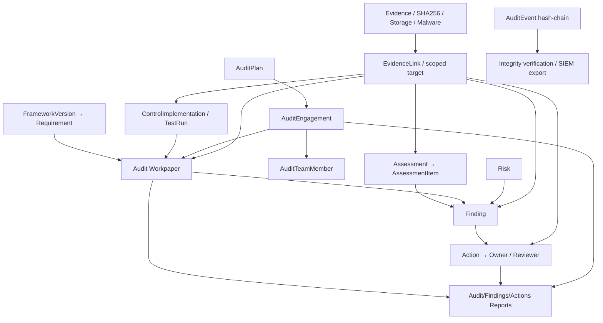

# مشخصات تفصیلی مدیریت شواهد، ممیزی، یافته‌ها و اقدامات — GRC Platform

> **شناسه:** GRC-EVIDENCE-AUDIT-401 · **نسخه:** 0.1.0 · **وضعیت:** DRAFT / بازبینی تخصصی در انتظار  
> **مبنای کد:** `main@e7a745c47919f6ec028e429c210bbdfd4589c691` · **پایلوت:** `pilot-20261013-r1` · **تاریخ:** ۱۴۰۵/۰۷/۲۲ / 2026-10-14  
> **مراجع:** [PRD](../GRC-PRD-001_FA.md)، [SRS](../GRC-SRS-002_FA.md)، [DATA](../GRC-DATA-003_FA.md)، [API-AI](../GRC-API-AI-004_FA.md)، [UX](../GRC-UX-005_FA.md)، [RTM](../GRC-RTM-006_FA.md)، [UAT](../GRC-UAT-007_FA.md)، [Risk](GRC-RISK-101_FA.md)، [Control](GRC-CONTROL-201_FA.md)، [Compliance](GRC-COMPLIANCE-301_FA.md).  
> **قرارداد واژگان:** `AS-IS` = موجود در Source بررسی‌شده، نه الزاماً آزمایش عملی؛ `OBSERVED` = دارای شاهد اجرای اپراتور؛ `GAP` = ضعف/ابهام؛ `TO-BE` = نیاز محصول؛ `POST-V1` = توسعه پس از نسخه نخست. **هیچ ادعای آزمایش امنیت مستقل یا ممیزی گواهی‌دهی در این سند وجود ندارد.**

## ۱. مأموریت، دامنه و تفکیک مفاهیم

این ماژول حلقه پیوند عملیاتی میان ریسک، استاندارد، کنترل و تصمیم را می‌سازد. سازمان باید بتواند:
1. برای هر ادعا یا نتیجه، شاهد مشخص با مالک، منبع، تاریخ، طبقه‌بندی، تمامیت و اعتبار نگهداری کند؛
2. برنامه ممیزی و مأموریت، تیم، معیار، روش آزمون، کاربرگ و نتیجه مستقل ثبت کند؛
3. یافته/عدم انطباق و علت ریشه‌ای را به بند/کنترل/ریسک/کاربرگ پیوند دهد؛
4. اقدام اصلاحی و پیشگیرانه (CAPA) با مالک، مسئول بازبینی، زمان‌بندی، شواهد اجرا و آزمون اثربخشی ردیابی کند؛
5. گزارش قابل حسابرسی و تاریخچه تغییرات سیستم تولید کند، بدون اینکه وجود فایل یا پایان کار به معنای رعایت استاندارد اعلام شود.

**تمایز حیاتی:**
- `Evidence uploaded` ≠ `malware clean` ≠ `source verified` ≠ `fresh/relevant/sufficient` ≠ `approved audit evidence`.
- `Workpaper result = pass` ≠ `independently reviewed`.
- `Action status=done` ≠ `corrective action verified effective` ≠ `Finding closed with review`.
- `AuditEngagement` (مأموریت ممیزی سازمانی) ≠ `AuditEvent` (رویداد فنی لاگ فعالیت و زنجیره تمامیت).
- `EvidenceLink relation_type=proves` یک **برچسب رابطه** است؛ اثبات رسمی یا تأیید محتوا ایجاد نمی‌کند.
- `Report generated` ≠ `signed final assurance opinion`.

**R0/R1:** Evidence CRUD, file+text+url, Malware boundary, Scope/Link، ممیزی داخلی/Workpapers، Findings/Actions، دفتر پیگیری، گزارش‌های محدود پیاده‌شده و Audit Trail. **POST-V1:** نمونه‌برداری آماری پیچیده، زنجیره نگهداری قضایی/Forensic کامل، امضای دیجیتال حقوقی واجد شرایط، Connectorهای گسترده DLP/SIEM/SOAR و اثربخشی تماماً خودکار.

## ۲. مدل دامنه و روابط



**AS-IS:** `EvidenceLink` به انواع عضو رجیستری `apps.common.domain_objects` ارجاع می‌دهد؛ هدف FK مستقیم در DB نیست و وجود/دامنه آن باید در سرویس کنترل شود. `Action.source_type/source_id` به Finding، RiskTreatment یا مرجع ثبت‌شده متصل می‌شود. `Finding.audit_workpaper` و `Finding.assessment_item` FKهای اختیاری‌اند. ارتباط Event Log تاریخچه API و User با نظر ممیزی یا فایل Evidence یکی نیست.

## ۳. شواهد: فرهنگ داده دقیق

### ۳.۱ Evidence — رکورد مدرک
| فیلد واقعی | نوع/دامنه | قید و کاربرد |
|---|---|---|
| `id` | UUID | شناسه پایدار |
| `tenant` | FK از سرور | مرز سخت چندسازمانی |
| `organization_unit` | FK nullable | `null` کل سازمان، نیازمند permission whole Tenant |
| `title` | Char(255) | عنوان قابل پیگیری |
| `description` | Text | موضوع و دامنه مدرک |
| `evidence_type` | enum | `file/url/text/screenshot/report/log/configuration/other` |
| `source` | Char(255) | منشأ؛ فعلاً متن، نه FK اجباری ConnectorRun |
| `owner` | FK User | عضو فعال Tenant |
| `collected_at,valid_until` | DateTime nullable | اعتبار زمانی/زمان جمع‌آوری؛ با timezone |
| `classification` | enum | `public/internal/confidential/secret` |
| `storage_key` | Char(500) read-only | کلید Object Storage تحت Tenant، نباید URL عمومی دائمی باشد |
| `original_filename` | Char(255) read-only | نام پاک‌سازی‌شده فایل |
| `mime_type` | Char(160) read-only | MIME |
| `size` | BigInteger read-only | اندازه واقعی |
| `sha256` | Char(64) read-only | هش فایل خام برای تمامیت |
| `url` | URLField | مدرک نوع نشانی؛ URL ارسالی «خواندن خودکار امن» را تضمین نمی‌کند |
| `text_content` | Text | مدرک متن مجاز |
| `metadata` | JSON | گسترش با کلیدهای Malware حفاظت‌شده Server-side |
| `created_at/updated_at/deleted_at` | Time | چرخه نگهداری/آرشیو |

**رفتار موجود:** `EvidenceSerializer` تغییر مستقیم `storage_key,size,sha256,filename,mime` را منع می‌کند و کلیدهای سرور مربوط به Malware را از Payload رد می‌کند؛ هنگام Metadata PATCH کلیدهای اسکن موجود را حفظ می‌کند. `store_uploaded_evidence` SHA256 حساب می‌کند، Object را با مسیر `tenant/{tenant_id}/evidence/{evidence_id}/...` ذخیره و اسکن را `pending` می‌کند.

**TO-BE:** `evidence_version,source_type,source_record_id,collector,collector_version,source_timestamp,collection_method,retention_class,legal_hold,review_state,reviewed_by/at,review_comment,verification_method,trust_level,access_reason,customer_rights,connector_run_id`. هر کدام نیازمند Data Migration/Schema و سیاست؛ قرار دادن بی‌قاعده در Metadata کافی نیست.

### ۳.۲ اسکن/قرنطینه/دانلود
- **AS-IS File Admission:** حداکثر اندازه طبق `EVIDENCE_MAX_FILE_SIZE` (fallback کد 25 MiB)، نام فایل Path-stripped، پسوندهای اجرایی/HTML/SVG و MIME فعال مسدود.
- **AS-IS Malware States:** `pending/scanning/clean/infected/error` به‌صورت `metadata.malware_scan_status` و `malware_scan_scanner/attempts/scanned_at/sha256/size/error_code`.
- **AS-IS Queue:** `enqueue_evidence_scan` فقط با Scanner enabled و Autosubmit فعال، Task را ارسال می‌کند. شکست Queue وضعیت `error` می‌گذارد؛ نتیجه نباید به clean تبدیل شود.
- **AS-IS Scanner:** مسیر `clamd` در شبکه مورد اعتماد؛ اتصال ClamAV TCP فاقد TLS/Authentication ذاتاً باید در شبکه محافظت‌شده باشد. Scanner غیر فعال، فایل را clean اعلام نمی‌کند.
- **AS-IS Object Integrity:** نتیجه اسکن با کلید، SHA و Size همان Object مقایسه می‌شود؛ mismatch باعث `error` است.
- **AS-IS Download:** `GET /evidence/{id}/download/` در صورت فایل ذخیره‌شده، URL امضاشده 300 ثانیه برمی‌گرداند؛ اگر `EVIDENCE_REQUIRE_CLEAN_DOWNLOAD=true` و حالت غیر clean باشد HTTP 409 با `EVIDENCE_NOT_CLEARED` و Audit Denied ثبت می‌کند. **وجود این Flag برای Production الزامی است؛ تنظیم توسعه/پایلوت ممکن است false باشد.**
- **TO-BE:** دسترسی فایلی علاوه بر Tenant/Unit باید Classification/Need-to-know را جدا کنترل کند؛ URL از Proxy با سیاست PII/Retention/Role و Short TTL، امضای دسترسی مشتری و Revocation عملی تست شود.
- **TO-BE:** Validation فایل و Format/Parser/Archive bomb، ClamAV health و Fail-closed تولید، اسکن واقعی EICAR در محیط مجاز، Egress صفر مطابق سیاست مشتری، کلیدهای Object Storage و Lifecycle/Backup/Restore مستقل بررسی شوند.

**هشدار:** Malware clean صرفاً نبود Signature شناخته‌شده در یک Scanner/زمان است؛ نه حق قانونیِ استفاده از سند، نه دقت محتوا، نه کفایت Evidence.

### ۳.۳ EvidenceLink — رابطه به رکورد GRC
| فیلد | نوع/حوزه | قید |
|---|---|---|
| `tenant` | FK | از نشست؛ همه روابط داخل Tenant |
| `evidence` | FK Evidence | باید متعلق به Tenant باشد |
| `object_type` | Char(60) | یکی از انواع Capability `evidence` در Domain Registry |
| `object_id` | UUID | رکورد Target واقعی در Tenant |
| `relation_type` | enum | `supports/proves/references/generated_from` |
| Unique | tenant+evidence+object_type+object_id+relation_type | منع تکرار |

**AS-IS Create:** `link_scope` هدف را resolve می‌کند و تطابق Tenant را بررسی؛ اختیار `evidence.manage` برای Unit مدرک و Unit هدف کنترل؛ اگر Evidence دارای Unit و Target دارای Unit هستند، باید یکسان باشند. یک Evidence می‌تواند به چند Target مجاز لینک شود.

**GAP امنیتی برای بررسی:** در `EvidenceLinkViewSet.perform_update` فقط permission Unit هدف **قدیم** بررسی می‌شود؛ مسیر Serializer وجود هدف جدید/هم-Tenant را ارزیابی می‌کند ولی در همان View مسیر Permission Unit مقصد/مدرک جدید و سازگاری واحد همانند Create به‌وضوح تکرار نشده است. باید با PATCH بین دو Unit و User محدود بازتولید/اصلاح شود (#188). این گزارش ادعای سوءاستفاده تأییدشده نیست.

**TO-BE:** `EvidenceLink.review_state/reviewed_by/at`، نوع ادعا `supports/proves` نیازمند Rule/Reviewer؛ پیوند مدرک قدیمی/منقضی/قرنطینه‌شده در Review نهایی معتبر نشود؛ Metadata Scope/Classification در Export و AI رعایت شود.

## ۴. ممیزی داخلی: فیلدهای اصلی

### ۴.۱ AuditPlan — برنامه ممیزی
| فیلد | نوع/وضعیت |
|---|---|
| `tenant,organization_unit` | Tenant و Unit nullable |
| `title,owner` | عنوان و مالکِ عضو فعال |
| `period_start,period_end` | Date ضروری؛ کنترل `end>=start` TO-BE |
| `status` | `draft/approved/active/closed` |
| `approved_by,approved_at` | Set در `POST /audit-plans/{id}/approve/` |
| `metadata` | JSON |
| `created_at/updated_at/deleted_at` | تاریخچه |

**AS-IS:** Viewset برای List/Create/Update/Archive و Approve وجود دارد؛ Approve فقط `internal_audit.review` را کنترل و `approved_by/at` ثبت می‌کند. **TO-BE:** عدم Self-Approval، Gate وجود Scope/Criteria/Team/Budget، محتوای تصویب‌شده immutable و Revocation/Revision مستقل.

### ۴.۲ AuditEngagement — مأموریت ممیزی
| فیلد | نوع/دامنه |
|---|---|
| `tenant` | FK Tenant |
| `plan` | FK AuditPlan nullable، باید در Tenant |
| `organization_unit` | FK Unit nullable |
| `framework_version` | FK FrameworkVersion nullable، local/global visible |
| `title` | Char(255) |
| `audit_type` | `internal/framework/control/process/follow_up` |
| `objective,scope` | Text |
| `lead_auditor` | FK User فعال |
| `start_date,end_date` | Date nullable |
| `status` | `draft/planned/in_progress/review/completed/cancelled` |
| `conclusion` | Text |
| `requirements` | M2M Requirement |
| `controls` | M2M ControlImplementation |
| `metadata,created_at,updated_at,deleted_at` | اطلاعات/تاریخچه |

**AS-IS:** Audit CRUD و فیلتر Search/Status/Type/Lead و `GET /audits/{id}/report/` DOCX وجود دارد؛ Serializer Tenant ارتباط Plan/Framework/Requirements/Controls را کنترل می‌کند. **TO-BE:** Requirement/Control از Scope و Version تعیین‌شده ممیزی باشد و Independent Audit Role نسبت به عملکردِ خود ممیزی‌شونده تعریف شود؛ در پایان مأموریت بدون Workpaper Reviewed/Findings unresolved تنها Draft Report صادر شود.

### ۴.۳ AuditTeamMember — اعضای تیم
`engagement` FK، `user` FK و `role` Char(80) default `auditor`؛ Unique روی `engagement+user`.

**شکاف بررسی امنیتی:** `AuditTeamMemberSerializer` در کد مرورشده هیچ `validate` برای تعلق Engagement به Tenant نشست و عضویت فعال User ندارد؛ `AuditTeamMemberViewSet.perform_create` Permission را نسبت به Tenant جاری و Unit مأموریت می‌سنجد ولی شرط `engagement.tenant_id == tenant.id` صریح ندارد. باید تست دو Tenant/Engagement بدون Unit و User خارجی قبل از پذیرش تجاری PASS شود (#188). **هیچ Incident تأییدشده مطرح نشده است.**

**TO-BE:** `audit_role(lead/auditor/reviewer/observer)`, `competency`, `independence_declaration`, `conflict_of_interest`, `assigned_at`, `scope`; سیاست جلوگیری از ممیزی کارِ تحت مسئولیت خود.

### ۴.۴ Workpaper — کاربرگ ممیزی
| فیلد | نوع و قید |
|---|---|
| `engagement` | FK، ثابت بعد از ایجاد در Serializer |
| `requirement` | FK nullable، Framework visible |
| `control_implementation` | FK nullable، Tenant مشترک |
| `title,objective,procedure,sample` | Text/Char برای هدف، روش اجرا و نمونه |
| `tester` | FK User عضو فعال Tenant |
| `result` | `not_tested/pass/fail/partial/not_applicable` |
| `conclusion` | Text |
| `status` | `draft/ready/reviewed` |
| `reviewed_by,reviewed_at` | Server-managed |
| `created_at/updated_at/deleted_at` | تاریخچه |

**AS-IS:** CRUD، `POST /audit-workpapers/{id}/review/` و `POST /audit-workpapers/{id}/findings/` دارد. Review وضعیت Reviewed و Reviewer/Time را ثبت می‌کند. **GAP:** در همان Action شرط `reviewer != tester`، شرط `status=ready`، اعتبار Evidence و جلوگیری از Edit بعد از Reviewed به‌وضوح enforce نشده است. Review نتیجه ممیزی مستقل قابل استناد تلقی نشود تا Gateهای هدف پیاده‌سازی/آزمون شوند.

**TO-BE fields:** `test_population,sample_size,sampling_basis,test_period,expected_result,test_method_version,review_decision,review_note,evidence_ids,supervisor,scope_snapshot,conclusion_version` با Snapshot و immutable Reviewed Workpaper.

## ۵. یافته‌ها و CAPA

### ۵.۱ Finding — یافته/عدم انطباق
| فیلد | نوع/دامنه |
|---|---|
| `tenant,organization_unit` | FK Tenant + Unit nullable |
| `assessment_item` | FK nullable؛ خود Scope و Requirement را می‌تواند ارث ببرد |
| `audit_workpaper` | FK nullable؛ Unit ممیزی و Refs مرتبط |
| `requirement` | FK nullable؛ visible |
| `control_implementation` | FK nullable؛ tenant-consistent |
| `risk` | FK nullable؛ tenant-consistent |
| `finding_type` | `non_conformity/observation/weakness/opportunity` |
| `title,description,root_cause` | عنوان، توضیح و علت ریشه‌ای |
| `severity` | `low/medium/high/critical` |
| `owner` | عضو فعال Tenant |
| `due_date` | Date nullable |
| `status` | `open/in_remediation/verification/closed/accepted` |
| `closed_by,closed_at,closure_comment` | Server-managed |
| `metadata,created_at,updated_at,deleted_at` | اطلاعات/تاریخچه |

**AS-IS:** `POST /findings/{id}/actions/` یک Action با `source_type=finding` می‌سازد و اگر Finding open باشد `in_remediation` می‌کند. `POST /findings/{id}/close/` با `finding.close` باز بودن هیچ Action مرتبطی به‌جز Done/Cancelled را رد می‌کند؛ `force=true` تنها با Whole-Tenant finding.close و بدون الزام مستقل در سرویس امکان‌پذیر است. Status=closed با PATCH عمومی رد شده و از Action رسمی می‌گذرد.

**GAP:** تمام شدن Actionها **به‌تنهایی** تأیید اثربخشی، علت ریشه‌ای، Evidence و Reviewer مستقل را اثبات نمی‌کند. سرویس `close_finding` فقط Actionهای باز را بررسی و ClosureComment (حتی خالی) را ثبت می‌کند؛ Gap حاکمیتی است.

**TO-BE:** RootCause category، Containment، Correction، CorrectiveAction، PreventiveAction، recurrence، effectiveness_test_ref، verification_result، closure_approved_by/at، change_request، Acceptance policy جداگانه، Reopen/Dispute History و SLA/escalation.

### ۵.۲ Action — اقدام
| فیلد | نوع/دامنه |
|---|---|
| `tenant,organization_unit` | Tenant / Unit nullable |
| `title,description` | عنوان/شرح |
| `owner,reviewer` | FK User، عضو فعال |
| `priority` | `low/medium/high/critical` |
| `start_date,due_date` | Date nullable |
| `progress` | PositiveSmallInteger 0..100 |
| `status` | `todo/in_progress/review/done/cancelled` |
| `completed_at` | Timestamp read-only |
| `source_type,source_id` | نوع/UUID موجود در DomainRegistry `action_source` |
| `metadata,created_at,updated_at,deleted_at` | وضعیت/تاریخچه |

**AS-IS:** Action List فیلتر Search/Status/Priority/Owner/Unit و Due `overdue/due_soon/undated` دارد؛ `PATCH /actions/{id}/` با `status=done` زمان اتمام و `progress=100` را ثبت می‌کند. User reviewer فیلد قابل نوشتن است، اما **Endpoint مستقل برای تصویب Done توسط Reviewer در Source بررسی‌شده نبود**. Reopen/Undo Completion باید از نظر `completed_at` و Progress به‌طور مستقل آزمون شود.

**TO-BE:** Submit-for-Verification → Reviewer Approval/Rejection → Accepted Done، Evidence Test، مسئولیت و Escalation، تاریخچه immutable تصمیم، اقدام ناشی از RiskTreatment/Finding/Assessment/Incident با Source Validated و Scope matching، SLA/Notifications و Reopen دلیل‌دار.

## ۶. AuditEvent — لاگ تغییرات با زنجیره تمامیت (متفاوت از ممیزی داخلی)

| فیلد | معنا |
|---|---|
| `tenant,actor,actor_username` | سازمان/کاربر و Snapshot نام |
| `action,category,outcome` | عملیات، دسته و `success/failure/denied` |
| `object_type,object_id,object_repr` | موضوع |
| `old_data,new_data,metadata` | Delta کنترل‌شده؛ عدم نگهداری Secrets |
| `ip_address,user_agent,http_method,path,request_id` | Trace |
| `created_at` | زمان UTC |
| `chain_sequence,previous_hash,event_hash,integrity_key_id` | زنجیره HMAC/SHA256 per Tenant و Global |

**AS-IS:** AuditEvent با Manager اپلیکیشن append-only است؛ Update/Delete عادی ممنوع؛ `record_audit_event` زنجیره مبتنی بر HMAC و Key ID می‌سازد، ابزار `verify_audit_integrity` دارد. Key معتبر `AUDIT_INTEGRITY_KEY` در Production لازم است؛ کلید Rotation تاریخی به طرح/آزمون مستقلی نیاز دارد. این مکانیزم **اثبات استقلال WORM/Immutable Storage در برابر DBA مخرب نیست**؛ باید Offsite/SIEM/Backup و کنترل کلید هم ارزیابی شوند.

**AS-IS Export:** `GET /api/v1/audit-events/` و Endpoint صادرات SIEM در `apps.audit.urls` با `audit.view` whole-tenant و `jsonl` یا JSON schema محدود؛ داده‌های حساس قدیمی از SIEM export حذف می‌شوند. نام Route صادرات باید در فایل urls/OpenAPI کنترل شود.

**TO-BE:** پوشش همه Transitionهای حساس، Immutable Event برای Review/Rejection/ForceClose/Export، Redaction Policy، Retention/WORM و Test Integrity روی Restore در مرکز داده مشتری.

## ۷. نقشه صفحات و UI

| ID | مسیر واقعی | AS-IS | TO-BE |
|---|---|---|---|
| EAU-UI-01 | `/evidence` | کتابخانه شواهد، جست‌وجو، Create فایل/متن/URL، Classification و Scan Status، Download | Detail/Version/Review/Expiry، لینک‌سازی آگاهانه، مالور/مبنا و Policy |
| EAU-UI-02 | `/audits` | فهرست ممیزی با Search/Status/Type و Workpapers Count | تعریف Plan/Engagement/Team و فیلتر تاریخ/Scope |
| EAU-UI-03 | `/audits/[id]` | فقط عنوان، Scope/Objective/Status و Download DOCX | Workspace مأموریت، تیم، Workpapers، Evidence، Findings، Review، Approval |
| EAU-UI-04 | `/findings` | جدول یافته‌ها، Severity/Status/Owner/Due و Action Count | Create/Edit/Classification/Trend/Closure Review/Export |
| EAU-UI-05 | `/findings/[id]` | Root Cause ویرایش Blur، Create Action با `prompt` و **اولین کاربر**، Close با Comment ثابت | CAPA Wizard، انتخاب واقعی Owner، Evidence، Closure Test و Reviewer |
| EAU-UI-06 | `/actions` | فهرست، Due/Status/Priority/Search | Work Center و SLA، bulk مدیریت مجاز |
| EAU-UI-07 | `/actions/[id]` | Edit Title/Unit/Owner/Reviewer/Priority/Status/Dates/Progress، Source | Submit/Verify/Reject و Evidence/Audit History |
| EAU-UI-08 | `/reports` | Catalog و Preview/Export طبق Typeهای موجود | Report packs رسمی Audit/CAPA/Evidence |
| EAU-UI-09 | `/work` | کارتابل مشترک | Reviewer Inbox و موعد Evidence/Findings/Actions |
| EAU-UI-10 | `/admin/operations` | وضعیت عملیاتی/Backup/Queue | Scanner, egress, storage integrity, audit-chain health |

**حالت‌های UX استاندارد:** `loading/empty/error/forbidden/pending_scan/infected/expired/unreviewed/approved/rejected/overdue` نباید یکی شوند. در فرم بسته‌شدن Finding، متن «تأیید اثربخشی» نباید به‌صورت پیش‌فرض بدون Evidence از طرف User ثبت شود. برای Action/Workpaper/Plan/Engagement باید Buttonهای Create/Edit/Review را با Backend Permission و Status هماهنگ ساخت؛ خطاهای 4xx باید فیلد مشخص داشته باشند.

### UI فرم‌های پیشنهادی هدف
- **Evidence Wizard:** نوع، عنوان، Unit، Owner، منبع، جمع‌آوری، اعتبار، طبقه‌بندی، فایل/لینک/متن، SHA/Scan، هدف‌های لینک، Reviewer و Approval.
- **AuditPlan/Engagement:** دوره، Scope، اهداف، معیارهای نسخه‌دار، Lead، تیم و استقلال، برنامه، Method، Schedule، Review/Approval.
- **Workpaper:** Objective، Criterion، ControlImplementation، روش، Sample، TestRun/Result، Evidence selector، Conclusion، Submit for Review، Reviewer Comment/Date.
- **Finding/CAPA:** Source Context، Type/Severity، Explanation، Root Cause، Owner، Due، Correction vs Corrective vs Preventive Action، Verification Evidence، Approval/Closure.
- **Action:** Owner/Reviewer، Priority، Start/Due، Progress، Evidence، Submit/Return/Verify، Source link؛ هیچ `done=verified` خودکار.

## ۸. API موجود و سیاست مجوز

| قابلیت | AS-IS Route | Permission/قید |
|---|---|---|
| Evidence CRUD | `/api/v1/evidence/` | `evidence.view/manage` با Unit |
| Evidence Download | `GET /api/v1/evidence/{id}/download/` | view + Clean gate Config + Audit |
| EvidenceLink CRUD | `/api/v1/evidence-links/` | `evidence.view/manage`؛ link_scope/Unit برای Create |
| AuditPlan CRUD/Approve | `/api/v1/audit-plans/`, `POST /{id}/approve/` | `internal_audit.view/manage/review` |
| AuditEngagement CRUD | `/api/v1/audits/` | `internal_audit.view/manage` |
| Audit Report DOCX | `GET /api/v1/audits/{id}/report/` | `report.generate` Scoped |
| AuditTeamMember CRUD | `/api/v1/audit-team-members/` | `internal_audit.view/manage`؛ P0 Review #188 |
| Workpaper CRUD/Review | `/api/v1/audit-workpapers/`, `POST /{id}/review/` | `internal_audit.view/perform/review` |
| Finding from Workpaper | `POST /api/v1/audit-workpapers/{id}/findings/` | `finding.manage` Scoped |
| Finding CRUD/Actions/Close | `/api/v1/findings/`, `POST /{id}/actions/`, `POST /{id}/close/` | `finding.view/manage/close` |
| Action CRUD, selectors | `/api/v1/actions/`, `GET /selector-options/` | `action.view/manage` |
| AuditEvent List | `/api/v1/audit-events/` | `audit.view` whole Tenant |
| Formal Reports | `/api/v1/reports/catalog/`, `preview/`, `export/` | `report.view/generate` و Scope |

**TO-BE routes** مانند `/evidence/{id}/review/`, `/audit-workpapers/{id}/submit-review/`, `/audit-workpapers/{id}/reject/`, `/findings/{id}/verify-closure/`, `/actions/{id}/approve-completion/`، `/audit-plans/{id}/revoke-approval/` و `/evidence/{id}/versions/` فعلاً **پیشنهاد طراحی هستند و در این Baseline موجود تلقی نمی‌شوند**.

### ۸.۱ نمونه Evidence JSON، صرفاً داده مصنوعی
```json
{
  "organization_unit": "00000000-0000-4000-8000-000000000401",
  "title": "گزارش آزمون بازیابی آزمایشی",
  "description": "نمونه سند ساختگی برای کنترل بازیابی",
  "evidence_type": "text",
  "source": "manual-test",
  "owner": 1,
  "classification": "internal",
  "text_content": "آزمون بازیابی در محیط آموزشی انجام شد.",
  "valid_until": "2026-12-01T00:00:00+03:30"
}
```
شناسه، Tenant و کاربر واقعی نیستند؛ `tenant` از Context معتبر سرور استخراج می‌شود.

### ۸.۲ نمونه ارتباط EvidenceLink
```json
{
  "evidence": "00000000-0000-4000-8000-000000000402",
  "object_type": "audit_workpaper",
  "object_id": "00000000-0000-4000-8000-000000000403",
  "relation_type": "supports"
}
```
تنها اگر Target در Registry و همان Tenant/Scope مجاز باشد باید 201 بگیرد.

### ۸.۳ نمونه Finding و Action
```json
{
  "title": "عدم احراز صحت آزمون بازیابی",
  "finding_type": "non_conformity",
  "severity": "high",
  "description": "خروجی آزمون برای همه نمونه‌ها تأیید نشده است.",
  "root_cause": "پوشش ناکافی رویه آزمون",
  "owner": 1,
  "audit_workpaper": "00000000-0000-4000-8000-000000000403"
}
```
Action باید از طریق `POST /findings/{id}/actions/` با `title,owner,priority,due_date` ایجاد و Source واقعی در Backend Set شود، نه با UUID قابل اعتماد از سمت کلاینت.

## ۹. چرخه‌های Workflow هدف

### EAU-FLOW-01 — مدرک از دریافت تا بازبینی
Create → Quarantine/Pending → Scan (فایل) → Clean/Denied → Source/Expiry/Classification Validation → Link Scoped → Human Review → Accepted Evidence → Reuse across permitted domains → Re-review when Expired/Source changed → Retention/Archive. **در AS-IS مرحله Human Evidence Review به‌صورت Entity مستقل کامل پیاده نشده است.**

### EAU-FLOW-02 — ممیزی از برنامه تا گزارش
Plan Draft → Approve independently → Engagement Planned → Team with active membership/independence → Workpapers and Sample/Evidence → Tester result → Submit for independent Review → Finding → Action/Verification → Report Draft → Authorized Approval/Sign → Archive with immutable snapshot. **AS-IS Workpaper Review و DOCX موجود، Gateهای رسمی مستقل TO-BE هستند.**

### EAU-FLOW-03 — عدم انطباق و CAPA
Create Finding (AssessmentItem/Workpaper) → classify severity/owner/deadline → Root Cause → Action(s) with due dates → Evidence of execution → Reviewer tests effectiveness → Close or Reopen → Audit Trail/Report. `force` باید Policy exception با دلیل و Approval جدا داشته باشد.

### EAU-FLOW-04 — Evidence مشترک
یک Evidence مجاز می‌تواند به دو AssessmentItem و یک Workpaper متصل شود بدون تکثیر Blob. `valid_until`، تغییر Classification، Archived Target یا Unclean File باید در هر استفاده جدید و Export دوباره بررسی شوند؛ «لینک از قبل موجود» مجوز دائمی ایجاد نمی‌کند.

### EAU-FLOW-05 — تعویض مسئول اقدام
Action Reviewer/Owner مستقل، Notification مربوط و Scope با تغییر Unit/Owner مجدداً بررسی شوند؛ انتقال بین Units بدون مجوز مقصد رد، Ownership history ثبت؛ انجام از طریق Review نه صرف PATCH وضعیت.

## ۱۰. هوش مصنوعی: حداقل داده مجاز و خروجی پیشنهادی

**AS-IS:** Gateway دارای توانایی RAG و Document Draft عمومی است، اما Workflow تخصصی «AI Auditor» یا تأیید خودکار کاربرگ/بستن Finding در این بررسی تأیید نشده؛ AI نصب‌شده فعلی خاموش است.

| Task هدف | Context محدود مجاز پس از Auth | خروجی صرفاً پیشنهادی |
|---|---|---|
| Evidence classification | Type/Source/Title/Expiry/Classification، متن مجاز | پیشنهاد دسته، ناقص‌بودن داده، عدم قطعیت |
| Workpaper design | Scope/Framework/Requirement/Control/Previous approved tests | روش و نمونه/سؤالات آزمایشی |
| Evidence gap analysis | Claim/Item/linked evidence/Status/Review | Missing Evidence List/Question |
| Finding root-cause draft | Finding/Procedure/Result/Rationale مجاز | علل محتمل (نه علت اثبات‌شده) |
| CAPA drafting | Finding, open actions, due, constraints | Draft Action/Verification |
| Executive audit narrative | approved/verified facts and report query | روایت مدیریتی با Source IDs |
| RAG | فقط Chunks مجاز Tenant/Unit/Classification | پاسخ با مرجع واقعی و Unknowns |

**TO-BE Contract:**
```json
{
  "schema_version": "grc.audit.ai.v1",
  "status": "suggestion",
  "subject": {"type": "audit_workpaper", "id": "00000000-0000-4000-8000-000000000403"},
  "summary": "پوشش شواهد آزمون بازیابی کامل نیست.",
  "candidate_evidence_gaps": [
    {
      "statement": "گزارش یکپارچگی فایل‌های بازیابی‌شده ارائه نشده است.",
      "source_ids": [],
      "certainty": "unknown"
    }
  ],
  "candidate_actions": [{"title": "دریافت گزارش آزمون با Hash", "priority": "high"}],
  "missing_data": ["دامنه نمونه‌برداری", "بازبین مستقل"],
  "human_review_required": true,
  "approved_audit_opinion": false
}
```
**مرز امنیت:** Cloud Egress مطابق حقوق/طبقه‌بندی؛ فایل‌های آلوده به AI یا Preview تبدیل نشوند؛ Text Evidence را untrusted تلقی کنیم؛ هیچ `Finding.close`, `Action.done`, `Workpaper.reviewed`, `AuditPlan.approved` خودکار بدون Domain Permission/Decision انسانی.

## ۱۱. گزارش‌ها، خروجی‌ها و KPI

| Report ID | داده و ورودی | وضعیت |
|---|---|---|
| RPT-EAU-01 | Evidence register، Owner,Unit,Source,Classification,ValidUntil,Hash,Scan | TO-BE تخصصی؛ Export Scope gated |
| RPT-EAU-02 | Evidence coverage per Assessment/Control/Workpaper و Proof Review | TO-BE |
| RPT-EAU-03 | Quarantine/Scan queue/Error/Expired/Retry | TO-BE عملیات |
| RPT-EAU-04 | AuditPlan/Engagement/Team/Status/Scope/Due | TO-BE رجیستر برنامه |
| RPT-EAU-05 | Single Audit DOCX (Title/Scope/Objective/Workpaper/Findings) | **AS-IS** `/audits/{id}/report/` قالب ساده انگلیسی |
| RPT-EAU-06 | Formal Audit Report with Scope/Criteria/Sampling/Review/Evidence/Signatures | TO-BE چاپ رسمی |
| RPT-EAU-07 | Findings Register با Severity/Owner/RootCause/Due | **AS-IS** FormalReports Catalog، Export براساس Catalog |
| RPT-EAU-08 | Actions Register با Priority/Owner/Due/Progress/Source | **AS-IS** FormalReports Catalog |
| RPT-EAU-09 | CAPA Aging و Verification Effectiveness، Reopen Trend | TO-BE |
| RPT-EAU-10 | Audit Event Integrity Chain/Verification Summary | ابزار AS-IS و گزارش مدیریتی TO-BE |
| RPT-EAU-11 | Audit SIEM JSON/JSONL (safe fields) | AS-IS `audit.view` whole-tenant، محدود به 1000 هر Batch |
| RPT-EAU-12 | Management Cross-Module Audit/Compliance/Risk/Control Evidence Pack | TO-BE |

**نکته:** `apps.reporting.formal_reports` برای Audit/Findings/Actions و برخی دیگر خروجی CSV/XLSX/DOCX و HTML/PDF طبق نوع موجود دارد؛ هر Export باید با Scope/Version/Status دقیق آزمون شود. Report تک‌ممیزی از `internal_audits/exporters.py` DOCX ثابت انگلیسی تولید می‌کند؛ **گزارش رسمی فارسی با سربرگ، جدول، تاریخ شمسی، امضا و Reviewer Snapshot هنوز تعهد اجرایی اثبات‌شده نیست**.

**KPIهای ضروری و قواعد مخرج:** تعداد Evidence با Scan Clean ≠ تعداد Evidence Reviewed؛ درصد Workpapers Reviewed با شرط Independence؛ یافته‌های Open/Overdue/Repeated؛ Actions Done vs Verified؛ Missing/Expired Evidence؛ نرخ CAPA با Effectiveness Test؛ هیچ `0` برای Not Assessed یا Data Missing نمایش «موفقیت» ندهد.

## ۱۲. قواعد اعتبارسنجی

| Rule | وضعیت | نتیجه لازم |
|---|---|---|
| EAU-VAL-01 | AS-IS | Evidence Tenant/Unit/Owner درست |
| EAU-VAL-02 | AS-IS | StorageKey/SHA/Scan metadata Server-managed |
| EAU-VAL-03 | AS-IS | پسوند/MIME فعال و فایل بیش از Limit رد |
| EAU-VAL-04 | AS-IS | Blob SHA/Size به اسکن گره خورده و mismatch→error |
| EAU-VAL-05 | AS-IS config-dependent | Download غیرclean در Production با Flag=true رد و Audit Denied |
| EAU-VAL-06 | GAP | Scanner واقعی+fail-closed باید برای مشتری با شواهد نصب ثابت شود |
| EAU-VAL-07 | AS-IS | EvidenceLink CREATE به DomainRegistry/Scope معتبر |
| EAU-VAL-08 | **GAP SECURITY** | PATCH EvidenceLink باید Permission/Scope مقصد و Evidence جدید را دوباره کنترل کند (#188) |
| EAU-VAL-09 | **GAP SECURITY** | AuditTeamMember Engagement و User فعال در Tenant یکسان الزام شود (#188) |
| EAU-VAL-10 | AS-IS | Workpaper FK Tenant و Engagement در UPDATE ثابت است |
| EAU-VAL-11 | GAP | Workpaper Review فقط با Reviewer مستقل/ready/Evidence معتبر |
| EAU-VAL-12 | GAP | AuditPlan Approval با No Self-Approval و Snapshot |
| EAU-VAL-13 | AS-IS | Finding Close اقدام باز را رد می‌کند مگر Force authorized |
| EAU-VAL-14 | GAP | Finding Close بدون اثبات Effectiveness/Reviewer مستقل مجاز تلقی نشود |
| EAU-VAL-15 | AS-IS | Action Source Type باید ثبت‌شده و هم-Tenant باشد |
| EAU-VAL-16 | GAP | Action Done مستقیم با PATCH معادل Verified نیست |
| EAU-VAL-17 | GAP | Action Reopen `completed_at/progress` باید Consistency داشته باشد |
| EAU-VAL-18 | TO-BE | تاریخ Jalali UI/Print و ISO API بدون drift |
| EAU-VAL-19 | TO-BE | Evidence/Report Export باید Classification و Retention Policy را اعمال کند |
| EAU-VAL-20 | AS-IS | AuditEvent normal ORM append-only و HMAC chain |
| EAU-VAL-21 | TO-BE | شکست/Rotate کلید و Restore، Chain Verification مستقل |
| EAU-VAL-22 | TO-BE | AI فقط Draft/Suggestion و بدون Auto-Approval |
| EAU-VAL-23 | TO-BE | Workpaper Reviewed و Report Approved بعد از تغییر Source باید Stale شود |
| EAU-VAL-24 | TO-BE | Scope همه Related Objects (Plan/Engagement/CI/Requirement) همخوان باشد |
| EAU-VAL-25 | TO-BE | EvidenceLink/Narrative باید منشأ و Reviewer مشخص و Audit داشته باشد |
| EAU-VAL-26 | TO-BE | Force Close با Reason و Approval مستقل و گزارش استثنا |

## ۱۳. شکاف‌های شناخته‌شده برای برنامه توسعه

| Gap | شرح | اولویت | مرجع |
|---|---|---|---|
| EAU-GAP-01 | AuditTeamMember Create بدون Tenant/User ownership validation صریح | P0 بررسی امنیت | #188 |
| EAU-GAP-02 | EvidenceLink PATCH اعتبارسنجی Permission مقصد را صریح انجام نمی‌دهد | P0 بررسی امنیت | #188 |
| EAU-GAP-03 | Workpaper Review بدون Independence/Ready/Evidence Gate صریح | P1 | Issue لازم |
| EAU-GAP-04 | AuditPlan Approve بدون No Self Approval/Version Snapshot | P1 | Issue لازم |
| EAU-GAP-05 | Finding Close فقط تکمیل Actions را می‌سنجد، نه آزمون اثر اصلاح | P1 | Issue لازم |
| EAU-GAP-06 | Action Done با PATCH، Reviewer Gate مجزا ندارد | P1 | Issue لازم |
| EAU-GAP-07 | Action Reopen نیازمند تطبیق completed_at/progress | P1 | بررسی آزمون |
| EAU-GAP-08 | UI ممیزی فقط Detail و Report ساده، نه Workpaper/Team/Review کامل | P1 UX | بررسی Frontend |
| EAU-GAP-09 | UI Finding در ایجاد Action اولین User و Prompt/Comment ثابت دارد | P1 UX | بررسی Frontend |
| EAU-GAP-10 | Evidence Scan/Download دارای قابلیت، اما Scanner واقعی پایلوت اثبات نشده | P0 Customer gate | Operational UAT |
| EAU-GAP-11 | Evidence Provenance/Review/Retention/Legal Hold مستقل تکمیل نیست | P1 | Data/API |
| EAU-GAP-12 | Evidence classification برای File Access مستقل از Unit نیازمند Policy/test | P1 Security | Security review |
| EAU-GAP-13 | Audit DOCX تک‌مأموریت انگلیسی و بدون Formal Sign-off است | P1 RTL/Report | Exporter |
| EAU-GAP-14 | Foreign/Unit Link Tests و Cross-Module End-to-End در Pilot اجرا نشده | P0/P1 UAT | #161 |
| EAU-GAP-15 | تاریخ شمسی عمومی نرم‌افزار تکمیل نشده | P1 | #182 |
| EAU-GAP-16 | زنجیره Audit Key Rotation و Restore/Offsite Integrity نیازمند UAT مستقل | P1 Operations | Acceptance Gates |

**ادبیات امنیتی:** شکاف‌های P0 بر پایه ممیزی استاتیک Source است؛ باید با داده مصنوعی بازتولید شوند. وقوع نشت/خرابی واقعی مشتری **تأیید نشده است**.

## ۱۴. معیارهای پذیرش

| AC | معیار |
|---|---|
| EAU-AC-01 | ایجاد File/Text/URL Evidence و Persistence با Unit/Owner/Class مجاز |
| EAU-AC-02 | فایل نامجاز/بیش‌ازحد مجاز Reject و Scan metadata غیرقابل جعل |
| EAU-AC-03 | Scanner و Download Clean Gate واقعی: pending/infected/error بدون URL |
| EAU-AC-04 | Evidence Hash/Size integrity، Queue Failure و Object Change fail-closed |
| EAU-AC-05 | EvidenceLink چندموضوعی valid، Cross-Tenant/Unit و PATCH مقصد غیرمجاز رد |
| EAU-AC-06 | AuditPlan Owner/Period/Approval با reviewer مستقل/Version معتبر |
| EAU-AC-07 | Engagement/Team/Requirement/Control Tenant/Scope سازگار |
| EAU-AC-08 | Workpaper Test/Result/Evidence/Review با Reviewer≠Tester و تاریخچه |
| EAU-AC-09 | یافته از Assessment یا Workpaper Scope/Requirement درست به ارث ببرد |
| EAU-AC-10 | Finding + CAPA Action با Owner/Reviewer/Due و Source درست |
| EAU-AC-11 | Action Done/Review/Evidence و Reopen بدون تناقض؛ اثر واقعی جدا |
| EAU-AC-12 | Close بدون Action تمام‌شده/Effectiveness معتبر رد؛ Exception مستند و مجاز |
| EAU-AC-13 | Report Audit/Findings/Actions با Scope/Source/Format و فایل قابل بازشدن |
| EAU-AC-14 | AuditEvent Append-only/Integrity Verification و Safe SIEM export |
| EAU-AC-15 | Permission/Classification/Tenant/Unit برای UI/API/Export/AI برقرار |
| EAU-AC-16 | UX فرم‌ها RTL، تاریخ جلالی، خطا و انتخاب Owner/Evidence آگاهانه |
| EAU-AC-17 | Evidence اتوماتیک/AI بدون تأیید انسانی اصالت و Compliance اعلام نکنند |
| EAU-AC-18 | E2E از استاندارد/کنترل/ریسک به ممیزی، Finding، CAPA و گزارش قابل تکرار باشد |

## ۱۵. Definition of Done
- Story/PR باید `EAU-AC-xx` و `EAU-TC-xx` را با Unit Test و Evidence link کند.
- Issue #188 با Test دو Tenant/Unit بررسی/رفع؛ هیچ Export/List/Detail/Mutation خارج Scope مجاز نباشد.
- Scanner روی پروفایل Production و فایل آزمایشی Clean/Infected/Error عملاً آزمون شود؛ شواهد Hash/Queue/Storage و URL expiry واقعی ثبت شود.
- بازبین مستقل برای Workpaper/Plan/Finding/Action، ثبت Review State و Audit Trail قابل مشاهده باشد.
- گزارش‌ها منبع، Scope، نسخه، زمان، حقوق محتوا و عدم اطمینان را نشان دهند؛ چاپ رسمی RTL/Jalali مستقل آزمون شود.
- بازشدن DOCX/XLSX/PDF ادعاشده و عدم تناقض با Dataset واقعی بررسی شود.
- هیچ نتیجه از AI به‌تنهایی State معتبر را تغییر ندهد.
- Release جدید Signed با SHA/Build مشخص، Migration rollback/restore و UAT واقعی لازم است. **PR مستنداتی جایگزین اجرای برنامه‌نویسی/QA نیست.**

## ۱۶. تصمیم‌های معماری باز
- **DEC-EAU-01:** Evidence approval از نظر حقوقی/محرمانگی و استقلال Reviewer در کدام دامنه الزامی است؟
- **DEC-EAU-02:** سیاست Classification هنگام گرفتن URL Presigned و Source Content توسط AI چیست؟
- **DEC-EAU-03:** زمان انقضای Evidence و Test Effectiveness و بازبینی مجدد چگونه تعریف شود؟
- **DEC-EAU-04:** ممیزی داخلی Plan/Workpaper/Report چه سطح امضا/تصویبی نیاز دارد؟
- **DEC-EAU-05:** آیا Finding با تمام Action Done اما بدون آزمون اثر قابل بستن است؟ پیشنهاد: خیر.
- **DEC-EAU-06:** `force=true` تنها برای استثنای بحران یا نقش معین و با دو امضا مجاز باشد؟
- **DEC-EAU-07:** Vendor/Connector Evidence برای کدام مشتری و با کدام Rights/Provenance قابل اعتماد است؟
- **DEC-EAU-08:** نسخه و Snapshot Workpaper، EvidenceLink و Audit Report چگونه مدیریت شوند؟
- **DEC-EAU-09:** آیا Classification کنترل دسترسی جدید نیاز دارد یا همان RBAC Scope فعلی کافی است؟
- **DEC-EAU-10:** نحوه بازیابی و چرخش کلید زنجیره HMAC در استقرار مستقل مشتری چیست؟

---
**فایل‌های کد مرورشده:** `backend/apps/evidence/{models,serializers,services,views,malware,malware_service,tests,test_malware}.py`، `backend/apps/internal_audits/{models,serializers,views,exporters,tests}.py`، `backend/apps/findings/{models,serializers,services,views,tests}.py`، `backend/apps/actions/{models,serializers,views,tests}.py`، `backend/apps/audit/{models,views,integrity}.py`، `backend/apps/reporting/{formal_reports,views}.py`، `frontend/app/{evidence,audits,findings,actions}/**/page.tsx`، `backend/apps/common/domain_objects.py`.
