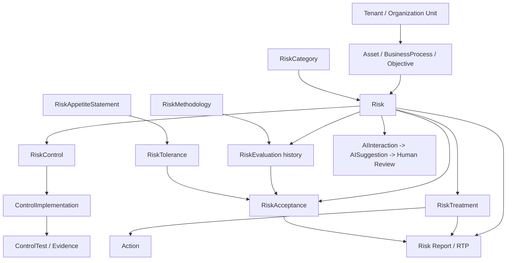

# مشخصات تفصیلی ماژول مدیریت ریسک — GRC Platform

> **شناسه:** GRC-RISK-101 · **نسخه:** 0.1.0 · **وضعیت:** DRAFT / نیازمند تصویب Product Owner، Tech Lead، QA و Security  
> **تاریخ مبنا:** ۱۴۰۵/۰۷/۲۱ / 2026-10-13  
> **Baseline اجرایی:** `main@e7a745c47919f6ec028e429c210bbdfd4589c691` / پایلوت `pilot-20261013-r1`  
> **اسناد مادر:** [PRD-001](../GRC-PRD-001_FA.md)، [SRS-002](../GRC-SRS-002_FA.md)، [DATA-003](../GRC-DATA-003_FA.md)، [API-AI-004](../GRC-API-AI-004_FA.md)، [UX-005](../GRC-UX-005_FA.md)، [RTM-006](../GRC-RTM-006_FA.md)، [UAT-007](../GRC-UAT-007_FA.md)  
> **وضعیت‌های این سند:** **AS-IS** تأیید از کد، **OBSERVED** خروجی اپراتور، **GAP** نقص شناخته‌شده، **TO-BE** الزام طراحی، **R2** توسعه بعدی. وجود فیلد پیشنهادی به معنای وجود Migration/API آن نیست.

## ۱. مأموریت و دامنه

### هدف کسب‌وکاری
شناخت، ثبت، ارزیابی، اولویت‌بندی، تصمیم‌گیری، درمان، پذیرش و پایش ریسک‌های مرتبط با اهداف/دارایی‌ها/فرآیندهای سازمان با تاریخچه قابل استناد؛ اتصال هر تصمیم به Control، Evidence، Action، Approval و گزارش RTP. این بخش یک موتور مشترک برای ISMS/ISO 27001، ISO 31000، افتا، COBIT، کیفیت، عملیات و ارزیابی‌های سفارشی است و **یک روش امتیازدهی واحد را بر همه صنایع تحمیل نمی‌کند**.

### دستاورد قابل سنجش
- هر ریسک مالک، دامنه، سناریو و شناسه پایدار دارد.
- امتیاز ریسک از Methodology معتبر و نسخه مشخص قابل بازتولید است.
- چهار نوع ارزیابی تاریخی `inherent/current/residual/target` بدون overwrite ثبت می‌شوند.
- تصمیم پذیرش با سیاست تحمل و بازبین مستقل قابل بررسی و در زمان معین منقضی می‌شود.
- Treatment به کنترل، کار، شواهد و سنجش اثربخشی متصل می‌شود.
- Dashboard/Reports فقط از داده مجاز، قابل‌ردیابی و به‌روز مشتق می‌شوند.
- AI فقط پیشنهادِ مستند با بازبینی انسانی تولید می‌کند.

### خارج از دامنه نسخه نخست
FAIR/Monte Carlo و مدل پیشرفته کمی، ارزش‌گذاری پولی خودکار، تایید خودکار ریسک توسط AI، پیش‌بینی معتبر احتمال رخداد با ML و تصمیم‌های حقوقی/بیمه‌ای خودکار. این‌ها در R2 نیازمند مدل و منابع مستقل‌اند.

## ۲. اصطلاحات و تمایزهای دامنه
| اصطلاح | تعریف و تفاوت |
|---|---|
| Risk | هویت و سناریوی یک عدم قطعیت بر اهداف؛ **معادل RiskEvaluation نیست** |
| Asset | دارایی زمینه‌ساز ریسک؛ رابطه موجود Risk.asset اختیاری است |
| RiskCategory | نوع ریسک، نه وضعیت یا درجه ریسک |
| Methodology | روش و معیارهای محاسبه؛ متکی به Tenant |
| Inherent | ارزیابی قبل از اثر کنترل‌های مورد بررسی |
| Current | ارزیابی وضعیت جاری، طبق متد مصوب |
| Residual | ریسک باقیمانده بعد از کنترل‌های موجود |
| Target | مقدار هدف پس از درمان پیشنهادی |
| Appetite | بیانیه رسمی تمایل سازمان نسبت به ریسک |
| Tolerance | حداکثر امتیاز پذیرفته‌شده در نوع ارزیابی مشخص |
| Treatment | برنامه پاسخ به ریسک (کاهش/اجتناب/انتقال/پذیرش) |
| Acceptance | تصمیم مستند و مستقل برای پذیرش بر مبنای ارزیابی و Appetite |
| RiskControl | پیوند بین یک ریسک و اجرای واقعی یک کنترل، نه صرفاً عنوان Control |
| Evidence | مدرک با منشأ، طبقه‌بندی، اعتبار زمانی و ارتباط با موضوع |
| RTP | برنامه درمان/برخورد با ریسک؛ خروجی از داده ثبت‌شده |

## ۳. نقشه دامنه و روابط



**کار‌دینالیتی واقعی AS-IS:** `Risk.asset` یک FK اختیاری است، پس یک ریسک حداکثر یک Asset مستقیم دارد؛ Risk↔Process و Risk↔Objective با مدل‌های میانی موجودند؛ پیوند چنددارایی یک خواسته TO-BE است. `Action` ناشی از Treatment از طریق `source_type='risk_treatment'` و `source_id` مرتبط می‌شود، نه FK مستقیم. همه روابط مهم باید Tenant/Scope compatible باشند.

## ۴. فرهنگ داده فیلدبه‌فیلد

### ۴.۱ Risk (AS-IS با مدل `apps.risks.Risk`)
| نام ذخیره/فیلد | نوع | اجباری | قابل‌ویرایش | محدودیت/توضیح |
|---|---|---|---|---|
| `id` | UUID | خودکار | خیر | شناسه پایدار |
| `tenant` | FK Tenant | خودکار از نشست | خیر | هرگز از کلاینت قابل اعتماد نباشد |
| `organization_unit` | FK nullable | خیر | با مجوز | `null` دامنه کل Tenant؛ نیازمند whole-tenant permission |
| `asset` | FK Asset nullable | خیر | با مجوز | باید Tenant و Unit هم‌دامنه باشد؛ هنگام Scope change مجدداً validate شود |
| `category` | FK RiskCategory nullable | خیر | با مجوز | Tenant خود یا دسته global مجاز |
| `code` | Char(100) | بله | با سیاست کد | unique(Tenant,code)، trim و طول ورودی |
| `title` | Char(255) | بله | بله | عنوان روشن؛ طول و خالی‌نبودن در UI/API |
| `scenario` | Text | خیر در DB | بله | رخداد مشخص و شرایط؛ برای ارزیابی حرفه‌ای در مرحله Open لازم شود (TO-BE) |
| `cause` | Text | خیر | بله | تهدید/نقطه شکست/محرک |
| `consequence` | Text | خیر | بله | اثر بر هدف/دارایی/خدمت |
| `owner` | FK User | بله | بله | عضو فعال همان Tenant |
| `status` | enum | پیش‌فرض `draft` | از Transition مجاز | `draft/open/treatment/accepted/closed/archived` |
| `review_date` | Date nullable | خیر | بله | UI شمسی؛ API Gregorian ISO |
| `metadata` | JSON | پیش‌فرض `{}` | محدود | کانال توسعه کنترل‌شده، نه کلیدهای کسب‌وکار نامعتبر |
| `created_at/updated_at/deleted_at` | Timestamp | خودکار | خیر | Audit و soft-delete |

**AS-IS UX:** ایجاد فرم ریسک در `/risks` `code,title,owner` را الزامی می‌کند، `organization_unit,asset,scenario,cause,consequence,review_date` اختیاری‌اند و هنگام ایجاد `status=open` می‌فرستد؛ فرم Edit ندارد. Backend `RiskViewSet` قابلیت PATCH/UPDATE با RBAC و رویداد `risk.update` دارد (#183).

**TO-BE فیلدهای تکمیلی:** `risk_statement` ساختاریافته (علت→رویداد→پیامد)، `risk_source`, `threat`, `vulnerability`, `business_impact_dimension`, `identified_by`, `identified_at`, `next_review_reason`, `approval_required`; برای فیلدهای جدید نیاز به Product Decision، Migration و Data Import Map است، نه ذخیره بی‌قاعده در Metadata.

### ۴.۲ RiskCategory (AS-IS)
| فیلد | نوع/قید |
|---|---|
| `tenant` | nullable؛ `null` = Global Category |
| `parent` | FK خودارجاع اختیاری؛ بدون چرخه و Parent ناسازگار |
| `code` | Slug(100)، یکتا با توجه به مالکیت |
| `name` | Char(200)، لازم |
| `description` | Text |
| `is_global` | خروجی مشتق‌شده Serializer (read-only) |

Global Category باید فقط خواندنی باشد؛ Category محلی با `risk.manage` کل Tenant ساخته/اصلاح شود. وضعیت حذف در صورت داشتن فرزند یا ریسک مرجع ممنوع باشد.

### ۴.۳ RiskMethodology (AS-IS و TO-BE)
| فیلد | نوع | وضعیت و قید |
|---|---|---|
| `id` | UUID | خودکار |
| `tenant` | FK | سازمانی؛ روش Global بین Tenantها نیست |
| `name` | Char(200) | یکتا برای هر Tenant |
| `methodology_type` | enum | `qualitative/semi_quantitative/quantitative` |
| `likelihood_scale` | JSON list | در `create` اگر غایب باشد default؛ آیتم نمونه `{value:1,label:'Rare'}` |
| `impact_scale` | JSON list | مشابه |
| `matrix` | JSON object | در کد فعلی ذخیره می‌شود، اما فرمول محاسبه فعلی از آن استفاده نمی‌کند |
| `thresholds` | JSON list | نمونه `{min:10,max:16,level:'high'}` |
| `formula` | String | فعلاً فقط `product` توسط `calculate_score` پشتیبانی می‌شود |
| `is_default` | Boolean | در ثبت/ویرایش یکی دیگر default قبلی برداشته می‌شود |
| `status` | Char(20) | `active` برای انتخاب در UI؛ صرفاً String در مدل جاری |
| `created_at/updated_at` | Timestamp | خودکار |

**TO-BE قواعد الزامی روش:**
- Scale ها غیرتهی، مقدار عددی یکتا، برچسب روشن و بازه معتبر باشند.
- احتمال/اثر ورودی باید در دامنه یا مجموعه مقادیر مصوب Scale قرار داشته باشند؛ `DecimalField` به‌تنهایی کافی نیست.
- Threshold بدون شکاف، همپوشانی ناخواسته و خارج از دامنه Score تعریف شود؛ سطح نامعتبر Reject.
- فقط Formula مورد پشتیبانی فعال شود؛ `qualitative` و `quantitative` بدون Engine مناسب نباید وعده محاسبه معتبر دهند.
- **روش استفاده‌شده باید غیرقابل‌تغییر یا نسخه‌دار باشد** تا تغییر Threshold معنی ارزیابی تاریخی را عوض نکند. AS-IS Version مستقل ندارد.
- ساخت اولین Methodology مسیر راهنمای اولیه و Error Validation روشن داشته باشد؛ روش آزمایشی از پیش‌تعریف‌شده فقط با تصمیم و تأیید کاربر ساخته شود، نه به‌صورت مخفی.

### ۴.۴ RiskEvaluation (AS-IS)
| فیلد | نوع | قید |
|---|---|---|
| `risk` | FK Risk | همان Tenant/Scope |
| `methodology` | FK Methodology | همان Tenant |
| `evaluation_type` | enum | `inherent/current/residual/target` |
| `likelihood` | Decimal(10,2) | ورودی مثبت در UI؛ **TO-BE عضو مقیاس معتبر** |
| `impact` | Decimal(10,2) | مشابه |
| `score` | Decimal(14,4) | سمت سرور `likelihood * impact` در روش `product` |
| `level` | Char(40) | از Threshold؛ در غیر این صورت فعلاً `unclassified` |
| `evaluated_by` | FK User | از نشست |
| `evaluated_at` | DateTime | خودکار/سرور |
| `rationale` | Text | AS-IS اختیاری؛ TO-BE برای تصمیم‌های مهم الزامی |

**قاعده:** هر ارزیابی یک ردیف تاریخی جدید؛ `latest_evaluations` در پاسخ Risk خلاصه آخرین هر نوع را نمایش می‌دهد؛ این خلاصه، فهرست کامل تاریخچه نیست. باید API/صفحه History شامل فیلتر نوع، روش، زمان و مرجع باشد.

**قانون پیش‌فرض محاسبه کد:** Score=`L×I`، Thresholdها `low:1..4, medium:5..9, high:10..16, critical:17..25`؛ مثال `L=3,I=4` → `12/high` **صرفاً وقتی همین روش/Threshold ذخیره و فعال باشد**.

### ۴.۵ RiskControl (AS-IS)
| فیلد | نوع/قید |
|---|---|
| `risk` | FK Risk |
| `control_implementation` | FK ControlImplementation |
| `relationship_type` | `existing/treatment/compensating` |
| Unique | جفت `risk + control_implementation` تکراری نشود |
| Scope | هم‌Tenant، و ControlImplementation در Unit ریسک |

**TO-BE:** در جزئیات ریسک، عملکرد/آخرین آزمون/شواهد این کنترل نیز نشان داده شود؛ اثر آن بر residual score توسط مسئول ارزیابی توجیه شود، نه با ادعای خودکار.

### ۴.۶ RiskTreatment (AS-IS)
| فیلد | نوع/قید |
|---|---|
| `risk` | FK Risk |
| `strategy` | `avoid/reduce/transfer/accept` |
| `description` | Text |
| `owner` | FK User، عضو فعال Tenant |
| `target_date` | Date nullable |
| `target_score` | Decimal nullable |
| `approval_status` | `not_submitted/pending/approved/rejected` |
| `status` | `draft/planned/in_progress/completed/cancelled` |
| `accepted_by/accepted_at` | داده زمان/عامل اجرای action `accept` فعلی (نام‌گذاری برای Approval می‌تواند مبهم باشد) |

**مشاهده از کد:** ایجاد Treatment، `Risk.status=treatment` می‌کند؛ Actionهای منبع `risk_treatment` می‌سازد؛ endpoint `accept` با همان `risk.treatment.manage` Approval Status را `approved` می‌کند. **این رفتار موجود لزوماً سیاست تفکیک وظایفِ کامل نیست** و با `RiskAcceptance` قانونی/حاکمیتی تفاوت دارد.

**TO-BE:** مقدار/هزینه، معیار موفقیت، نیازمندی کنترل، شواهد اجرا، تفکیک Submit/Approve، استقلال Approver، اثرگذاری واقعی بعد از Test، اتصال Action و کنترل تکمیل پیش‌شرط‌های Status.

### ۴.۷ RiskAppetiteStatement / RiskTolerance (AS-IS)
| موجودیت | فیلدها و قید |
|---|---|
| Appetite | `code,version,title,description,organization_unit,owner,status,effective_from,effective_until,approved_by,approved_at` |
| Tolerance | `statement,evaluation_type(current|residual),maximum_score,description` |

قواعد جاری: نسخه Draft قابل اصلاح؛ نسخه Approved ثابت است، Retire مسیر جدا دارد؛ Owner نباید Appetite خود را Approve کند؛ برای Approval حداقل یک Tolerance لازم است؛ دو نسخه مصوب متداخل در یک دامنه ممنوع‌اند.

### ۴.۸ RiskAcceptance (AS-IS)
| گروه | فیلدها |
|---|---|
| مرجع | `risk,evaluation,appetite,tenant` |
| درخواست | `requested_by,rationale,review_on,expires_on,supersedes,exception_justification` |
| تصمیم | `status,decided_by,decided_at,decision_note` |
| Snapshot | `evaluation_type_snapshot,score_snapshot,likelihood_snapshot,impact_snapshot,evaluated_at_snapshot,tolerance_max_snapshot,exceeds_tolerance` |

قواعد جاری: فقط ارزیابی `current` یا `residual`، Appetite مصوب و مؤثر و Tolerance متناسب؛ متقاضی نمی‌تواند درخواست خود را Approve/Reject کند؛ پذیرش مازاد بر حد تحمل نیازمند `risk.accept.override` و استدلال/یادداشت مستقل است؛ برای جایگزینی Approval قبلی باید `supersedes` صحیح ثبت شود؛ Snapshot درخواست immutable است.

## ۵. وضعیت‌ها و ماشین حالت

### ۵.۱ وضعیت Risk — AS-IS در مدل
`draft, open, treatment, accepted, closed, archived`.

**محدودیت AS-IS:** `RiskSerializer` امکان مقداردهی `status` را در ModelViewSet دارد؛ در کد مرورشده قواعد کامل Transition/Precondition برای تمام حالت‌ها مشاهده نمی‌شود. بنابراین وضعیت فعلی را نباید معادل Workflow رسمی تصویب دانست.

### ۵.۲ ماشین حالت هدف (TO-BE، نیازمند Approval)
| از | به | پیش‌شرط اجباری | مجوز/نقش |
|---|---|---|---|
| draft | open | Owner، Scope، Scenario روشن و اعتبار داده | `risk.manage` |
| open | treatment | حداقل ارزیابی مناسب و طرح درمان | `risk.treatment.manage` |
| open/treatment | accepted | RiskAcceptance مستقلِ Approved و معتبر | فقط مسیر `risk.accept.approve` / `override` |
| treatment | open | درمان رد/لغو یا نقص اصلاحی با دلیل | مالک مجاز + Audit |
| treatment/accepted | closed | ارزیابی نهایی و اثبات کنترل/نتیجه، تأیید مجاز | نقش Close ویژه (TO-BE) |
| any nonarchived | archived | بدون نابودکردن Snapshot/Reportهای موجود و با تأیید | `risk.manage` |
| accepted | open/treatment | انقضای پذیرش یا تغییر زمینه/تجدید ارزیابی | Workflow کنترل‌شده |

تغییر وضعیت از UI/Endpoint عمومی نباید Approval/Appetite/evaluation را دور بزند. هنگام پیاده‌سازی نیازمند تصمیم مجزا درباره `closed` و `accepted` و مهاجرت داده‌های قدیمی است.

### ۵.۳ حالت‌های مستقل
- Treatment lifecycle با Approval Status یکی نیست.
- Appetite Version/Status مستقل از Risk Status است.
- RiskAcceptance `pending/approved/rejected/superseded` یک تصمیم مجزا است.
- Action `progress=100` مساوی Closed Risk نیست.

## ۶. صفحات و کامپوننت‌ها — قرارداد دقیق

### RSK-SCR-01 — فهرست ریسک‌ها `/risks`
**AS-IS:** فهرست کد/عنوان/واحد/مالک و آخرین inherent/residual/target/status، جست‌وجو و فرم Create.  
**TO-BE:** فیلتر کد، عنوان، واحد، دسته، Asset، Owner، Level و نوع ارزیابی، Due/Overdue، Status، Framework، بدون ارزیابی؛ Pagination سروری، Sort، ستون‌های قابل تنظیم، دسترسی Save/View/Edit مجاز و Export.  
**حالت خالی:** بدون ریسک ≠ بدون مجوز؛ Empty/Error/Loading جدا.  
**عملکرد:** کلیک شناسه به Detail، دکمه «ریسک جدید» فقط اگر مجاز، هشدار نداشتن Methodology قبل از ارزیابی.

### RSK-SCR-02 — ایجاد/ویرایش ریسک
**گروه A هویت:** Code*, Title*, Category, Owner*, Unit/Scope, Asset.  
**گروه B تحلیل:** Scenario, Cause, Consequence, Process/Objective روابط (TO-BE).  
**گروه C مرور:** ReviewDate, Status تحت Workflow، توضیح علت تغییر.  
**دکمه:** Save، Save & Continue، Cancel؛ Submit busy و عدم دوباره‌ارسال؛ خطای فیلدی؛ History.  
**AS-IS:** Create موجود؛ Edit UI غایب؛ Backend PATCH موجود (#183).  
**TO-BE:** اطلاعات از GET prefill، Scope change دوباره Asset را validate کند، کد/رابطه اصلی بدون برهم‌زدن History تغییر یابد؛ هنگام خطای PATCH داده تایپ‌شده حفظ شود.  
**قواعد نسخه‌ای:** اگر دو کاربر یک رکورد را ویرایش کنند، Version/ETag یا مقایسه `updated_at` و پاسخ Conflict هدف است، نه overwrite کورکورانه.

### RSK-SCR-03 — جزئیات ریسک `/risks/[id]`
تب‌های پیشنهادی:
1. **خلاصه:** Code، Title، Owner، Unit، Asset لینک‌دار، Status، تاریخ بازنگری و KPI معتبر؛ موقعیت Asset در ابتدای صفحه.
2. **سناریو و تحلیل:** Scenario/Cause/Consequence، Category، روابط Process/Objective، Knowledge Links.
3. **ارزیابی‌ها:** 4 کارت آخرین نوع، نمودار Trend و **جدول تاریخچه همه ارزیابی‌ها**.
4. **کنترل‌ها و شواهد:** ControlImplementation، آخرین TestRun، Evidence Status.
5. **درمان و اقدامات:** Treatment Strategy، Status/Approval، Owner، Target، Action، Progress.
6. **حاکمیت/پذیرش:** Appetite مؤثر، Tolerance، Acceptance History، Expiry/Review.
7. **خروجی و سابقه:** RTP، تغییرات، تصمیم‌ها، نسخه روش، Export و Audit.

**AS-IS:** صفحه جزئیات Form ارزیابی/درمان/اقدام و Download RTP دارد؛ `دارایی مرتبط: {risk.asset_title || 'بدون دارایی مشخص'}` پایین بخش «سناریو و عوامل ریسک» است؛ **Edit ندارد** و History کامل همه ارزیابی‌ها در صفحه فعلی نیست.

### RSK-SCR-04 — روش‌های ارزیابی `/risks/methodologies`
**AS-IS:** دکمه `+ روش 5×5` با `window.prompt` نام را می‌گیرد و POST می‌زند؛ خطای کلی «ثبت ناموفق بود» نمایش می‌دهد.
**TO-BE:** فهرست نسخه‌ها، فرم فارسی برای عنوان، نوع، مقیاس احتمال/اثر (هر عدد و Label و تعریف)، Threshold و Level، Formula، وضعیت، پیش‌نمایش ماتریس با Legend، شبیه‌سازی Score، انتخاب Default، Publish/Archive و تاریخچه.  
**رفتار در شکست:** دقیقاً Response امن 4xx را نمایش دهد، بدون ارسال Secret؛ برای `401` و Refresh، تشخیص نشست از خطای Validation جدا باشد.  
**Gap پایلوت:** `POST risk-methodologies/` با 400 شکست خورد؛ علت **نامشخص** تا دریافت Response. هیچ Fix در این سند ادعا نمی‌شود.

### RSK-SCR-05 — حاکمیت ریسک `/risks/governance`
**AS-IS:** تنظیم Appetite/Residual Tolerance، فهرست نسخه‌های مصوب، Request Acceptance با Snapshot ارزیابی Current/Residual، بازبینی مستقل و Approval/Reject.  
**TO-BE:** نمایش واضح Effective/Expired/Retired، هشدار تضاد روش امتیازدهی با Tolerance، مقایسه Risk Score در مقابل Limit، تاریخ تجدیدنظر، Approval Conflict و Queue بازبین.

### RSK-SCR-06 — مرکز گزارش ریسک `/reports` و `/risks/[id]`
نمای RTP، Risk Register، Heatmap، Change History، Acceptance/Expiry، Treatment Aging، Open Actions، Exceptions و Trends؛ در قالب‌های معتبر با برچسب Draft/Approved و Scope.

### RSK-SCR-07 — کارتابل `/work`
ریسک‌های نیازمند ارزیابی، بازنگری نزدیک، Treatment تأخیردار، پذیرش در انتظار Approval، سند/شاهد منقضی و Change impactهای مهم؛ هر ردیف لینک به رکورد مرجع.

## ۷. APIهای موجود و قرارداد هدف

| عملیات | AS-IS Endpoint | حق دسترسی موجود / مرز |
|---|---|---|
| Category List/Create/Update/Archive | `GET/POST /api/v1/risk-categories/`، `PATCH/DELETE .../{id}/` | `risk.view`؛ Manage کل Tenant برای نوشتن |
| Methodology List/Create/Update/Archive | `GET/POST /api/v1/risk-methodologies/`، `PATCH/DELETE .../{id}/` | `risk.view` برای خواندن؛ whole-Tenant `risk.manage` برای نوشتن |
| Risk List/Create | `GET/POST /api/v1/risks/` | `risk.view` / `risk.manage` در Scope |
| Risk Detail/PATCH/DELETE | `GET/PATCH/DELETE /api/v1/risks/{id}/` | Read/Manage؛ Archive نرم در DELETE |
| Evaluate | `POST /api/v1/risks/{id}/evaluate/` | `risk.evaluate` و Tenant method match |
| Single Risk RTP | `GET /api/v1/risks/{id}/rtp/?format=json\|docx` | `risk.view` + Scope |
| Risk Controls | `/api/v1/risk-controls/` | `risk.view`/Manage و Unit match |
| Treatment | `/api/v1/risk-treatments/` | `risk.view`/treatment.manage |
| Treatment Action | `POST /api/v1/risk-treatments/{id}/actions/` | `risk.treatment.manage` |
| Treatment Accept | `POST /api/v1/risk-treatments/{id}/accept/` | `risk.treatment.manage` **(Gap SoD target)** |
| Appetite | `/api/v1/risk-appetites/`, `POST /{id}/approve/`, `POST /{id}/retire/` | `risk.appetite.view/manage/approve` |
| Tolerance | `/api/v1/risk-tolerances/` | `risk.appetite.view/manage` |
| Acceptance | `/api/v1/risk-acceptances/`, `POST /{id}/approve/`, `POST /{id}/reject/` | `risk.view`, `risk.accept.request/approve/override` |
| Report Center RTP | `/api/v1/reports/catalog/`, `preview/`, `export/` با `type=rtp` | `report.view` + Scope و فیلتر |

**نکته فنی:** Routerهای DRF امکان PUT/PATCH/DELETE برای ViewSetهای ModelViewSet دارند؛ نام روش‌ها و Payloadهای رسمی باید در OpenAPI اجرایی و تست قرارداد تعیین شوند. موارد History کامل/Method Versioning/ETag/API گزارش‌های جدید در این جدول فقط TO-BE هستند، نه مسیرهای موجود.

### ۷.۱ درخواست نمونه ایجاد Risk — قرارداد فعلی
```json
{
  "organization_unit": "00000000-0000-4000-8000-000000000011",
  "asset": "00000000-0000-4000-8000-000000000012",
  "category": null,
  "code": "TEST-RISK-001",
  "title": "اختلال در سامانه مدیریت اسناد",
  "scenario": "بازیابی سرویس پس از خرابی با شکست مواجه شود",
  "cause": "نقص پشتیبان‌گیری یا خطای انسانی",
  "consequence": "توقف فرآیندهای وابسته",
  "owner": 1,
  "status": "open",
  "review_date": null,
  "metadata": {}
}
```
UUID/Owner در این نمونه **مصنوعی** است و نباید به عنوان ID محیط واقعی استفاده شود؛ `tenant` هرگز در Payload قابل اعتماد نیست.

### ۷.۲ درخواست نمونه ارزیابی — AS-IS
```json
{
  "methodology": "00000000-0000-4000-8000-000000000021",
  "evaluation_type": "inherent",
  "likelihood": "3",
  "impact": "4",
  "rationale": "امتیاز آزمایشی در روش 5×5"
}
```
خروجی موفق `201` شامل `id,evaluation_type,score,level,likelihood,impact` است. در روش Product با Thresholdهای پیش‌فرض `score=12.0000`، `level='high'`.

### ۷.۳ پاسخ خطا — قرارداد هدف
```json
{
  "error": {
    "code": "RISK_METHOD_INVALID",
    "message": "امتیاز احتمال خارج از مقیاس روش است.",
    "fields": {"likelihood": ["مقدار انتخاب‌شده مجاز نیست."]},
    "request_id": "request-uuid"
  }
}
```
**TO-BE**: ساختار خطای مرکزی باید با Responseهای موجود DRF سازگار/نسخه‌دار شود؛ کلاینت فعلی ممکن است پاسخ Field Error خام DRF بگیرد. توسعه‌دهنده حق ندارد بدون تست، پاسخ همه APIها را تغییر دهد.

## ۸. قواعد اعتبارسنجی بحرانی و معیار عدم پذیرش

| Rule ID | الزام | وضعیت مبنا |
|---|---|---|
| RISK-VAL-001 | Tenant/Scope همه FKs با Risk یکسان، Owner فعال | AS-IS در serializerهای اصلی |
| RISK-VAL-002 | `code` یکتا در Tenant و Trim/Length | Unique DB؛ UI Create Length 80 با DB 100 |
| RISK-VAL-003 | Asset با Unit سازگار؛ تغییر Unit لینک ناسازگار را رد کند | AS-IS Backend؛ UI Create reset asset |
| RISK-VAL-004 | Formula ناشناخته و Methodology Tenant دیگر Reject | AS-IS در `calculate_score` و `evaluate_risk` |
| RISK-VAL-005 | Probability/Impact عضو Scale و Threshold coverage معتبر | **TO-BE؛ در سرویس محاسبه فعلی enforce نمی‌شود** |
| RISK-VAL-006 | RiskEvaluation immutability + Methodology version frozen | تاریخچه Create موجود؛ Freeze نسخه Method TO-BE |
| RISK-VAL-007 | پذیرش فقط Current/Residual و Appetite Effective | AS-IS در Acceptance Serializer |
| RISK-VAL-008 | Requester≠Decider، Tolerance override مجاز | AS-IS Acceptance View/Model |
| RISK-VAL-009 | Status `accepted/closed` از Generic PATCH دور زده نشود | TO-BE Gap تعیین سیاست |
| RISK-VAL-010 | Treatment Approval نیازمند SoD و Approval reason | TO-BE Gap در endpoint `accept` |
| RISK-VAL-011 | Assessment که Scope/Methodology تغییر کرده نیازمند بررسی Stale شود | TO-BE |
| RISK-VAL-012 | Archive باعث حذف تاریخچه/Decision/Report نشود | Soft Delete AS-IS، کنترل گزارش TO-BE |
| RISK-VAL-013 | جلوگیری از `double-submit` ارزیابی/درمان/پذیرش | UI busy موجود بخشی؛ Idempotency TO-BE |
| RISK-VAL-014 | فرم‌ها تاریخ Jalali و API Date ISO داشته باشند | GAP #182 |
| RISK-VAL-015 | Error 400/401/403/409 دقیق، ایمن و قابل فهم باشد | GAP صفحه Methodology |

## ۹. ماتریس مجوزها (هدف منطبق بر کد تا حد معلوم)

| فعالیت | حداقل Permission منطبق با کد | محدودیت |
|---|---|---|
| مشاهده ریسک/Export تک‌ریسک | `risk.view` | Unit Scope |
| ثبت و ویرایش ریسک | `risk.manage` | Unit قدیم/جدید |
| ساخت روش و دسته محلی | `risk.manage` | whole Tenant |
| ارزیابی ریسک | `risk.evaluate` | Unit |
| ثبت درمان/Action | `risk.treatment.manage` | Risk Unit |
| مشاهده سیاست | `risk.appetite.view` | Scope |
| مدیریت سیاست/Threshold | `risk.appetite.manage` | Unit/whole |
| تصویب Appetite | `risk.appetite.approve` | جدا از Owner |
| درخواست پذیرش | `risk.accept.request` | Unit |
| تصویب/رد پذیرش | `risk.accept.approve` | Unit، مستقل از Requester |
| Override حد تحمل | `risk.accept.override` | با justification |
| گزارش مرکز | `report.view` | Unit و Tenant |
| AI درباره ریسک | `ai.use` + `risk.view` | Provider/Classification Policy |

**قاعده UX:** Buttons باید متناسب با مجوز دیده شوند؛ **قاعده امنیت:** حتی اگر کاربر درخواست مستقیم API بسازد، Backend همه مجوزها را مجدداً بررسی کند.

## ۱۰. گردش‌کار کامل کاربر

### FLOW-RSK-01 — شناسایی و ثبت
1. انتخاب Tenant و Scope واقعی.
2. انتخاب Asset/Process/Objective مجاز.
3. ثبت Code، Title، Owner، Scenario/Cause/Consequence.
4. بررسی کد تکراری و Scope.
5. ذخیره و نمایش Detail با پیوند Asset در Header و Audit.
6. ویرایش/Change Reason توسط Owner مجاز؛ Refresh و تأیید Persistence.

### FLOW-RSK-02 — ارزیابی اولیه
1. اگر Methodology فعال وجود ندارد: پیام واضح + لینک ساخت در Scope whole-Tenant (نه دکمه غیرفعال بی‌علت).
2. انتخاب Methodology مصوب؛ نمایش مقیاس و تعریف احتمال/اثر.
3. انتخاب Type (`inherent`) و مقادیر قابل قبول، ثبت Rationale.
4. محاسبه Backend و ثبت Evaluation تاریخی با Actor/Time/Method Version.
5. نمایش Score/Level و وضعیت «بیش از حد تحمل» در صورت وجود Policy قابل تطبیق.
6. ارزیابی دوباره با Type دیگر تاریخچه قبلی را بازنویسی نکند.

### FLOW-RSK-03 — کنترل و Residual
1. انتخاب `ControlImplementation` هم‌دامنه و تعیین Existing/Treatment/Compensating.
2. مشاهده Evidence/Effectiveness/Test آخر.
3. ثبت Residual/Current با استدلال؛ مقایسه Inherent↔Residual.
4. عدم وجود Evidence یا Control Test با وضعیت «نامشخص/اثبات‌نشده» مشخص شود.

### FLOW-RSK-04 — درمان
1. انتخاب پاسخ Reduce/Avoid/Transfer/Accept.
2. تعریف Owner، Target Date/Score و کارها.
3. درخواست Review و Approve مستقل (TO-BE برای Treatment).
4. کارهای Action در Work Center با سررسید و Progress.
5. بارگذاری Evidence، آزمون Effectiveness، ارزیابی Residual جدید و Closure کنترل‌شده.
6. تأخیر یا رد اجرا، اعلان و Escalation بدهد.

### FLOW-RSK-05 — اشتها و پذیرش
1. مدیر ریسک Appetite Draft و Tolerance نسخه‌دار تعریف می‌کند.
2. Approver مستقل آن را تصویب می‌کند.
3. Risk دارای Current/Residual Evaluation و Appetite موثر انتخاب می‌شود.
4. Request شامل Rationale و Review/Expiry و Exception ساخته می‌شود.
5. درخواست به Approver مستقل می‌رود؛ اگر Score بیش از Tolerance است Permission `override` و توجیه مستقل لازم است.
6. Approve/Reject و Snapshot با Audit؛ درخواست بعدی برای تجدید نیاز به Supersession صحیح دارد.
7. انقضا/ReviewOn هشدار تولید کند؛ در Dashboards تصمیم منقضی به‌عنوان پذیرش معتبر نمایش داده نشود.

### FLOW-RSK-06 — RTP و گزارش
1. Risk/Scope/Time/Status انتخاب شوند.
2. Snapshot ریسک، ارزیابی‌ها، کنترل‌ها، طرح‌ها، اقدامات و Acceptance معتبر به Dataset گزارش برسند.
3. Preview و Download در فرمت واقعی پشتیبانی‌شده؛ Audit Export و عنوان Draft/Approved روشن.
4. در گزارش مدیریتی از Riskهای فاقد ارزیابی، «N/A» یا «ارزیابی‌نشده» به‌جای Risk=0 استفاده شود.

## ۱۱. هوش مصنوعی اختصاصی ریسک

### ۱۱.۱ AS-IS
`POST /api/v1/ai/assist/risk/` ورودی `risk_id?`, `text?`, `provider_id?`, `classification?` می‌گیرد. قبل از تحلیل Risk، `risk.view` و Tenant/Unit کنترل می‌شود. خروجی یک `AIInteraction` و `AISuggestion` از نوع `risk_analysis` است که `proposed_value.text` دارد؛ **نه RiskEvaluation/Action قطعی**.

### ۱۱.۲ TO-BE: داده ورودی حداقلی و مجاز
| داده | منبع و شرط |
|---|---|
| Risk ID, Title, Scenario, Cause, Consequence | رکورد Risk قابل رؤیت |
| Tenant/Unit | سرور فقط برای Authorization؛ شناسه خام لازم نیست لزوماً به مدل برود |
| Asset Name/Type/Criticality/CIA | Asset مجاز و مرتبط |
| Process/Objective | فقط رابطه موجود و قابل‌دسترسی |
| Methodology/Scale/Threshold Version | روش مصوب و Snapshot |
| Evaluation History | فقط بازه/نوع مرتبط، مجوز risk.view |
| Control/Implementation/Test | فقط Scope سازگار و Evidence مجاز |
| Relevant Requirements | Framework مجاز و حقوق استفاده معتبر |
| Evidence source/date/hash/status | فقط اطلاعات لازم، بدون Secrets |
| Risk Appetite & Tolerance | سیاست مؤثر و مجاز برای مقایسه |
| Task/Output Schema/Language | نسخه قرارداد و نیاز کاربر |
| Classification/Provider policy | در Gateway سمت سرور، نه دستور مدل |

### ۱۱.۳ TO-BE: قالب خروجی ساختاریافته
```json
{
  "schema_version": "grc.risk.ai.v1",
  "subject": {"type": "risk", "id": "00000000-0000-4000-8000-000000000001"},
  "status": "suggestion",
  "summary": "ریسک نیازمند بررسی قابلیت بازیابی است",
  "candidate_causes": [
    {"text": "خرابی بازیابی نسخه پشتیبان", "supporting_source_ids": []}
  ],
  "candidate_impacts": [
    {"text": "وقفه در سرویس اسناد", "supporting_source_ids": []}
  ],
  "control_gaps": [
    {"statement": "شواهد آزمون بازیابی در Context مجاز موجود نیست", "supporting_source_ids": [], "certainty": "unknown"}
  ],
  "candidate_treatments": [
    {"strategy": "reduce", "title": "آزمون بازیابی", "rationale": "احراز توان بازیابی", "required_evidence": "گزارش آزمون"}
  ],
  "unknowns": ["مدرک آزمون بازیابی وجود ندارد"],
  "human_review_required": true,
  "risk_score_is_authoritative": false
}
```
این **طراحی پیشنهادی** است. نمره یا پیشنهاد AI نباید جایگزین حساب Methodology و تصمیم مسئول شود؛ `supporting_source_ids` باید واقعاً در Scope قابل دسترس باشند. مدل نباید منابع جعلی یا اطلاعات Tenant دیگر را نمایش دهد.

### ۱۱.۴ موارد استفاده
- پیشنهاد ریسک‌های محتمل از دارایی/فرآیند مشخص (نه ایجاد مستقیم).
- تحلیل سناریو/علت/پیامد و تکمیل Draft توسط کارشناس.
- پیشنهاد کنترل و Evidence لازم برای تأیید اثربخشی.
- تهیه متن توجیه Treatment و گزارش تغییر امتیاز.
- تشخیص داده ناکافی برای محاسبه/پذیرش.
- پیشنهاد خلاصه برای کمیته ریسک با استناد به رکوردهای Authoritative.
- خودکارسازی فقط Draft/Task مجاز؛ پذیرش، Close و Approval کاملاً انسانی.

## ۱۲. گزارش‌ها و خروجی‌ها

| Report ID | ورودی/فیلتر | خروجی مورد انتظار | وضعیت |
|---|---|---|---|
| RPT-RSK-01 | Risk ID | Single Risk RTP با Evaluations/Treatments/Actions/Controls | AS-IS JSON/DOCX از risk RTP |
| RPT-RSK-02 | Unit, from/to, status | Treatment Plan aggregate | AS-IS Catalog PDF/DOCX/XLSX/CSV |
| RPT-RSK-03 | Tenant/Unit, owner, status | Risk Register با آخرین ارزیابی معتبر | TO-BE تخصصی |
| RPT-RSK-04 | Method/Unit/time | Heatmap 5×5 با N/A بدون ارزیابی | TO-BE تخصصی |
| RPT-RSK-05 | Risk ID, time, type | Trend ارزیابی و Change Reasons | TO-BE تخصصی |
| RPT-RSK-06 | Policy/Unit/Expiry | Acceptance، استثناهای خارج Tolerance، معوقات | TO-BE تخصصی |
| RPT-RSK-07 | Treatment/Owner/date | اقدامات درمان معوق/اثربخشی | بخشی از Actions؛ ترکیبی TO-BE |
| RPT-RSK-08 | Framework/Control/Risk | ماتریس پوشش کنترل به ریسک و بند | TO-BE ترکیبی |
| RPT-RSK-09 | Risk category / Asset / Process | سناریوهای مهم برای مدیریت ارشد | TO-BE تحلیلی |

**ساختار رسمی همه فایل‌ها:** عنوان/کد/نسخه/Scope/زمان استخراج/وضعیت تصویب/روش محاسبه/لیست منابع/تاریخ شمسی نمایش/شماره صفحات و Audit Export. وضعیت‌های نامعلوم به‌صورت خطای داده یا «ارزیابی‌نشده» نمایش داده شوند، نه عدد صفر یا سبز.

## ۱۳. آزمون‌های پذیرش اختصاصی (ارجاع به `GRC-RISK-UAT-102_FA.md`)

| AC ID | شرط PASS |
|---|---|
| RSK-AC-01 | Risk ایجاد و بعد از Reload برقرار؛ FK Asset و Unit سازگار |
| RSK-AC-02 | Edit UI با PATCH، RBAC و Audit، داده قدیمی محفوظ |
| RSK-AC-03 | Methodology 5×5 از UI با HTTP 201 ثبت و در Drop-down فعال ظاهر شود |
| RSK-AC-04 | L=3,I=4 با Product Threshold باعث 12/high شود و بعد از Reload باقی بماند |
| RSK-AC-05 | ارزیابی دوم، تاریخچه اولی را overwrite نکند |
| RSK-AC-06 | Scale/Threshold/Formula و Tenant Method نامعتبر، 4xx معنادار بدهند |
| RSK-AC-07 | ControlImplementation ناسازگار یا Asset Unit دیگر Reject شود |
| RSK-AC-08 | Treatment+Action به Risk/RTP وصل و Role/Scope درست باشد |
| RSK-AC-09 | Appetite Owner خود آن را Approve نکند؛ بدون Tolerance Approval نشود |
| RSK-AC-10 | Acceptance فقط Current/Residual؛ شخص درخواست‌دهنده تصویب نکند |
| RSK-AC-11 | Override خارج Tolerance بدون مجوز و توجیه رد شود |
| RSK-AC-12 | پذیرش منقضی یا Superseded معتبر نمایش داده نشود |
| RSK-AC-13 | RTP و Risk Report دارای Scope/روش/داده منبع درست باشند |
| RSK-AC-14 | نمایش/ویرایش تاریخ شمسی بدون drift در ذخیره Gregorian |
| RSK-AC-15 | AI فقط Suggestion بسازد و Cross-Tenant/Prompt Injection رد شود |
| RSK-AC-16 | تغییر Risk Status بدون پیش‌شرط Workflow تصویبی مجاز نباشد (TO-BE) |

## ۱۴. شکاف‌های دقیق مشاهده‌شده نسبت به طراحی

| Gap | مشاهده از Source یا UAT | اولویت | پیگیری |
|---|---|---|---|
| RISK-GAP-01 | Methodology POST در پایلوت HTTP 400؛ Body پاسخ ناشناخته و علت قطعی مشخص نیست | P0 مانع UAT | #161 |
| RISK-GAP-02 | Methodology UI فقط Prompt نام و خطای کلی، بدون Field Validation | P1 | #64 / #161 |
| RISK-GAP-03 | Edit Risk در Frontend وجود ندارد؛ Backend PATCH موجود | P1 | #183 |
| RISK-GAP-04 | تاریخ Native/Gregorian در Risk/Method/Governance | P1 | #182 |
| RISK-GAP-05 | Asset لینک شده، ولی پایین Detail نمایش داده می‌شود و یافتن آن دشوار است | P1 UX | #161 / #183 |
| RISK-GAP-06 | `RiskEvaluationCreateSerializer` عضو Scale بودن Likelihood/Impact را بررسی نمی‌کند؛ Calculate product عملاً مقادیر دلخواه را ضرب می‌کند | P1 دقت محاسبه | Issue لازم |
| RISK-GAP-07 | `RiskMethodology` Model نسخه غیرقابل‌تغییر ندارد؛ تغییر Threshold اثر تفسیر تاریخی دارد | P1 یکپارچگی | Issue لازم |
| RISK-GAP-08 | `Risk.status` انتقال‌های مصوب و پیش‌شرط‌های چرخه‌عمر را enforce نمی‌کند | P1 حاکمیت | Issue لازم |
| RISK-GAP-09 | Approval درمان از `risk.treatment.manage` انجام می‌شود؛ جدایی وظایف مستقل تضمین نشده | P1 حاکمیت | Issue لازم |
| RISK-GAP-10 | UI Risk Detail آخرین ارزیابی را نشان می‌دهد، History کامل/متادیتای Method Version ندارد | P1 | Issue لازم |
| RISK-GAP-11 | Risk RTP تک‌موردی DOCX محتوای انگلیسی و قالب ثابت دارد؛ چاپ رسمی فارسی نیازمند بهبود است | P1 | Issue لازم |
| RISK-GAP-12 | همپوشانی `RiskTreatment.accept` و `RiskAcceptance.approve` در UX باید واضح تفکیک شود | P1 UX | Issue لازم |

**هشدار:** Gapهای متکی بر مرور کد، شناسایی شکاف Contract/Design هستند؛ به‌جز موارد دارای آزمایش زنده، وجود exploit یا حادثه امنیتی در محیط مشتری ادعا نشده است.

## ۱۵. Definition of Done و خروجی توسعه‌دهنده
1. PR به Requirement IDs ارجاع دارد و Screenshot ساختگی را جای UAT نمی‌گذارد.
2. Data Migration در صورت تغییر Schema افزایشی و برگشت/بازیابی آن آزمون شده است.
3. Backend validation، Scoped RBAC، Audit و تست همزمانی در عملیات حساس وجود دارد.
4. تمام Create/View/Edit/Archive یا Transition مجاز از UI و API کار می‌کنند.
5. Methodology/Scoring/Acceptance Test برای حالت معتبر و نامعتبر PASS دارد.
6. RTL/Jalali، Empty/Error/Loading، URL Direct Access و سطح دسترسی کنترل شده‌اند.
7. DOCX/PDFهای ادعاشده واقعاً با متن و داده فارسی صحیح باز می‌شوند.
8. AI Disabled باعث خرابی Risk/Assessment Core نمی‌شود؛ AI Output انسانی/مستند است.
9. UAT روی Build جدید Signed و SHA دقیق انجام و Evidence در Issue قرار داده می‌شود.
10. مستندات PRD/SRS/Data/API/UX/RTM/UAT مطابق تغییرات به‌روزرسانی شده‌اند.

## ۱۶. تصمیم‌های لازم پیش از کدنویسی تکمیلی

- **DEC-RSK-01:** آیا مدل‌سازی چند Asset در R1 الزامی است یا رابطه FK موجود تا R2 کافی است؟
- **DEC-RSK-02:** کدام واحد/مدیر می‌تواند `Risk.status=accepted/closed` کند؟ آیا Closure نیازمند چند Approval است؟
- **DEC-RSK-03:** نسخه‌های Methodology پس از نخستین RiskEvaluation چگونه Freeze و Retire شوند؟
- **DEC-RSK-04:** اعتبار Rationale ارزیابی و مدارک کنترلی تحت کدام سیاست سازمانی اجباری است؟
- **DEC-RSK-05:** آیا تغییر `code` Risk پس از ایجاد مجاز است یا فقط Title قابل اصلاح است؟
- **DEC-RSK-06:** دامنه Report/RTP رسمی، قالب فارسی، امضا و نسخه Snapshot چیست؟
- **DEC-RSK-07:** چه مقدار تطبیق خودکار Methodology با Risk Appetite امن و مطلوب است؟
- **DEC-RSK-08:** یکسان‌سازی عملکرد Approval درمان و Acceptance حاکمیتی در UI چگونه باشد؟

**تا تصویب تصمیم‌ها، کد موجود و Migrationها بدون دستور فنی تغییر نکنند.**

---
**مبنای مرور کد:** `backend/apps/risks/{models,serializers,services,views,urls,exporters}.py`، `backend/apps/risk_governance/{models,serializers,views,urls}.py`، `frontend/app/risks/{page.tsx,[id]/page.tsx,methodologies/page.tsx,governance/page.tsx}`، `backend/apps/reporting/formal_reports.py` و `docs/product/PRODUCT_BRAIN_FA.md`.
